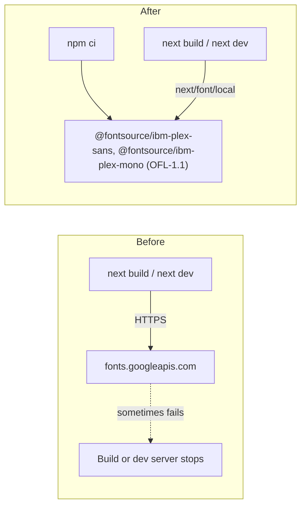

# Task: Self-Hosted Fonts

## Goal
Remove the font download from the frontend build. `next/font/google` downloads IBM Plex Sans and IBM Plex Mono from Google at build time, and that download sometimes fails: the dev server or the build stops, and CI E2E jobs fail with no test run (Step 5, Step 6). After this task, the build reads the font files from the installed packages, so a build needs no host other than the npm registry, which `npm ci` uses already.

## Constraints & Context
- The same fonts, weights, subset, and CSS variables: IBM Plex Sans 300 to 700, IBM Plex Mono 400 to 700, Latin, normal style; `--font-ibm-plex-sans` and `--font-ibm-plex-mono`. The page must look the same.
- The packages are `@fontsource/ibm-plex-sans` and `@fontsource/ibm-plex-mono`, version 5.3.0, license OFL-1.1, pinned to the exact version. No font binary goes into git.
- Installing the two packages is a download (about 4 MB unpacked), so it needs the user's approval.
- Read the Next.js 16 docs in `node_modules/next/dist/docs/` first (AGENTS.md). `next/font/local` takes `src` as an array of `{ path, weight, style }`, relative to the file that calls it.
- One direct commit, checked on the clone and cherry-picked (the runner cannot carry the `package-lock.json` change). It needs the user's "Yes, apply it". Push only after the user approves.

## Acceptance Criteria
- [x] Plan approved, with the package install. (2026-11-09)
- [x] `src/app/layout.tsx` uses `next/font/local` with the Fontsource files; no source file imports `next/font/google`. A unit test guards that.
- [x] A build succeeds while HTTPS to other hosts fails (a proxy that refuses every connection), which the old build cannot do.
- [x] Screenshots before and after match (same fonts), and the unit, E2E, and demo E2E tests pass.

## Status
`done` (2026-11-10: applied as `841943b`; CI run 42665659154 green)
