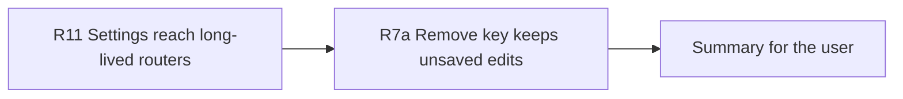

# Handoff: Step 2 Review Items R11 and R7a (2026-10-21)

Read this file first. Then read `CLAUDE.md` (project rules), "Review of R7 to R10 (2026-10-21)" in `tasks/todo.md` (under **Now**, items R11 and R7a), and `tasks/lessons.md` (the last section, "Reviewing security changes"). The check commands are in section 4 of `tasks/handoff-2026-10-19.md`. Section 4 of `tasks/handoff-step2-review.md` has the environment notes.

The user will review your work after you finish.

## 1. Status

| Item | State |
|------|-------|
| `main` | `18fd659`, pushed to `origin/main` on 2026-10-21. |
| CI | Run 39584571514 for `18fd659` passed all 11 jobs: backend 1,102 passed, mypy gate 182 known and 0 new, Vitest 46 files passed, Playwright 42 passed with 0 flaky and no retries. |
| Done | Step 2.1 to 2.6, review items R1 to R10, R5a, R5b, and F1. |
| This handoff | R11 (backend) and R7a (frontend). They do not depend on each other. |

## 2. The task

For each item:

1. Write a test that fails on the current code. Run it and keep the failure output for the summary. Then make the change.
2. Prove the test with a mutation: put the old behavior back, see the test fail, restore the file, and compare the restored file with your version.
3. Run all checks (section 4 of `tasks/handoff-2026-10-19.md`). Delete `apps/frontend-ts/.next` before `npm run type-check`: `tsconfig.json` includes `.next/types` and `.next/dev/types`, and stale files from a dev server made tsc fail in the last review.
4. Tick the item in `tasks/todo.md` and add a short "Done (date)" note with the test name and the mutation.
5. Make one commit per item with a conventional subject. Do not push.

Stop and ask the user if a change needs a decision that this file does not cover.

### R11: Saved Settings must reach long-lived routers

**Problem:** Most code paths build a new router for each run or request with `create_router()` (`src/llm/router.py`), which loads the saved Settings. Two paths keep one router for the life of the process:

- `src/api/main.py` (lifespan): `initialize_agent_system(create_router(prefer_local=True))`. `initialize_agent_system` in `src/api/routes/agents.py` gives that router to the agents.
- `src/api/routes/profile.py`: `_get_linkedin_analyzer` caches `_llm_router`.

Nothing reloads these routers when Settings change. Also, `LLMRouter.apply_user_settings` sets `self.api_key` and `self.gemini_api_key` only when a stored key exists, so a removed key stays in memory. Result: after the user removes a key or sets the cloud fallback to "None (local only)", agents and LinkedIn analysis keep the old key and the old fallback until the backend restarts.

**Required behavior:**

- A router built by `create_router()` applies the latest saved Settings before each `generate` and `generate_async` call when the Settings changed since it last applied them.
- A router built directly with `LLMRouter(...)` does not load Settings. Many tests build `LLMRouter(routes=...)` and expect their own routes.
- When a stored key is removed, the router goes back to the key it had from its constructor (usually `None`, so the client uses `ANTHROPIC_API_KEY` or `GEMINI_API_KEY` from the environment). Check how `AnthropicClient` handles `api_key=None`; `GeminiClient` uses `api_key or os.getenv("GEMINI_API_KEY")`.

**Suggested change:**

- In `src/api/settings.py`, keep a module-level revision number that `SettingsStorage.save_settings` increases, and a function `get_settings_revision()`.
- In `LLMRouter`: remember the constructor keys; `apply_user_settings` sets each key to the stored key or the constructor key, and records the revision it applied. `create_router()` marks the router as one that follows Settings. At the start of `generate` and `generate_async`, a router that follows Settings calls `apply_user_settings()` when the revision changed. Import from `..api.settings` inside the function, as `apply_user_settings` does now (avoid a circular import).
- Pipeline stages and cover letters call `generate` from worker threads (`asyncio.to_thread`). Guard the check and the reload with a `threading.Lock` so two threads do not reload at the same time.
- The revision is per process. That is enough because the backend runs one uvicorn worker (Step 1 decision 2). Say this in a comment.

**Tests** (the R6 fixture gives each test a temporary settings directory):

- A `create_router()` router with a saved Anthropic key and an Anthropic fallback for one task. Then save Settings with the key removed and the cloud fallback set to `none` (use `apply_cloud_fallback_provider`). On the next `generate` with a failing Ollama client (mock `_get_client`), Anthropic is not called, and `router.api_key` is the constructor value. Before the change, Anthropic is called with the old key.
- With `ANTHROPIC_API_KEY` set by `monkeypatch.setenv` and the saved key removed, the Anthropic client gets the environment key, not the old saved key.
- A router built with `LLMRouter(routes=...)` keeps its own routes after Settings are saved.
- One test through the API: get the cached LinkedIn analyzer router (`_get_linkedin_analyzer()`) or initialize the agent system with a `create_router()` router, change Settings with `TestClient` (`PUT /api/settings/` or `DELETE /api/settings/api-keys/anthropic`), and check that the long-lived router uses the new Settings on its next call.

**Mutation:** Remove the revision check from `generate`. The first test must fail.

**Runtime proof:** Not against a running server. A running backend reads and writes the real `apps/backend-py/data/settings/user_settings.json`. The tests above are enough.

### R7a: "Remove saved key" must not discard unsaved edits

**Problem:** `SettingsPage` (`apps/frontend-ts/src/app/settings/page.tsx`, about line 808) renders `<SettingsForm key={data.updated_at ?? data.version ?? "settings"} initial={data} />`. Removing a key saves Settings on the server, which changes `updated_at`. The `deleteApiKey` mutation then invalidates the `["settings"]` query, the refetch brings the new `updated_at`, and the form remounts. Any unsaved edits in other fields are lost.

**Required behavior:**

- "Remove saved key" and background refetches update what the page shows (for example, "Key saved" goes away) without a remount and without changing fields the user is editing.
- After Save and after Reset, the form still shows the saved values, as today.

**Suggested change:** Key `SettingsForm` on a local form version in `SettingsPage` that increases only when an action replaces the form values (Save, Reset, and any other action with that purpose, such as applying Ollama defaults; check where that action lives). Pass a callback to `SettingsForm` for those actions. Keep "Key saved" driven by the `initial` prop, which updates without a remount.

**Trap:** Do not only change the `deleteApiKey` success handler to `setQueryData` with the old `updated_at`. The settings query has `staleTime: 60_000`, and React Query refetches on window focus, so a later refetch brings the new `updated_at` and remounts the form anyway.

**Tests** (Vitest; extend `tests/app/settings/remove-api-key.test.tsx`):

- With `has_anthropic_key` true: type a value in another field (for example the maximum API cost), click "Remove saved key" (mock `deleteApiKey`, and make the next `settingsApi.get` return `has_anthropic_key` false and a new `updated_at`). After the refetch, the typed value is still in the field and "Key saved" is gone.
- After a successful Save, the form shows the values that the save returned.

**Mutation:** Put back `key={data.updated_at ?? data.version ?? "settings"}`. The first test must fail.

## 3. Traps

- **Real settings file.** Never open, print, or change `apps/backend-py/data/settings/user_settings.json`. Never call a settings write route on a server that uses the real data directory.
- **`.env` files.** Never open `.env` or `.env.local`.
- **R11 and existing tests.** Run the full backend suite after R11. If a test fails because a router now reloads Settings, find out whether that router should follow Settings; do not weaken the new behavior to make the old test pass.
- **Line endings.** Do not commit files that changed only in line endings. Check with `git ls-files --eol` or `tr -dc '\r' < file | wc -c`.
- **Scratch files.** Put temporary scripts and commit messages outside the repository.

## 4. Rules (unchanged)

- Follow `CLAUDE.md`: docstrings with description, arguments, and returns; type hints; ASD-STE100 for documentation; no emojis; a Mermaid diagram in documentation.
- Before each commit, run `git status --short` and stage only the files of that item.
- Never run `scripts/mypy_gate.py --update` to accept a new error. A change that fixes errors can shrink the baseline with `--update`.
- Run Black and ruff only on `main.py scripts/mypy_gate.py src/ tests/`.
- Use Docker `node:20` for frontend checks.
- Keep dry run as the default. Do not make auto-submit reachable.
- Push only from WSL, and only after the user approves.

## 5. Summary to leave for the user

At the end, add "Cursor results (date)" to this file with:

- The commits (hash and subject), one per item.
- For each item: what changed, the test that proves it with its failure output before the fix, and the mutation result.
- Every check you ran and its result, including Playwright with its passed and flaky counts. Say clearly what you did not run and why.
- Any question for the user.

## Cursor results (2026-10-21)

Completed in order: R11 → R7a. Not pushed.

### Commits

| Hash | Subject |
|------|---------|
| `c676d13` | fix(llm): reload changed settings in long-lived routers |
| `c23e4a8` | fix(settings): preserve unsaved edits when removing a key |

### R11 — Settings reach long-lived routers

- **Change:** Successful Settings writes increment a process-local revision.
  Routers from `create_router()` check the revision under a
  `threading.Lock` before every `generate` and `generate_async`, reload changed
  routes, and restore constructor keys when a stored key is removed. Direct
  `LLMRouter(...)` instances do not follow Settings. One process-local revision
  is sufficient because the backend runs one uvicorn worker.
- **Before fix:** `test_generate_reloads_removed_key_and_none_fallback` failed
  with `DID NOT RAISE RuntimeError`; the stale Anthropic fallback still ran.
- **Tests:** Four `TestCreateRouterReloadsChangedSettings` cases cover fallback
  removal, environment-key fallback, direct-router isolation, and API DELETE
  reaching a long-lived factory router.
- **Mutation:** Removed the revision refresh from `generate`; the first test
  failed (`MUT_EXIT=1`). Restored file matched the fixed copy and all seven
  router Settings tests passed.
- **Runtime:** Not run against a real server because it would read/write the
  user's real Settings. TestClient uses R6 temporary storage.

### R7a — Key removal keeps unsaved edits

- **Change:** `SettingsForm` uses a page-local replacement version as its key.
  The version changes only after Save or Reset. Key removal and background
  refetches update `initial` flags without remounting. Save and Reset put their
  returned Settings in the query cache and then replace the form.
- **Before fix:** The corrected draft-preservation test failed because maximum
  cost reset from the typed value 17 to server value 5 after the DELETE
  refetch.
- **Tests:** The extended Vitest file proves key removal keeps a draft and
  removes “Key saved”; successful Save displays the returned value.
- **Mutation:** Restored
  `key={data.updated_at ?? data.version ?? "settings"}`; draft preservation
  failed (`MUT_EXIT=1`). The restored fixed file matched byte-for-byte and all
  three tests passed.

### Final gate

| Check | Result |
|-------|--------|
| Black / ruff / mypy gate | Pass; 182 known mypy errors, 0 new |
| pytest | 1,106 passed, 1 warning |
| ESLint / tsc / Prettier | Pass (`.next` removed before tsc) |
| Vitest | 252 passed in 46 files |
| `next build` | Pass |
| Playwright | 42 passed, 0 failed, 0 flaky, 0 retries |

### Not run

- No real-server Settings write proof, to protect
  `apps/backend-py/data/settings/user_settings.json`.
