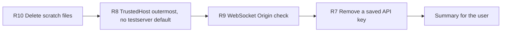

# Handoff: Step 2 Review Items R7 to R10 (2026-10-21)

Read this file first. Then read `CLAUDE.md` (project rules), "Step 2 review (2026-10-20)" in `tasks/todo.md` (under **Now**, items R7 to R10), and `tasks/lessons.md` (the last section, "Reviewing security changes"). The check commands are in section 4 of `tasks/handoff-2026-10-19.md`. Section 4 of `tasks/handoff-step2-review.md` has the environment notes (Docker in WSL, line endings, commit messages from PowerShell).

The user will review your work after you finish.

## 1. Status

| Item | State |
|------|-------|
| `main` | `0850904`, pushed to `origin/main` on 2026-10-21. |
| CI | Run 39538133734 for `0850904` passed all 11 jobs: backend 1,095 passed, mypy gate 182 known and 0 new, Vitest 45 files passed, Playwright 42 passed and 0 flaky. |
| Done | Step 2.1 to 2.6, review items R1 to R6, R5a, R5b, and F1. |
| This handoff | R7, R8, R9, R10. |

## 2. The task

Do the items in this order. R8 and R9 both change `src/api/main.py`, so do them one after the other.

For each item (except R10, which has no test):

1. Write a test that fails on the current code. Run it and keep the failure output for the summary. Then make the change.
2. Prove the test with a mutation: put the old behavior back, see the test fail, restore the file, and compare the restored file with your version.
3. Where this file asks for a runtime proof, run it against a real server, not only a unit test.
4. Run all checks (section 4 of `tasks/handoff-2026-10-19.md`).
5. Tick the item in `tasks/todo.md` and add a short "Done (date)" note with the test name, the mutation, and the runtime proof.
6. Make one commit per item with a conventional subject. Do not push.

Stop and ask the user if a change needs a decision that this file does not cover.

### R10: Delete the scratch files

Delete these untracked files: the 12 files `tasks/_*.sh` and `tasks/_commit_msg.txt` (13 files). Check each name with `git status --short` first; delete only files that start with `tasks/_`. Do not delete `tasks/handoff-2026-10-19.md` or `tasks/handoff-step2.md`; the user decides about those. From now on, put temporary scripts and commit messages outside the repository. Tick R10 in `tasks/todo.md` in the R8 commit (R10 has no commit of its own, because untracked files are not in Git).

### R8: TrustedHost runs first; `testserver` only in tests

**Problem:** In `src/api/main.py`, `_allowed_hosts()` defaults to `localhost,127.0.0.1,testserver,backend`. `testserver` is only for FastAPI's `TestClient`. Also, `TrustedHostMiddleware` is added before `CORSMiddleware`. In Starlette the middleware added last runs first, so CORS runs before the Host check. The comment above it says the opposite. Result: a CORS preflight (`OPTIONS` with `Origin` and `Access-Control-Request-Method`) with a bad `Host` gets a 200 from CORS and never reaches the Host check.

**Required behavior:**

- Default allowed hosts: `localhost`, `127.0.0.1`, `backend`. `ALLOWED_HOSTS` still overrides them.
- Tests add `testserver`: at the top of `tests/conftest.py`, before any import of the app, set `os.environ.setdefault("ALLOWED_HOSTS", "localhost,127.0.0.1,testserver,backend")`.
- Add `TrustedHostMiddleware` after `CORSMiddleware`, so the Host check runs first. Fix the comment.

**Tests:**

- `_allowed_hosts()` with `ALLOWED_HOSTS` removed (`monkeypatch.delenv`) does not contain `testserver`.
- Through `TestClient`: `OPTIONS /api/health` with `Host: evil.example`, `Origin: http://localhost:3000`, and `Access-Control-Request-Method: GET` returns 400. Before the change it returns 200.

**Mutation:** Put the middleware back in the old order. The preflight test must fail.

**Runtime proof:** Start uvicorn with a temporary env file, as R1 did (`API_KEY=review-key` in a file under `/tmp`, `--env-file` to that file, a free port such as 8766). Startup on `/mnt/d` takes about 100 s. Send the same preflight with `curl -X OPTIONS`; expect 400. Check that `GET /api/health` with `Host: 127.0.0.1:8766` still returns 200. Delete the temporary env file after.

### R9: Check `Origin` on the pipeline WebSocket

**Problem:** `@app.websocket("/api/pipeline/{run_id}/progress")` in `src/api/main.py` accepts every connection (`manager.connect` calls `websocket.accept()` in `src/api/websocket/progress.py`). Browsers do not apply CORS to WebSockets and cannot send `X-API-Key`, so any page open in the browser can connect to `ws://localhost:8000` and read progress events for a run ID it knows.

**Required behavior (decided for this handoff; the user can change it):**

- Before `accept()`, read the `origin` header. If it is present and is not in the CORS allow list (`_parse_cors_origins()` in `src/api/main.py`), close the connection with code 1008 (policy violation) and log a warning with the origin.
- Allow a connection with no `Origin` header. Browsers always send `Origin` on a WebSocket, so a missing header means a local non-browser client, the same rule as the frontend proxy guard.
- Keep `TrustedHostMiddleware` on WebSockets (it already checks the `websocket` scope).

**Tests:** Through `TestClient.websocket_connect`: `Origin: http://evil.example` is refused (the connection closes with code 1008, or the handshake fails); `Origin: http://localhost:3000` connects; no `Origin` connects.

**Mutation:** Remove the Origin check. The refusal test must fail.

**Runtime proof:** Start uvicorn as in R8. With the `websockets` library from the backend venv (version 15.0.1), connect to `ws://127.0.0.1:8766/api/pipeline/test-run/progress` with `origin="http://evil.example"`; expect a refusal. Connect again with `origin="http://localhost:3000"`; expect success.

### R7: Remove a saved cloud API key

**Problem:** Since Step 2.4, a blank key field in Settings keeps the stored key (`merge_preserving_api_keys` in `src/api/settings.py`). There is no way to remove a key that was saved in Settings.

**Required behavior (decided for this handoff; the user can change it):**

- Backend: `DELETE /api/settings/api-keys/{provider}` in `src/api/routes/settings.py`, where `provider` is `anthropic` or `gemini` (any other value returns 422). It clears that stored key, saves the settings, and returns `for_client(...)` of the result, the same as the other settings routes. The other key and all other settings stay the same. Keep `merge_preserving_api_keys` as it is.
- Frontend: add `settingsApi.deleteApiKey(provider)` in `src/lib/api/settings.ts`. On the Settings page (`src/app/settings/page.tsx`), next to "Key saved", show a "Remove saved key" button. After a successful call, refresh the settings query so "Key saved" goes away, and show a toast.
- Below the key field, say that a key set in the environment (`ANTHROPIC_API_KEY`, `GEMINI_API_KEY`) still applies after the saved key is removed.

**Tests:**

- Backend, through `TestClient` (the R6 fixture already gives each test a temporary settings directory): save both keys, call `DELETE /api/settings/api-keys/anthropic`, and check that the response has `has_anthropic_key` false and `has_gemini_key` true, and that a new `load_settings()` has no Anthropic key and still has the Gemini key. `DELETE /api/settings/api-keys/openai` returns 422.
- Frontend (Vitest): with `has_anthropic_key` true, clicking "Remove saved key" calls `settingsApi.deleteApiKey("anthropic")`.

**Mutation:** Make the route skip `save_settings`. The backend test must fail.

**Runtime proof:** Not against a real server. A running backend uses the real `apps/backend-py/data/settings/user_settings.json`, and a DELETE would remove the user's saved key. The `TestClient` test is enough for R7.

## 3. Traps

- **Real settings file.** Never open, print, or change `apps/backend-py/data/settings/user_settings.json`. Never call a settings write route (PUT, reset, ollama-defaults, or the new DELETE) on a server that uses the real data directory.
- **`.env` files.** Never open `.env` or `.env.local`. For runtime proofs, use a temporary env file that you create, as described in R8.
- **R8 and the tests.** If `ALLOWED_HOSTS` is not set before `src.api.main` is imported, every `TestClient` request returns 400. Set it at the top of `tests/conftest.py`, not inside a fixture.
- **R9 and the frontend.** The Live Monitor connects from the page origin (`http://localhost:3000` or `http://127.0.0.1:3000`). Both are in the default CORS list for development. Do not add other origins.
- **Line endings.** Do not commit files that changed only in line endings. Check with `git ls-files --eol` or `tr -dc '\r' < file | wc -c`.

## 4. Rules (unchanged)

- Follow `CLAUDE.md`: docstrings with description, arguments, and returns; type hints; ASD-STE100 for documentation; no emojis; a Mermaid diagram in documentation.
- Before each commit, run `git status --short` and stage only the files of that item.
- Never run `scripts/mypy_gate.py --update` to accept a new error. A change that fixes errors can shrink the baseline with `--update`.
- Run Black and ruff only on `main.py scripts/mypy_gate.py src/ tests/`.
- Use Docker `node:20` for frontend checks.
- Keep dry run as the default. Do not make auto-submit reachable.
- Push only from WSL, and only after the user approves.

## 5. Summary to leave for the user

At the end, add "Cursor results (date)" to this file with:

- The commits (hash and subject), one per item.
- For each item: what changed, the test that proves it with its failure output before the fix, the mutation result, and the runtime proof where this file asks for one.
- Every check you ran and its result. Say clearly what you did not run and why. Run the full gate (backend and frontend, including Playwright) after the last item.
- Any question for the user.

## Cursor results (2026-10-21)

Order completed: R10 → R8 → R9 → R7. Not pushed (await approval).

### Commits

| Hash | Subject |
|------|---------|
| (no commit) | R10: deleted 13 untracked `tasks/_*.sh` / `tasks/_commit_msg.txt` (tick in R8) |
| `1bcd43e` | fix(api): run TrustedHost before CORS and drop testserver default |
| `a32bfe5` | fix(api): refuse pipeline WebSocket Origins outside the CORS list |
| `e66c950` | feat(settings): add DELETE to clear a saved cloud API key |

### R10 — Delete scratch files

- Removed the 13 untracked `tasks/_*.sh` and `tasks/_commit_msg.txt` files. Left `tasks/handoff-*.md` alone.

### R8 — TrustedHost outermost; no `testserver` default

- **Change:** Defaults `localhost,127.0.0.1,backend`; `tests/conftest.py` sets `ALLOWED_HOSTS` with `testserver` before app import; add TrustedHost after CORS so Host runs first.
- **Before fix:** `test_default_allowed_hosts_exclude_testserver` → `AssertionError: 'testserver' not in [...]`; `test_cors_preflight_rejects_unknown_host` → `assert 200 == 400`.
- **Mutation:** Old middleware order → preflight test fails (`MUT_EXIT=1`); restore → 4 TrustedHost tests pass.
- **Runtime:** uvicorn `:8766` with temp env (`API_KEY=review-key`); OPTIONS `Host: evil.example` → 400; GET health `Host: 127.0.0.1:8766` → 200.

### R9 — WebSocket Origin check

- **Change:** Before `accept()`, refuse `Origin` not on CORS allow list with close 1008; missing `Origin` allowed.
- **Before fix:** `test_refuses_evil_origin` → `DID NOT RAISE WebSocketDisconnect`.
- **Mutation:** Remove Origin check → refusal test fails; restore → 3 passed.
- **Runtime:** websockets client; `origin=http://evil.example` refused (`InvalidStatus` / HTTP 403 handshake); `origin=http://localhost:3000` received `connected`.

### R7 — Remove a saved cloud API key

- **Change:** `DELETE /api/settings/api-keys/{provider}` (`anthropic`|`gemini`, else 422); `settingsApi.deleteApiKey`; Settings "Remove saved key" + env-key note.
- **Before fix:** DELETE → 404.
- **Mutation:** Skip `save_settings` → `test_delete_anthropic_keeps_gemini` fails; restore → 2 passed.
- **Vitest:** `remove-api-key.test.tsx` → click calls `deleteApiKey("anthropic")`.
- **Runtime:** Not against a real server (would clear the user's real settings file). TestClient is enough.

### Full gate (after R7)

| Check | Result |
|-------|--------|
| Black / ruff / mypy gate | Pass (182 known, 0 new) |
| pytest | 1102 passed |
| ESLint / tsc / Prettier | Pass (after restoring CRLF-only dirt from HEAD) |
| Vitest | 250 passed in 46 files |
| `next build` | Pass |
| Playwright | 42 passed |

### Questions

- Push `1bcd43e..e66c950` (and earlier unpushed commits if any) from WSL?
- Keep refusing LinkedIn country hosts (e.g. `sg.linkedin.com`), or allow them?
