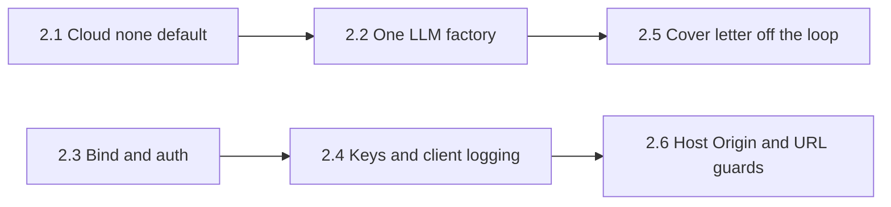

# Notes: Step 2, Make Local-First True

This text moved here from `tasks/todo.md` on 2026-10-24, without changes. Paths in it are as of that date: a reference to a section of `tasks/todo.md` now means a section of this file or of another task's `notes.md`, and a `tasks/handoff-*.md` file is now in its step's task folder (Step 2 and Step 3.2 handoffs are in `tasks/archive/`). `tasks/lessons.md` is now `docs/lessons.md`.

#### Step 2 plan: Make local-first true

**Goal:** Resume text and API keys stay on the machine by default. Cloud LLM use is opt-in, logged, and visible in the UI. Auth is on unless the user sets an explicit bypass. The API is not reachable from other devices on the network by default.

**Constraints:**

- Do not make auto-submit reachable (Step 5).
- Keep dry run as the default in every layer.
- Each sub-step is one commit (or PR) with its own tests. Run all local checks before each push.
- Do not change eval scoring, scam rules, or RAG fusion (Step 3).
- Line numbers below were re-checked on 2026-10-19 after Steps 1.1 to 1.7.

Steps 2.1 and 2.3 can start in parallel. Step 2.2 needs 2.1 so that factory-built routers inherit `CloudProvider.NONE`. Step 2.5 is independent of 2.3 and 2.4. Step 2.6 can follow 2.4.

##### Step 2.1: No silent cloud fallback (effort: S) — S1

- [x] Add `CloudProvider.NONE` in `src/api/settings.py`. Make it the default for `APIConfig.cloud_fallback_provider` (today the default is `CloudProvider.ANTHROPIC` at about line 71) (decision 1).
- [x] In `src/llm/router.py`, stop treating Anthropic as the default fallback on the built-in routes (about lines 81 to 201). When the primary provider fails and fallback is `none` or unset, log the failure and raise (or return a clear error). Do not call a cloud client.
- [x] On every successful `generate` call, log and return which provider and model ran (primary or fallback). Extend the response / metadata the API already exposes so the UI can show a small "Cloud" badge on results when the provider was not Ollama (decision 6).
- [x] Settings UI: cloud fallback control includes "None (local only)". Document that a cloud key alone does not send data until the user picks a cloud fallback.
- [x] Tests: with `CloudProvider.NONE`, a forced Ollama failure does not call Anthropic or Gemini. With Anthropic selected, a forced Ollama failure does call Anthropic and the response marks `provider=anthropic`. Mutation: put Anthropic back as the default; the NONE test must fail.
- [x] Done when: a run with no cloud fallback never leaves the machine, and the Cover Letter / Pipeline UIs can show when a cloud model was used.

**Review (2026-10-19):** `LLMResponse.provider` stamped by the router; Cover Letter shows a Cloud badge when `provider_used` is not ollama. Tests: `test_cloud_fallback_none.py`. Backend 1,073 passed; mypy gate 182/0 new.

##### Step 2.2: One LLM factory everywhere (effort: S) — S2

Bare `LLMRouter()` call sites re-checked on 2026-10-19:

| Location | Notes |
|----------|-------|
| `src/pipeline/stages.py` (~114) | Pipeline stages |
| `src/pipeline/orchestrator.py` (~182) | `llm_router or LLMRouter()` |
| `src/api/routes/profile.py` (~141, ~345, ~778) | Three sites |
| `src/api/main.py` (~78) | Agent system init |
| `src/evaluation/cover_letter_compare.py` (~325) | Compare writer |

Already correct: `cover_letter_service.py`, `cover_letter.py` routes, and `jobs.py` use `create_router(prefer_local=True)`.

- [x] Replace every bare `LLMRouter()` above with `create_router(...)` (or inject a router from the caller). Keep one public factory in `src/llm/router.py`.
- [x] Test that fails if a production module constructs `LLMRouter(` directly (AST or import-graph scan of `src/`, excluding tests and the factory itself).
- [x] Done when: Settings (host, models, fallback) apply to pipeline, profile, agents, and compare the same way they apply to Cover Letter.

**Review (2026-10-19):** AST scan in `test_no_bare_llm_router.py`. Backend 1,074 passed.

##### Step 2.3: Bind to localhost and require auth (effort: S) — S3, S4

Current state (2026-10-19):

- `scripts/dev.sh` (~84): `uvicorn ... --host 0.0.0.0`.
- `docker/Dockerfile` CMD: `--host 0.0.0.0`.
- `docker-compose.yml`: publishes backend `8000` and frontend `3000` on all host interfaces.
- `scripts/dev.sh` (~90): `npm run dev -- --port 3000`; `next dev` listens on all interfaces.
- `src/api/auth.py` (~51-58): skips auth when `ENVIRONMENT=development` and `API_KEY` is empty.

- [x] Bind the local API to `127.0.0.1` in `scripts/dev.sh`.
- [x] Docker: keep `--host 0.0.0.0` inside the backend container, so the frontend container reaches `backend:8000` on the Compose network. Stop publishing `8000` on the host (decision 3). Update `docker-run.sh` and `scripts/find-port.sh` if they still look for a free backend port.
  - Consequence: in Docker, the browser WebSocket (`ws://localhost:8000`) no longer connects. The Live Monitor still works from status polling (Step 1.5). If live events are needed in Docker later, publish `127.0.0.1:8000` only.
- [x] Bind the frontend to `127.0.0.1` (decision 4): run `next dev` with `-H 127.0.0.1` in `scripts/dev.sh`, and publish the frontend as `host_ip: 127.0.0.1` in `docker-compose.yml`. Reason: the Next.js proxy adds `X-API-Key` to every request it forwards, so any device that reaches port 3000 can use the API (for example `GET /api/proxy/profile/export`).
- [x] `setup.sh`: generate a random `API_KEY` and write it to both backend `.env` and frontend `.env.local` (never commit those files). Stop writing the public placeholder `your_api_key_here`.
- [x] Auth bypass only when `AUTH_DISABLED=1` is set explicitly. Remove the "empty API_KEY in development" bypass from `src/api/auth.py` (decision 2).
- [x] Tests: empty `API_KEY` without `AUTH_DISABLED` returns 401. `AUTH_DISABLED=1` allows requests. A test reads `docker-compose.yml` and fails if a port is published without `host_ip: 127.0.0.1`, or if backend port `8000` is published. Document the flag in `.env.example` and `docs/usage.md`.
- [x] Done when: a fresh setup has a real key, and another device on the LAN can reach neither the API nor the frontend proxy.

**Review (2026-10-19):** TestClient overrides auth except in `test_auth.py`. Compose test: `test_docker_compose_local_first.py`.

##### Step 2.4: Do not return or log secrets (effort: S) — S5

- [x] `GET /api/settings/` returns `has_anthropic_key` / `has_gemini_key` (booleans), not the key strings (`src/api/routes/settings.py`). PUT still accepts keys to save them.
- [x] Frontend Settings form uses the flags to show "Key saved" vs empty, and only sends a key field when the user edits it.
- [x] `src/lib/api/client.ts` (~149-153): do not log request or response bodies outside development (or never log bodies that may contain keys). Keep method and path.
- [x] Tests: settings GET fixture has no `sk-` / key material; client log spy does not receive the PUT body.
- [x] Done when: DevTools Network still needs HTTPS locally for transport safety, but the JSON settings payload and the console no longer print secrets.

**Review (2026-10-19):** `for_client` / `merge_preserving_api_keys`; client never logs bodies. Mutation: remove `for_client` from GET → test fails on secret leak.

##### Step 2.5: Cover letter routes off the event loop (effort: S) — follow-up from Step 1.6

- [x] `generate_cover_letter_for_profile` in `src/generation/cover_letter_service.py` awaits `asyncio.to_thread(generate_cover_letter_sync, ...)` (today it calls the sync body on the event loop at ~561).
- [x] Same pattern for any other async route that still awaits the sync service directly (`cover_letter.py`, `jobs.py` cover-letter path) if they bypass the helper.
- [x] Tests: while a generate is in flight, a health or status request still completes (same style as `test_pipeline_run_async.py`).
- [x] Done when: a long cover-letter generate does not stall WebSockets or other API requests on the single worker.

**Review (2026-10-19):** Routes already use the helper. Mutation: sync-on-loop → tick count fails.

##### Step 2.6: Host, Origin, ollama_host, and profile_url guards (effort: S to M) — S6, S7, S8

- [x] Validate `ollama_host` on Settings save (`src/api/settings.py` / routes): `http` or `https`, host and port only, and the host must be `localhost`, `127.0.0.1`, `host.docker.internal`, or `ollama` (decision 5).
- [x] Add `TrustedHostMiddleware` in `src/api/main.py` with hosts for local and Compose use.
- [x] Next.js proxy (`apps/frontend-ts/src/app/api/proxy/[...path]/route.ts`): reject a request when `Sec-Fetch-Site` is `cross-site`, or when `Origin` is present and is not the app origin (cross-site requests from a page the user visits). Also reject a `Host` that is not `localhost` or `127.0.0.1` with the app port (DNS rebinding). Allow requests with no `Origin`; after decision 4 only this machine can reach the proxy.
- [x] Validate `profile_url` before Playwright `page.goto` in `src/linkedin/session.py` (`fetch_profile_text` ~376, `navigate_to_url` ~372): allow only `https://` LinkedIn profile URLs; reject `file://`, bare IPs, and non-LinkedIn hosts.
- [x] Tests for each guard (reject bad host, bad Origin, bad profile URL).
- [x] Done when: a changed Settings host, a cross-site POST, and a `file://` profile URL are all refused with clear errors.

**Review (2026-10-19):** `navigate_to_url` allows any https LinkedIn path (search); `fetch_profile_text` requires `/in/`. ``ALLOWED_HOSTS`` includes ``testserver``.

##### Step 2 review (2026-10-20)

Cursor implemented Steps 2.1 to 2.6 in `8e97841`..`0560b48` (pushed with the R1 and R2 fixes on 2026-10-20). All CI checks passed: Black, ruff, mypy gate 182/0 new, pytest 1,085 passed, ESLint, tsc, Prettier, Vitest 241 passed in 43 files, and `next build`. Probes against running servers found two blockers that the tests did not cover.

Blockers (fix before push):

- [x] **R1. `make dev` returns 401 on every API call.** No code path loads `apps/backend-py/.env` for native runs: `scripts/dev.sh` does not source it, uvicorn has no `--env-file`, and `src/` never calls `load_dotenv`. Before Step 2.3, an empty `API_KEY` skipped auth in development, so the gap did not show. Probe: uvicorn started as `dev.sh` does logged `Authentication MISCONFIGURED`, and `GET /api/settings/` returned 401. `AUTH_DISABLED=1` in `.env` is ignored in the same way. Compose is not affected (it uses `env_file`). Fix: pass `--env-file "$BACKEND_DIR/.env"` to uvicorn in `scripts/dev.sh`; every `make dev*` target uses that script.
  - **Done (2026-10-20):** `scripts/dev.sh` passes `--env-file`. `tests/unit/test_dev_launcher.py` runs the real script in a temporary repository layout with a stub `python3` and checks the uvicorn arguments; it failed before the fix (`--env-file` missing). Runtime proof with `--reload`: no key 401, wrong key 401, right key 200. The real `dev.sh api` logged `Loading environment from '.../apps/backend-py/.env'` and no auth error.
- [x] **R2. The proxy rejects the app's own POST requests.** `guard.ts` compares `Origin` with `req.nextUrl.origin`. Next.js builds that URL from the server bind settings, not from the browser `Host`. Probes: the Docker standalone server (`HOSTNAME=0.0.0.0`) returned 403 for every same-origin POST; `next dev --hostname 127.0.0.1` returned 403 for `Origin: http://127.0.0.1:3001` and allowed only `localhost`. Same-origin GET requests send no `Origin`, so pages loaded, but saves, pipeline runs, and cover letter generation failed. The unit test built each request with a URL equal to its `Host`, so it could not see this. Fix: check the `Host` first, then require `Origin` to have the same host and port as the `Host` header.
  - **Done (2026-10-20):** `guard.ts` compares `new URL(origin).host` with the `Host` header. Four new tests in `guard.test.ts`; the two "allows" cases (server URL `0.0.0.0:3000` with `Host: 127.0.0.1:3005`, and server URL `localhost` with `Host: 127.0.0.1`) failed before the fix. Mutation: compare hostnames only, without the port; "rejects an Origin on another local port" failed. Real-server probes after the fix: same-origin POST passed the guard in the Docker standalone server and in `next dev --hostname 127.0.0.1`, on `127.0.0.1`, `localhost`, and published port 3005; `evil.example`, another local port, and a foreign `Host` returned 403.

Should fix (Step 2 gaps):

- [x] **R3.** The `ollama_host` allowlist runs as a model validator, so it also runs on load. `SettingsStorage.load_settings` turns any validation error into defaults, so a stored host outside the allowlist silently drops all saved settings, and the next save writes defaults without the stored API keys. Validate on save and validate only, or replace only the bad host on load and log a warning.
  - **Done (2026-10-21):** `load_settings` replaces a bad host with `host.docker.internal:11434`, logs a warning, keeps keys/routing. PUT/validate still reject bad hosts. Prove: `test_load_replaces_bad_ollama_host_and_keeps_other_fields` (before: key was `None`). Mutation: old `load_settings` → fails. Note: other load errors still `print` + defaults (left for a later cleanup).
- [x] **R4.** A bad LinkedIn `profile_url` is not refused with a clear error. `_fetch_linkedin_profile_text_sync` catches the `ValueError`, logs a warning, and continues with empty text after it opened a LinkedIn session. Validate `profile_url` on the request model (422) before a session starts.
  - **Done (2026-10-21):** `LinkedInProfileInput.profile_url` field_validator calls `validate_linkedin_profile_url`. Prove: `test_rejects_file_http_and_non_linkedin_urls` (before: 500, session reached). Mutation: remove validator → fails. `LinkedInPeopleSearchResult.profile_url` left (output only). Country hosts still refused (ask if that should change).
- [x] **R5.** The "Cloud" badge is on the Cover Letter page only. The Step 2.1 "Done when" also names the Pipeline UI.
  - **Done (2026-10-21):** `provider_used` on `GeneratedResume`; generate stage `cloud_documents`; status response + shared `CloudBadge`. Prove: `test_cloud_documents_counts_non_ollama_providers`, Vitest pipeline Cloud badge. Mutation: ignore resume provider in count → fails.

Smaller items:

- [x] **R6.** `tests/unit/test_settings_api.py` calls `PUT /api/settings/`, `POST /reset`, and `POST /ollama-defaults` on the real `data/settings/user_settings.json` (since 2026-07-09). Each pytest run resets the developer's settings, and after Step 2.4 that includes saved cloud API keys. Point the settings storage at `tmp_path` for these tests.
  - **Done (2026-10-21):** Autouse `_isolate_settings_storage` in `tests/conftest.py`. Prove: `test_get_storage_uses_pytest_temporary_directory` (failed before: pointed at `data/settings/user_settings.json`). Mutation: remove fixture → fails. Runtime: `stat -c %y` on real settings file unchanged across settings API tests and a full pytest run (`2026-10-20 22:27:07.458114300 +0800`). Note: `test_records_expire_after_ttl` flaked once in the full suite (passes alone); unrelated to R6.
- [x] **R7.** The Settings page cannot remove a saved cloud API key (a blank field keeps the stored key).
  - **Done (2026-10-21):** `DELETE /api/settings/api-keys/{provider}` (`anthropic`|`gemini`); Settings UI "Remove saved key" + env-key note. Prove: `test_delete_anthropic_keeps_gemini`, `test_delete_unknown_provider_returns_422` (before: 404); Vitest `remove-api-key.test.tsx`. Mutation: skip `save_settings` → backend test fails. No real-server DELETE (would wipe the user's settings file).
- [x] **R8.** `ALLOWED_HOSTS` defaults include `testserver`. Set it in test setup instead. The comment above `TrustedHostMiddleware` says it is outermost, but CORS (added later) wraps it.
  - **Done (2026-10-21):** Defaults are `localhost,127.0.0.1,backend`; `tests/conftest.py` sets `ALLOWED_HOSTS` with `testserver` before app import; TrustedHost is added after CORS so it runs first. Prove: `test_default_allowed_hosts_exclude_testserver`, `test_cors_preflight_rejects_unknown_host` (before: assert failed / 200). Mutation: old middleware order → preflight test fails. Runtime: uvicorn on 8766, OPTIONS with `Host: evil.example` → 400; GET health with `Host: 127.0.0.1:8766` → 200.
- [x] **R9.** The WebSocket `/api/pipeline/{run_id}/progress` has no auth and no `Origin` check. A page in the browser that knows a `run_id` can read progress events. Check `Origin` on connect.
  - **Done (2026-10-21):** Before `accept()`, refuse an `Origin` not on the CORS allow list with close code 1008; missing `Origin` is allowed. Prove: `test_refuses_evil_origin` / `test_allows_localhost_origin` / `test_allows_missing_origin` (before: evil did not raise). Mutation: remove Origin check → refusal test fails. Runtime: websockets client to uvicorn 8766; evil origin refused, `http://localhost:3000` received `connected`.
- [x] **R10.** Delete the Cursor scratch files `tasks/_*.sh` and `tasks/_commit_msg.txt` (untracked).
  - **Done (2026-10-21):** Removed the 13 untracked `tasks/_*.sh` / `tasks/_commit_msg.txt` files. No commit of its own (untracked). Tick recorded with the R8 commit.

**Review of R3 to R6 and F1 (2026-10-21):** The changes are correct. Full gate in WSL: Black, ruff, mypy gate 182 known and 0 new, pytest 1,092 passed (the real settings file's modification time did not change), ESLint, tsc, Prettier, Vitest 249 passed in 45 files, `next build`, Playwright 42 passed, and the Mobile Chrome smoke spec 10 times with no retries: 140 passed. Prettier first failed only on 8 files that had CRLF on disk and no content change (Cursor rewrites them); after the CR bytes were removed, it passed. Gaps:

- [x] **R5a.** No test covers `cloud_documents` in `GET /api/pipeline/status/{run_id}`. The route reads it with `getattr(..., None) or {}`, so a wrong name would show 0 and no test would fail.
  - **Done (2026-10-21):** `TestRunEndpoints` in `test_pipeline_routes.py` stores a real `PipelineResult` whose generate stage (key from `PipelineStage.GENERATE_RESUMES`) has `cloud_documents=2`, and checks that status returns 2; a run without that stage returns 0. Mutation: the route reads `"generate_resume"`; the test fails.
- [x] **R5b.** The stage test has a cloud resume with a local cover letter, but no case with a local resume and a cloud cover letter. If the cover letter provider is dropped, the test still passes.
  - **Done (2026-10-21):** `test_cloud_documents_counts_a_cloud_cover_letter` (local resume, `gemini` cover letter, count 1). Mutation: count the cover letter provider as `None`; the new test fails and the old test still passes, which confirms the gap.
- F1 also raised E2E timeouts (60 s navigation, 90 s for the navigation tests) for slow local Docker bind mounts. CI passed with 15 s before. See the Backlog item "Test and E2E hardening".

**Review of R7 to R10 (2026-10-21):** The changes are correct. Full gate in WSL: Black, ruff, mypy gate 182 known and 0 new, pytest 1,102 passed (the real settings file's modification time did not change), ESLint, Prettier, Vitest 250 passed in 46 files, `next build`, and Playwright passed. tsc failed once with a stale `.next` left by an earlier dev-server run (`tsconfig.json` includes `.next/types` and `.next/dev/types`); a rerun without `.next` passed. Runtime probes on uvicorn with a temporary env file: a CORS preflight with `Host: evil.example` returned 400 (200 with the real host); `Host: testserver` returned 400; a WebSocket with `Origin: http://evil.example` was refused with HTTP 403 and a warning, and `http://localhost:3000` and a missing `Origin` connected. New items:

- [x] **R11.** Saved Settings do not reach long-lived routers. `src/api/main.py` builds the agent system router one time at startup (`initialize_agent_system(create_router(...))`), and `src/api/routes/profile.py` caches `_llm_router` in `_get_linkedin_analyzer`. Nothing reloads them when settings change. So a removed API key, new routing, or a switch of the cloud fallback to "None (local only)" does not apply to agents or LinkedIn analysis until the backend restarts. Fix: build these routers per request (as the pipeline and cover letter paths do), or reload them after each settings write.
  - **Done (2026-10-21):** Successful saves increment a process-local Settings revision. Routers from `create_router()` check that revision under a lock before each sync/async generation, reload changed routing, and restore constructor keys when saved keys are removed. Direct `LLMRouter(...)` instances do not follow Settings. Prove: four `TestCreateRouterReloadsChangedSettings` tests, including API DELETE reaching a long-lived router (before: Anthropic fallback still ran). Mutation: remove the sync revision check → first test fails; restored file → 7 router Settings tests pass.
- [x] **R7a.** "Remove saved key" saves the settings, which changes `updated_at`. `SettingsPage` keys `SettingsForm` on `updated_at`, so the form remounts and discards unsaved edits in other fields. Update the query cache from the DELETE response without a remount, or warn when the form has unsaved changes.
  - **Done (2026-10-21):** `SettingsForm` is keyed on a local version that changes only after Save or Reset. Key removal and background refetches update server flags without remounting or losing drafts; Save/Reset cache their returned settings before replacing form values. Prove: `keeps unsaved edits when key removal refetches newer settings` and `shows values returned by a successful save` (before: maximum cost reset from 17 to 5). Mutation: restore the `updated_at` key → draft-preservation test fails; restored file → 3 tests pass.

**Review of R11 and R7a (2026-10-21):** The changes are correct. Full gate in WSL: Black, ruff, mypy gate 182 known and 0 new, pytest 1,106 passed (the real settings file's modification time did not change), ESLint, tsc (with `.next` deleted first), Prettier, Vitest 252 passed in 46 files, `next build`, and Playwright 42 passed with 0 retries. Both mutations repeated: with the two `generate` reload calls removed, `test_generate_reloads_removed_key_and_none_fallback` fails (the router takes the Anthropic fallback); with the `updated_at` key restored, the draft test fails. No other code writes the saved Settings from the UI (Ollama tier changes stay in the form until Save), so the local form version is safe. Small items:

- [x] **R11a.** `apply_user_settings` reads the Settings revision after `load_settings()`. If a save lands between the two, the router records the new revision with the old settings and misses that save until the next one. Read the revision before loading.
  - **Done (2026-10-21):** `apply_user_settings` reads the revision before `load_settings()` and records that value. `test_save_during_reload_is_applied_on_next_refresh` wraps `load_settings` so a save with a new key lands after the load; the next refresh must apply the new key (failed before: `'sk-ant-old' == 'sk-ant-new'`). Mutation: record `get_settings_revision()` after the load again (checksum changed, fixed-string count 1); the test fails.
- The API-level R11 test uses a new `create_router()` router and calls `_refresh_user_settings_if_changed()` directly, not the cached LinkedIn or agent router. The cached routers are covered indirectly: the Step 2.2 AST test requires `create_router()` everywhere, and the first R11 test proves that such a router reloads on `generate`.

##### Out of scope for Step 2

- LinkedIn automation / User Agreement / cookie storage hardening (review S9; Step 5).
- Scoring, dedupe, scam regex, RAG fusion (Step 3).
- Demo polish (Step 4).
- Easy Apply / auto-submit reachability (Step 5).

##### Decisions (2026-10-19)

1. **Default cloud fallback:** `CloudProvider.NONE`. A cloud model runs only when the user picks a cloud fallback in Settings.
2. **Auth bypass:** only `AUTH_DISABLED=1`. Remove the `ENVIRONMENT=development` + empty `API_KEY` bypass.
3. **Backend in Docker:** `0.0.0.0` inside the container; do not publish `8000` on the host. The frontend container uses `backend:8000`.
4. **Frontend:** bind to `127.0.0.1` in `next dev` and in Compose. This changes the plan's first recommendation (keep publishing `3000` on all interfaces), because the proxy adds the API key to every request it forwards.
5. **`ollama_host`:** allow only `localhost`, `127.0.0.1`, `host.docker.internal`, and `ollama`.
6. **Cloud badge:** show a small "Cloud" badge on results when the provider was not Ollama.
