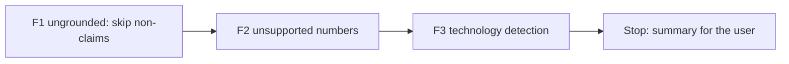

# Handoff: Step 3.2 Validator Fixes F1 to F3 (2026-10-22)

Read this file first. Then read `CLAUDE.md` (project rules), the "Step 3.2 fix plan" and "Decisions before the fixes (2026-10-22)" in `tasks/todo.md` (under **Now**, Step 3.2), the labeling guide `apps/backend-py/tests/fixtures/eval/grounding/README.md`, and `tasks/lessons.md` (the last four sections). The check commands are in section 4 of `tasks/handoff-2026-10-19.md`.

The user will review your work after F3.

## 1. Status

| Item | State |
|------|-------|
| `main` | `a1c818a`, 11 commits ahead of `origin/main` (not pushed). Do not push. |
| Reference | Baseline 2 on the main set: dataset SHA-256 `13e5ec3d...`, MLflow run `2d73d7766c004c1a90cd1c9393b78341`. The table is in `tasks/todo.md`. |
| Holdout | `apps/backend-py/tests/fixtures/eval/grounding_holdout/` holds 23 cases for one run after F7. **Do not open `cases.jsonl` or `profiles.json` in that folder.** You may read its `README.md`. `tests/unit/test_grounding_holdout.py` checks its format and is part of the normal suite. |
| This handoff | F1, F2, and F3 of the fix plan. **Stop after F3.** Do not start F4 to F7 or D5. |

## 2. The task

For each fix:

1. Write unit tests first, with new sentences that you write yourself. Do not copy sentences from the dataset. Run them and keep the failure output.
2. Make the change. Rules must be general: no rule may refer to a `case_id`, a fixture file, or a fictional name from the dataset.
3. Mutation proof. Put the old behavior back with an exact string replacement, check that the file checksum changed and that a fixed-string count of the mutated text is right, run the tests, see them fail, restore the file, and compare it with the backup (`tasks/lessons.md`, "Prove that a mutation was applied").
4. Run `python main.py eval grounding` on the main set (the default dataset). In `tasks/todo.md`, under the fix item, add a "Done (date)" note with the tests, the mutation, and a table of per-label precision, recall, F1, and **predicted count** against the previous run. When a fix lowers the F1 of another label, explain why or revert the fix.
5. Black, ruff, and the mypy gate on `main.py scripts/mypy_gate.py src/ tests/`, and the full pytest suite. One commit per fix.

### F1. `ungrounded_claims` skips sentences that state no fact

Where: `flag_ungrounded_sentences` in `apps/backend-py/src/generation/cover_letter_grounding.py` (about line 1401).

- Skip these sentence types: a greeting, including a leading greeting clause such as "Dear Hiring Team," in front of the first sentence; a sign-off ("Sincerely, Mara Chen", "Best regards"); thanks and calls to action (reuse `CoverLetterValidator.CALL_TO_ACTION_PHRASES` in `cover_letter_validator.py`, plus "thank you"); statements of interest, motivation, values, or working style (guide D4); and plans or intentions ("I would ...", "If <company> hired me ...", "In my first month ...").
- **Guard:** never skip a sentence that contains a number, a technology from the lexicon, a duration, or a past-tense claim verb ("built", "led", "shipped", "reduced", "managed", "rewrote", and similar). A plan sentence with a claim inside it ("I would bring ten years of Kubernetes experience") must still be checked.
- The last paragraph uses a stricter overlap threshold today (`closing_min_overlap_ratio`). Keep it only if the eval supports it, and say which.
- Tests, at least: each skipped type is not flagged; "I would bring ten years of Kubernetes experience" is still flagged for a profile without Kubernetes; "Thank you. At my last job I cut costs by 90%." still flags the second sentence; a greeting clause before the first sentence does not hide that sentence's claim.
- In the eval note, report how many cases have `ungrounded_claims` predicted (65 of 65 in Baseline 2) and the clean false-positive rate.

### F2. Unsupported numbers

- In a sentence about the candidate (one that F1 does not skip), each percentage, multiplier ("3x", "3 times"), or count with a noun ("8 teams", "140 stores") must appear in the profile text: summary, experience descriptions and highlights, project descriptions and highlights, and education. A number that does not appear flags `ungrounded_claims`.
- Normalize before you compare: "90%", "90 percent", and "ninety percent" are the same; "four" and "4" are the same.
- Do not check durations ("five years of ...", handled by the duration check) or calendar years ("in 2021").
- This replaces the M7 idea of keeping short tokens in the word overlap. Keep the `len(word) > 3` filter at about line 414 unless the eval shows a need.
- Tests: "cut costs by 90%" and "3x faster" are flagged for a profile without those numbers; a supported number in other words ("a rotation of four engineers" when the profile says 4) is not flagged; a duration and a calendar year are not checked here.

### F3. Technology detection

- **(a) Homonyms.** `swift`, `express`, `spring`, and `spark` (the allowlist at about lines 163 to 209) count as technologies only in a technology context: the product name ("Spring Boot", "Express.js", "Apache Spark", "SwiftUI"), or the word next to technology words ("built with Spark", "Swift for iOS", "an Express server"). Normal English ("spring semester", "a swift reply", "spark curiosity", "express my interest") is not a technology.
- **(b) Go.** `go` is in `_AMBIGUOUS_TEXT_ALIASES` (about line 363), so free text never matches it today. Match "Go" only in a technology context ("in Go", "written in Go", "Go services", "a Go service", "Golang"). "go live", "go through", and "ready to go" are not technologies.
- **(c) Negated claims.** "I have not run X", "I have never used X", and "I do not have X experience" are disclaimers (`_TECH_DISCLAIMER_BEFORE_RE`, about line 579).
- **(d) Related technologies (decision 2).** SQL is supported when the profile has a SQL database (PostgreSQL, MySQL, SQLite, MariaDB, SQL Server, or Oracle). Use a small explicit map in the code with a comment. Add a "Changes" entry with the date and the reason to the labeling guide (`tests/fixtures/eval/grounding/README.md`). Do not change any label: the current labels already treat SQL this way.
- Tests for each part, with normal-English negatives.

## 3. Traps

- **The holdout set.** Opening its cases makes it useless. The suite runs it only through `test_grounding_holdout.py`, which does not run the validator.
- **Labels and letters do not change.** Do not edit `tests/fixtures/eval/grounding/cases.jsonl` or `profiles.json`. If you think a label is wrong, write it in the summary.
- **Existing tests.** The grounding module has many unit tests. If an existing test asserts the old behavior that a decision changes (for example that "spring" in normal English is a technology), change the test and explain it in the summary. If no decision covers the conflict, stop and ask the user.
- **Wide skip rules hide claims.** F1 is the risky fix. Prefer a narrow rule with the guard over a wide one.
- **No real data.** Never open `.env`, `.env.local`, or `apps/backend-py/data/settings/user_settings.json`.
- **Startup time.** `main.py` takes about 100 s to start on `/mnt/d`; the full backend suite takes 4 to 8 minutes. Run long commands in the background.
- **Line endings and scratch files.** Check `git ls-files --eol` before you commit, and do not commit the 14 files that Cursor rewrites with CRLF. Put scratch files and commit messages outside the repository; use `git commit -F <file>`.

## 4. Rules (unchanged)

- Follow `CLAUDE.md`: docstrings with description, arguments, and returns; type hints; ASD-STE100 for documentation; no emojis; a Mermaid diagram in documentation.
- Before each commit, run `git status --short` and stage only the files of that fix.
- Never run `scripts/mypy_gate.py --update` to accept a new error. A fix that removes errors may shrink the baseline with `--update`.
- Keep dry run as the default. Do not make auto-submit reachable.
- Do not push. Push only from WSL, and only after the user approves.

## 5. Summary to leave for the user

At the end, add "Cursor results (date)" to this file with:

- The commits (hash and subject), one per fix.
- For each fix: what changed, the tests and their failure output before the fix, the mutation result, and the eval table against the previous run (precision, recall, F1, and predicted count per label), with any label that got worse and why.
- Any existing test you changed, and why.
- Any label you think is wrong (do not change it).
- Every check you ran and its result. Say clearly what you did not run.

## Cursor results (2026-10-22)

Work stopped after F3. F4 to F7 and D5 were not started. Nothing was pushed.

### Commits

- `972bddeb3896f6700ec065d3cb45632f37b06669` fix(grounding): skip non-claim sentences in the ungrounded check.
- `9b486082ad7f7499c931c019f204e8d0a64c384b` fix(grounding): flag percents and counts the profile does not state.
- `635a1ed3938ada8d88931f0b51b9550cad04dfdc` fix(grounding): match technologies only in a skill context.

Each commit contains only that fix. This results section is not part of those commits. `tasks/handoff-2026-10-19.md` and `tasks/handoff-step2.md` stayed untracked.

### F1. Non-claim sentences

`flag_ungrounded_sentences` skips a greeting, including a leading "Dear ...," clause, a sign-off, thanks, a call to action from `CoverLetterValidator.CALL_TO_ACTION_PHRASES`, a statement of interest or values, and a plan. A number, a duration, a lexicon technology, or a past-tense claim verb keeps the sentence in the check. "hired me" is not treated as that verb. The greeting clause is removed before the overlap check, so those words cannot hide the claim that follows.

The stricter closing overlap of 0.4 flagged the same sentences as 0.3 on this set (0 differences). The default `closing_min_overlap_ratio` is now 0.3, the same as the body. The table below was measured at 0.4, before that default change. The sentence sets match, so the table is the result for the committed default.

Tests, written before the change, on the old code: 3 failed, 1 passed. `test_plan_with_a_claim_is_still_flagged` already passed. Failures: non-claim sentences were flagged (the first extra item was `Hello`); "Thank you." was flagged; "Dear Hiring Partner, I invented..." was not flagged.

Mutation: the skip call was replaced with `if False and _is_skippable_non_claim(remainder):` (1 occurrence). The checksum changed from `c903f4b7de21664fa5fb527309e5522fea935996b9b3a3645e15127319792125` to `2859f811fee8aa02a9538a9f52ee358180e6ed8bbfa703c7da5d114d1fe2cf15`. `grep -F` count of the mutated text was 1. The non-claim test and the thanks test failed. The file was restored and matched the backup byte for byte. The greeting test stayed green under that mutation because the greeting strip is a separate line.

Eval: `.venv/bin/python main.py eval grounding` from `apps/backend-py`. Git SHA `b63f68c540f25791532136388c5c579a54922602`, dirty true. Dataset SHA-256 `13e5ec3d685a45d93da14e72ac1ea5f58239b94af98f7fb909dda58278b1c2f0` (unchanged). MLflow run `9603cef286114118ac897a0fe630ef75`. `ungrounded_claims` was predicted on 64 of 65 cases (65 of 65 in Baseline 2). `clean_false_positive_rate` is 0.966 (28 of 29; Baseline 2 was 1.000, 29 of 29). No label F1 fell.

| Label | P before | P after | R before | R after | F1 before | F1 after | Predicted before | Predicted after |
|-------|----------|---------|----------|---------|-----------|----------|------------------|-----------------|
| `fabricated_technology` | 0.500 | 0.500 | 0.875 | 0.875 | 0.636 | 0.636 | 14 | 14 |
| `inflated_duration` | 1.000 | 1.000 | 0.800 | 0.800 | 0.889 | 0.889 | 4 | 4 |
| `inconsistent_metric` | 1.000 | 1.000 | 1.000 | 1.000 | 1.000 | 1.000 | 3 | 3 |
| `fabricated_experience` | 1.000 | 1.000 | 0.125 | 0.125 | 0.222 | 0.222 | 1 | 1 |
| `analogical_claim` | 1.000 | 1.000 | 0.667 | 0.667 | 0.800 | 0.800 | 2 | 2 |
| `scope_inflation` | 0.667 | 0.667 | 0.500 | 0.500 | 0.571 | 0.571 | 3 | 3 |
| `technique_mismatch` | 1.000 | 1.000 | 0.667 | 0.667 | 0.800 | 0.800 | 2 | 2 |
| `ungrounded_claims` | 0.508 | 0.516 | 1.000 | 1.000 | 0.673 | 0.680 | 65 | 64 |
| micro | 0.574 | 0.581 | 0.806 | 0.806 | 0.671 | 0.675 | — | — |

### F2. Unsupported numbers

`flag_unsupported_number_sentences` checks a sentence that F1 does not skip. A percent (`90%`, `90 percent`, `ninety percent`), a multiplier (`3x`, `3 times`), or a count with a noun (`four engineers` when the profile says `4`) must appear in the summary, experience descriptions and highlights, project descriptions and highlights, or education text. Durations and calendar years are not checked here. A count is checked only when the sentence has a past-tense claim verb. Percents and multipliers are always checked. The `len(word) > 3` filter in `significant_words` stays. This eval did not show a need to remove it.

Tests, before the function existed: 5 failed with `ImportError: cannot import name 'flag_unsupported_number_sentences'`. After the function, `test_cover_letter_grounding.py` and `test_cover_letter_validator.py` passed (61 tests).

Mutation: `if unsupported:` was replaced with `if False and unsupported:` (1 occurrence). The checksum changed from `e098df84b812976c02bdaebc8252e178a3b0187e0a2473a52a871b6ef54d79ed` to `dc74a8627f7f6a76bdb409d4b06c2dd2466ee33a61e7ddc1a82bbcca40e78a29`. `grep -F` count of the mutated text was 1. `test_unsupported_percent_and_multiplier_are_flagged` failed (`assert '90%' in ''`). The file was restored and matched the backup byte for byte.

A first eval flagged the plan sentence in `clean__harbor_tests` that says "one test" and put `clean_false_positive_rate` back to 1.000. `ungrounded_claims` F1 fell from 0.680 to 0.673 (MLflow `76b91069c6294d86bb7d9e577610c56b`). That count has no past-tense claim verb, so it is not an achievement figure. The check now ignores such counts. A regression test covers a plan count ("one note about the change"). That first run is not the recorded F2 result.

Eval after that correction: Git SHA `972bddeb3896f6700ec065d3cb45632f37b06669`, dirty true. Dataset SHA-256 unchanged. MLflow run `353119451f9e4acca1abf9dfa60c688a`. Case predictions are identical to the F1 run. No label F1 fell. `clean_false_positive_rate` stays 0.966 (28 of 29). `ungrounded_claims` stays predicted on 64 of 65 cases. The unsupported numbers in this set were already flagged by the overlap check.

| Label | P before (F1) | P after | R before | R after | F1 before | F1 after | Predicted before | Predicted after |
|-------|---------------|---------|----------|---------|-----------|----------|------------------|-----------------|
| `fabricated_technology` | 0.500 | 0.500 | 0.875 | 0.875 | 0.636 | 0.636 | 14 | 14 |
| `inflated_duration` | 1.000 | 1.000 | 0.800 | 0.800 | 0.889 | 0.889 | 4 | 4 |
| `inconsistent_metric` | 1.000 | 1.000 | 1.000 | 1.000 | 1.000 | 1.000 | 3 | 3 |
| `fabricated_experience` | 1.000 | 1.000 | 0.125 | 0.125 | 0.222 | 0.222 | 1 | 1 |
| `analogical_claim` | 1.000 | 1.000 | 0.667 | 0.667 | 0.800 | 0.800 | 2 | 2 |
| `scope_inflation` | 0.667 | 0.667 | 0.500 | 0.500 | 0.571 | 0.571 | 3 | 3 |
| `technique_mismatch` | 1.000 | 1.000 | 0.667 | 0.667 | 0.800 | 0.800 | 2 | 2 |
| `ungrounded_claims` | 0.516 | 0.516 | 1.000 | 1.000 | 0.680 | 0.680 | 64 | 64 |
| micro | 0.581 | 0.581 | 0.806 | 0.806 | 0.675 | 0.675 | — | — |

### F3. Technology detection

`swift`, `express`, `spring`, and `spark` count only as a product name or next to a technology word. Ordinary English ("a swift reply", "spring semester", "spark curiosity", "express my interest") does not count. Bare `Go` counts for `in Go`, `written in Go`, `using Go`, `with Go`, and `Go service` / `Go services`. `go live`, `go through`, and `ready to go` do not count. `Golang` was already a lexicon term. `have not run`, `never run`, `have never used`, and `do not have` are disclaimers. A profile skill of PostgreSQL, MySQL, SQLite, MariaDB, SQL Server, or Oracle supports a letter that says SQL. The reverse is not implied. The labeling guide has a Changes entry dated 2026-10-22. No label was changed. `len(word) > 3` stays.

Tests, written before the change: 4 failed, 1 passed. The technology-context homonym test already passed. Failures: ordinary English extracted `swift`, `express`, `spring`, and `spark` (`assert 'swift' not in {'express', 'spark', 'spring', 'swift'}`); `written in Go` did not extract `golang` (`assert 'golang' in set()`); `I have not run Kubernetes` was still a claim (`assert 'kubernetes' not in {'kubernetes'}`); SQL was fabricated when the profile listed PostgreSQL (`assert 'sql' not in ['sql']`). After the change, `test_cover_letter_grounding.py` and `test_cover_letter_validator.py` passed (67 tests).

Mutation: `if canonical in _CONTEXTUAL_HOMONYMS and not _homonym_in_tech_context(` was replaced with `if False and canonical in _CONTEXTUAL_HOMONYMS and not _homonym_in_tech_context(` (1 occurrence). The checksum changed from `fdf5fb4ecece7d443217f4c2cbdc70eb98a49f2b85d155d4fcd53e34fe27fc32` to `8ee0af5584cdc77c54ec339a461065ee99932b25e88b68315b3739def50298a4`. `grep -F` count of the mutated text was 1. `test_ordinary_english_homonyms_are_not_technologies` failed with the same `swift` assertion. The other four F3 tests stayed green. The file was restored and matched the backup byte for byte.

Eval: Git SHA `9b486082ad7f7499c931c019f204e8d0a64c384b`, dirty true. Dataset SHA-256 unchanged. MLflow run `ed3a986964b841a4b8b3f337c273a304`. Report `apps/backend-py/data/eval/grounding/20261022T170347243249Z.json`. No label F1 fell. `ungrounded_claims` stays predicted on 64 of 65 cases. `clean_false_positive_rate` stays 0.966 (28 of 29).

| Label | P before (F2) | P after | R before | R after | F1 before | F1 after | Predicted before | Predicted after |
|-------|---------------|---------|----------|---------|-----------|----------|------------------|-----------------|
| `fabricated_technology` | 0.500 | 0.889 | 0.875 | 1.000 | 0.636 | 0.941 | 14 | 9 |
| `inflated_duration` | 1.000 | 1.000 | 0.800 | 0.800 | 0.889 | 0.889 | 4 | 4 |
| `inconsistent_metric` | 1.000 | 1.000 | 1.000 | 1.000 | 1.000 | 1.000 | 3 | 3 |
| `fabricated_experience` | 1.000 | 1.000 | 0.125 | 0.125 | 0.222 | 0.222 | 1 | 1 |
| `analogical_claim` | 1.000 | 1.000 | 0.667 | 0.667 | 0.800 | 0.800 | 2 | 2 |
| `scope_inflation` | 0.667 | 0.667 | 0.500 | 0.500 | 0.571 | 0.571 | 3 | 3 |
| `technique_mismatch` | 1.000 | 1.000 | 0.667 | 0.667 | 0.800 | 0.800 | 2 | 2 |
| `ungrounded_claims` | 0.516 | 0.516 | 1.000 | 1.000 | 0.680 | 0.680 | 64 | 64 |
| micro | 0.581 | 0.625 | 0.806 | 0.821 | 0.675 | 0.710 | — | — |

Five homonym cases lost a false `fabricated_technology` (`homonym__swift_reply`, `homonym__spring_semester`, `homonym__spark_curiosity`, `homonym__express_interest`, `homonym__all_four`). They still have extra `ungrounded_claims` from weak overlap. `fabricated_technology__go` is now a true positive, so recall of that label is 1.000. `inflated_duration__three_to_five_fastapi` lost a false `fabricated_technology` because the letter says SQL and the profile lists PostgreSQL. `inflated_duration` is still missed on that case. That miss belongs to the duration-range check (F4).

`analogical_claim__fastapi_kubernetes` still has an extra `fabricated_technology`. The letter says "similar to running Kubernetes" before "I have not run Kubernetes". The earlier mention is not one of the disclaimer phrases, so the claim wins. No case-specific rule was added. The expected label was left as it is.

### Existing tests

No existing test was changed. The test that says "shipped Spring services" still asserts only that `java` is fabricated. "Spring services" now counts as a technology context, and that assertion still passes.

### Labels

No label looks wrong. No label was changed. The remaining extra `fabricated_technology` on `analogical_claim__fastapi_kubernetes` is a prediction the three disclaimer phrases do not cover. The expected label stays `analogical_claim`.

### Checks

| Check | F1 | F2 | F3 |
|-------|----|----|----|
| Black `--check` on `main.py`, `scripts/mypy_gate.py`, `src/`, `tests/` | 271 files unchanged | 271 files unchanged | 271 files unchanged |
| ruff on the same paths | clean | clean | clean |
| `scripts/mypy_gate.py` | 182 known, 0 new | 182 known, 0 new | 182 known, 0 new |
| full pytest | 1149 passed, 1 Starlette warning, 325 s | 1155 passed, 1 warning, 218 s | 1160 passed, 1 Starlette warning, 222 s |

`scripts/mypy_gate.py --update` was not run. Frontend checks were not run. The CI gate was not run. The holdout cases and profiles were not opened. F4, F5, F6, F7, and D5 were not started. Nothing was pushed.
