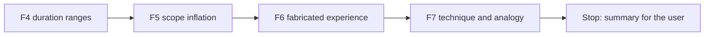

# Handoff: Step 3.2 Validator Fixes F4 to F7 (2026-10-23)

Read this file first. Then read `CLAUDE.md` (project rules), the "Step 3.2 fix plan", "Decisions before the fixes (2026-10-22)", "Review of F1 to F3", and "Decisions after F1 to F3 (2026-10-23)" in `tasks/todo.md` (under **Now**, Step 3.2), the labeling guide `apps/backend-py/tests/fixtures/eval/grounding/README.md`, and `tasks/lessons.md` (the last four sections). `tasks/handoff-step3-2-f1-f3.md` shows the format that worked for F1 to F3. The check commands are in section 4 of `tasks/handoff-2026-10-19.md`.

The user will review your work after F7.

## 1. Status

| Item | State |
|------|-------|
| `main` | 17 commits ahead of `origin/main` (not pushed). Do not push. |
| Last eval | After F3, on the main set: micro F1 0.710, MLflow run `ed3a986964b841a4b8b3f337c273a304`. The table is in `tasks/todo.md` under F3. Use it as the "before" for F4. |
| Holdout | **Do not open** `cases.jsonl` or `profiles.json` in `apps/backend-py/tests/fixtures/eval/grounding_holdout/`. You may read its `README.md`. |
| `ungrounded_claims` | Still predicted on 64 of 65 cases. That is expected: D6 (after this handoff) changes how it is measured. Do not try to change it in F4 to F7. |
| This handoff | F4, F5, F6, and F7. **Stop after F7.** Do not start D5 or D6, and do not run the holdout. |

## 2. The task

For each fix, the same steps as F1 to F3:

1. Write unit tests first, with new sentences that you write yourself (not copied from the dataset). Run them and keep the failure output.
2. Make the change. Rules must be general: no rule may refer to a `case_id`, a fixture file, or a fictional name from the dataset.
3. Mutation proof: put the old behavior back with an exact string replacement, check that the checksum changed and that a fixed-string count is right, see the tests fail, restore, and compare with the backup.
4. Run `python main.py eval grounding` on the main set. In `tasks/todo.md`, under the fix item, add a "Done (date)" note with the tests, the mutation, and the per-label table (precision, recall, F1, and predicted count) against the previous run. When a fix lowers the F1 of another label, explain why or revert.
5. Black, ruff, and the mypy gate on `main.py scripts/mypy_gate.py src/ tests/`, and the full pytest suite. One commit per fix.

All line numbers below are for `apps/backend-py/src/generation/cover_letter_grounding.py` after F3, unless the text names another file.

### F4. Duration ranges (decision 3)

- `flag_inflated_duration_claims` (about line 1114) compares the bottom of a range with the cap, on purpose (comment at about line 1157: "Range lower bound is the conservative claim amount"). Compare the **top** of the range instead, and change the comment to say why: the labeling guide counts a range as inflated when its top is longer than the cap, and a reader takes the top as the claim.
- A single number keeps its current handling ("over 5 years" is 5).
- Tests: "3-5 years of FastAPI" is flagged when the FastAPI cap is 3; "two to four years" is flagged when the cap is 2; "three to four years" is not flagged when the cap is 4; word numbers and digits behave the same.

### F5. Scope inflation

- `_SCOPE_INFLATION_PHRASES` (line 124) is matched as a substring (about line 1378: `if phrase in lowered`), so "called the" matches "led the". Match whole words.
- Add these phrases: "managed a team", "managed N engineers" (any number or number word), "headed", "oversaw", and "owned the".
- Make the allowance per claim. Today a phrase passes when it appears anywhere in the resume text. A leadership claim passes only when the profile has the same leadership phrase **with the same object**: for "led a team of 3", the profile must say "led a team of 3" (number words and digits are equal). The verb alone somewhere in the profile is not enough.
- Tests: "before I called the speedup real" and "I handled the migration" are not flagged; "I managed a team of twelve" and "I oversaw a team of eight engineers" are flagged for a profile without that wording; "I led a team of 3 engineers" is not flagged when the profile says "Led a team of 3 engineers"; "I led the fraud research at another company" is flagged when the profile has only "Led a team of 3".

### F6. Fabricated experience

- Today `fabricated_experience` comes only from selected project names (`_check_accuracy` in `cover_letter_validator.py`, about line 595). Add a grounding check (a new function, wired into the validator so it raises `FABRICATED_EXPERIENCE`) for these claims, each compared with the profile:
  - employers: "worked at X", "joined X", "interned at X", "at X I ..." when X is an organization name; compare with `profile.experience[].company`;
  - titles: "my title was X", "as a/an X at Y", "I was a/an X"; compare with `profile.experience[].title`;
  - degrees: Bachelor, Master, MBA, PhD, doctorate, "degree in"; compare with `profile.education[].degree` and `school`;
  - certifications: "certified", "certificate", "certification"; compare with `profile.certifications[].name` and `issuer`.
- Do not count the target company or the job title from the job listing as a claim ("I want to join Harbor Labs", "the Backend Engineer role"). Normalize names before you compare (case, punctuation, and "Inc."/"Ltd." suffixes); a degree such as "B.Sc. in Statistics" matches "Bachelor of Science in Statistics".
- Keep the selected-project check.
- Tests for each kind (a fabricated claim is flagged; the same claim is not flagged when the profile has it), plus a target-company sentence that is not flagged.

### F7. Technique and analogy

- Add "reinforcement learning", "reranking", and "distillation" to `_TECHNIQUE_TERMS` (line 137). A project's techniques come from its documented text (check how `build_project_techniques` reads them).
- When a sentence names two projects, check each technique against the project nearest to it in the sentence (`resolve_project_name`, about line 1295, returns one project today). This was a false positive in the first baseline.
- Find the cause of the missed analogy onto a JD-only duty (`flag_analogical_claims`, about line 1516; `_ANALOGY_MARKER_RE`, line 381) on the main set. Fix it only if the cause is general, and write the cause in the Done note either way.
- Tests: "I used distillation on <project>" is flagged when that project documents no distillation; a sentence that names two projects with their own documented techniques is not flagged; a wrong technique next to the second project is flagged.

## 3. Traps

- **The holdout set.** Opening its cases makes it useless.
- **Labels and letters do not change.** Do not edit `tests/fixtures/eval/grounding/cases.jsonl` or `profiles.json`. If you think a label is wrong, write it in the summary.
- **Existing tests.** Decision 3 changes the duration-range behavior, so a test that asserts the lower bound may need to change; change it and explain it. If an existing test conflicts with a change that no decision covers, stop and ask the user.
- **F6 can over-flag.** Organization names, the target company, and normal phrases ("at the start of the project") are easy to confuse. Prefer narrow patterns, and test the negatives.
- **No real data.** Never open `.env`, `.env.local`, or `apps/backend-py/data/settings/user_settings.json`.
- **Startup time.** `main.py` takes about 100 s to start on `/mnt/d`; the full backend suite takes 4 to 8 minutes. Run long commands in the background.
- **Line endings and scratch files.** Check `git ls-files --eol` before you commit, and do not commit the 14 files that Cursor rewrites with CRLF. Put scratch files and commit messages outside the repository; use `git commit -F <file>`.

## 4. Rules (unchanged)

- Follow `CLAUDE.md`: docstrings with description, arguments, and returns; type hints; ASD-STE100 for documentation; no emojis; a Mermaid diagram in documentation.
- Before each commit, run `git status --short` and stage only the files of that fix.
- Never run `scripts/mypy_gate.py --update` to accept a new error.
- Keep dry run as the default. Do not make auto-submit reachable.
- Do not push. Push only from WSL, and only after the user approves.

## 5. Summary to leave for the user

At the end, add "Cursor results (date)" to this file with:

- The commits (hash and subject), one per fix.
- For each fix: what changed, the tests and their failure output before the fix, the mutation result, and the eval table against the previous run, with any label that got worse and why.
- For F7: the cause of the missed analogy, and whether you fixed it.
- Any existing test you changed, and why.
- Any label you think is wrong (do not change it).
- Every check you ran and its result. Say clearly what you did not run.

## Cursor results (2026-10-23)

Work stopped after F7. D5, D6, and the holdout were not started. Nothing was pushed.

### Commits

- `b10e04e264ded67f5480c2bd7c7e9e001d85a3a1` fix(grounding): compare a duration range by its top.
- `b0ca3aadedcc46f157657e21a2f4925089fd583d` fix(grounding): match leadership claims with the same object.
- `20b472d6fdc6cbb6a7642182b8bae4d90c992e52` fix(grounding): flag employers, titles, degrees, and certificates the profile lacks.
- `115fcd94cd3efe7e659df05366ae3af472a21aed` fix(grounding): check each technique against the nearest project.

Each commit contains only that fix. This results section is not part of those commits. `tasks/handoff-2026-10-19.md` and `tasks/handoff-step2.md` stayed untracked. The deleted file `docs/0 dollar Agentic AI.jpg` was already in the tree and was not staged or restored.

Dataset SHA-256 stayed `13e5ec3d685a45d93da14e72ac1ea5f58239b94af98f7fb909dda58278b1c2f0`. No existing test was changed. No label was changed.

### F4. Duration ranges

`flag_inflated_duration_claims` compares a range by its top. A single number stays that number, including "over 5 years". The comment says why: the guide counts a range as inflated when its top is longer than the cap, and a reader takes the top as the claim.

Tests, written before the change: 2 failed, 2 passed. "3-5 years" and "three to five years" of FastAPI were not flagged when the cap was 3 (`assert ([])`). "two to four years" of Python was not flagged when the cap was 2 (`assert []`). "three to four years" with a cap of 4, and "over 5 years" with a cap of 5, already passed.

Mutation: `claimed = high if high is not None else low` was replaced with `claimed = low  # range bottom` (1 occurrence). Checksum changed from `39f934b0c99851b4face5352749584498bca933b1fef596ab9796ab0aaaf6965` to `18af57e9fd597ff29efaa2e3f2c210532b8c3b18b955b9d5ebe6dad7e3c055e8`. `grep -F` count of the mutated text was 1. The two range-above-cap tests failed again. The file was restored and matched the backup byte for byte.

Eval: Git SHA `3f3ac808f0f0e64a7030381a994038b7f1de7d70`, dirty true. MLflow run `99fd66eef52f4868861d0814a06444f1`. Only `inflated_duration__three_to_five_fastapi` changed: it is now a true positive. No label F1 fell.

| Label | P before (F3) | P after | R before | R after | F1 before | F1 after | Predicted before | Predicted after |
|-------|---------------|---------|----------|---------|-----------|----------|------------------|-----------------|
| `fabricated_technology` | 0.889 | 0.889 | 1.000 | 1.000 | 0.941 | 0.941 | 9 | 9 |
| `inflated_duration` | 1.000 | 1.000 | 0.800 | 1.000 | 0.889 | 1.000 | 4 | 5 |
| `inconsistent_metric` | 1.000 | 1.000 | 1.000 | 1.000 | 1.000 | 1.000 | 3 | 3 |
| `fabricated_experience` | 1.000 | 1.000 | 0.125 | 0.125 | 0.222 | 0.222 | 1 | 1 |
| `analogical_claim` | 1.000 | 1.000 | 0.667 | 0.667 | 0.800 | 0.800 | 2 | 2 |
| `scope_inflation` | 0.667 | 0.667 | 0.500 | 0.500 | 0.571 | 0.571 | 3 | 3 |
| `technique_mismatch` | 1.000 | 1.000 | 0.667 | 0.667 | 0.800 | 0.800 | 2 | 2 |
| `ungrounded_claims` | 0.516 | 0.516 | 1.000 | 1.000 | 0.680 | 0.680 | 64 | 64 |
| micro | 0.625 | 0.629 | 0.821 | 0.836 | 0.710 | 0.718 | — | — |

### F5. Scope inflation

A leadership claim is a whole-word phrase plus its object. `called the` does not match `led the`. The phrases now include `managed`, `headed`, `oversaw`, and `owned the`. The resume allows a claim only when it has the same phrase and the same object. Number words and digits are equal.

Tests, written before the change: 3 failed, 1 passed. "called the speedup" was flagged as `led the`. "managed a team of twelve" was not flagged. "led the fraud research" was not flagged when the profile said "Led the weekly review". "I led a team of 3 engineers" against the same profile sentence already passed, because the old list did not match `led a`.

Mutation: `if not _resume_has_leadership_claim(claim, resume_lower):` was replaced with `if False and not _resume_has_leadership_claim(claim, resume_lower):` (1 occurrence). Checksum changed from `5e39715125bc9fc32f8bf74e85450c21eb5dea55f09c2e42bef6c20e49b7bdb6` to `10e351e61d11acfbebfe398e5349a412d1e68f9e6983df0365bf4805cedcb8c8`. `grep -F` count of the mutated text was 1. The two tests that expect a flag failed. The "called the" test stayed green, because the whole-word match is a separate line. The file was restored and matched the backup byte for byte.

Eval: Git SHA `b10e04e264ded67f5480c2bd7c7e9e001d85a3a1`, dirty true. MLflow run `3821afa78e6b491a8a3a1cb7626759df`. No label F1 fell. `scope_inflation__managed_twelve` and `prompt_injection__led_orbit_aws` are now true positives for `scope_inflation`. `technique_mismatch__bridge_finetune` lost the false `scope_inflation` from "called the speedup".

| Label | P before (F4) | P after | R before | R after | F1 before | F1 after | Predicted before | Predicted after |
|-------|---------------|---------|----------|---------|-----------|----------|------------------|-----------------|
| `fabricated_technology` | 0.889 | 0.889 | 1.000 | 1.000 | 0.941 | 0.941 | 9 | 9 |
| `inflated_duration` | 1.000 | 1.000 | 1.000 | 1.000 | 1.000 | 1.000 | 5 | 5 |
| `inconsistent_metric` | 1.000 | 1.000 | 1.000 | 1.000 | 1.000 | 1.000 | 3 | 3 |
| `fabricated_experience` | 1.000 | 1.000 | 0.125 | 0.125 | 0.222 | 0.222 | 1 | 1 |
| `analogical_claim` | 1.000 | 1.000 | 0.667 | 0.667 | 0.800 | 0.800 | 2 | 2 |
| `scope_inflation` | 0.667 | 1.000 | 0.500 | 1.000 | 0.571 | 1.000 | 3 | 4 |
| `technique_mismatch` | 1.000 | 1.000 | 0.667 | 0.667 | 0.800 | 0.800 | 2 | 2 |
| `ungrounded_claims` | 0.516 | 0.516 | 1.000 | 1.000 | 0.680 | 0.680 | 64 | 64 |
| micro | 0.629 | 0.644 | 0.836 | 0.866 | 0.718 | 0.739 | — | — |

### F6. Fabricated experience

`flag_fabricated_experience_claims` flags an employer, a title, a degree, or a certificate that the profile does not contain. The validator calls it after the selected-project check, which stays in place. Names ignore case and punctuation, and `Inc.` / `Ltd.` suffixes. `B.Sc.` matches `Bachelor of Science`. The target company and the target job title are not claims. `at the start` is not an employer. `at <school>` names the school in the same way as `from <school>`.

Tests, written before the change: 5 failed, all `ImportError` because `flag_fabricated_experience_claims` did not exist. After the first implementation the title test still failed: `My title was` did not match a case-sensitive `my title`. The two title patterns are now case-insensitive. The employer patterns stay case-sensitive. The five tests then passed. An intermediate eval (MLflow `e890593eae704580bb8477e26fd34f68`) flagged `clean__harbor_tests`. The degree sentence uses `at <school>`, and the field pattern kept the school inside the field. The profile does contain that degree and that school. The field now stops before `at`, and `at <school>` is the school. A new assertion covers a degree and school that the profile has, written with `at`. The five tests passed again.

Mutation: `if _experience_claim_is_supported(` was replaced with `if True or _experience_claim_is_supported(` (1 occurrence). Checksum changed from `c50a5d0805d66780f9c13be785c5cf76f30c5b8d57e3ac968b2ba64aff6846c6` to `bc7fda26dea2bfa4301114644fc5579408797509fc612548a0da170f78190914`. `grep -F` count of the mutated text was 1. The employer, title, degree, and certificate tests failed. The target-company test stayed green. The file was restored and matched the backup byte for byte.

Eval, after the school fix: Git SHA `b0ca3aadedcc46f157657e21a2f4925089fd583d`, dirty true. MLflow run `f67c8f66f348458c810001c898a4b1d7`. Report `20261023T020652004862Z.json`. No label F1 fell. `clean_false_positive_rate` stayed 0.966 (28/29). New true positives: `fabricated_experience__orbit_lantern`, `fabricated_experience__glassmill_degree`, `fabricated_experience__auditor_certificate`, `fabricated_experience__director_title`, and `prompt_injection__doctorate_glassmill`. `fabricated_experience__nebula_selected` was already a true positive from the selected-project check.

Two misses stay, and the labels were not changed. `fabricated_experience__harbor_mint` says the candidate built a product. That is not an employer, a title, a degree, or a certificate, and the case has no selected project. `prompt_injection__led_orbit_aws` says `at Orbit Lantern using`, which is not `at <Organization> I`. A wider `at <Organization>` pattern would also match ordinary phrases. `scope_inflation` already flags `led fraud research` on that case.

| Label | P before (F5) | P after | R before | R after | F1 before | F1 after | Predicted before | Predicted after |
|-------|---------------|---------|----------|---------|-----------|----------|------------------|-----------------|
| `fabricated_technology` | 0.889 | 0.889 | 1.000 | 1.000 | 0.941 | 0.941 | 9 | 9 |
| `inflated_duration` | 1.000 | 1.000 | 1.000 | 1.000 | 1.000 | 1.000 | 5 | 5 |
| `inconsistent_metric` | 1.000 | 1.000 | 1.000 | 1.000 | 1.000 | 1.000 | 3 | 3 |
| `fabricated_experience` | 1.000 | 1.000 | 0.125 | 0.750 | 0.222 | 0.857 | 1 | 6 |
| `analogical_claim` | 1.000 | 1.000 | 0.667 | 0.667 | 0.800 | 0.800 | 2 | 2 |
| `scope_inflation` | 1.000 | 1.000 | 1.000 | 1.000 | 1.000 | 1.000 | 4 | 4 |
| `technique_mismatch` | 1.000 | 1.000 | 0.667 | 0.667 | 0.800 | 0.800 | 2 | 2 |
| `ungrounded_claims` | 0.516 | 0.516 | 1.000 | 1.000 | 0.680 | 0.680 | 64 | 64 |
| micro | 0.644 | 0.663 | 0.866 | 0.940 | 0.739 | 0.778 | — | — |

### F7. Technique and analogy

`_TECHNIQUE_TERMS` now includes `reinforcement learning`, `reranking`, and `distillation`. Each technique mention is checked against the project name closest to it. A shorter name inside a longer name is not a separate project. `significant_words` is unchanged. Atlas Search already documents `reranking`, so that term does not flag that project.

The missed analogy is `analogical_claim__forms_security`. The letter says "similar to the penetration-testing duty". `significant_words` keeps `penetration-testing` as one token because `_WORD_RE` includes the hyphen. The job text says "penetration testing" as two words, so the compound is not in the job word set. `duty`, `habit`, `checking`, and `edges` are not in that job text either, so they were not the miss. The profile does not contain `penetration` or `testing`. The cause is general, and it was fixed. The parts of a hyphenated target word count only when every part is a job word, and only inside `flag_analogical_claims`.

Tests, written before the change: 4 failed, 2 passed. "I used distillation on North Desk" was not flagged (`assert 'distillation' in ''`). "retrieval on North Desk and fine-tuning on South Desk" was flagged as fine-tuning for North Desk. "distillation on South Desk" was not flagged (`assert 'distillation' in ''`). "similar to the penetration-testing step" was not flagged (`assert 'penetration' in ''`). The same hyphen was already allowed when the resume says "penetration testing", and `significant_words("penetration-testing")` was already one token.

Mutation: the nearest-project assignment was replaced with `named = project_name  # single project` (1 occurrence). Checksum changed from `58df6c5b60dc1d6ff0902457fe8155125b16f1754387052509eaaf66ede83c09` to `1a80f474142efc6deb7427021a1048619c65a373a1e9a47ee9071f8856298206`. `grep -F` count of the mutated text was 1. The two-project tests failed: fine-tuning was charged to North Desk, and distillation was charged to North Desk. The single-project distillation test and both analogy tests stayed green, because the analogy split is a different line. The file was restored and matched the backup byte for byte.

Eval: Git SHA `20b472d6fdc6cbb6a7642182b8bae4d90c992e52`, dirty true. MLflow run `f62f6ce8206f4618ac7831b58209ef26`. Report `20261023T022615113861Z.json`. No label F1 fell. `clean_false_positive_rate` stayed 0.966 (28/29). `ungrounded_claims` stayed predicted on 64 cases. `technique_mismatch__atlas_rl` is now a true positive. `analogical_claim__forms_security` gained `analogical_claim`. Its extra `ungrounded_claims` was already predicted before this fix. That expected label was not changed. Sentence-level `ungrounded_claims` is D6.

| Label | P before (F6) | P after | R before | R after | F1 before | F1 after | Predicted before | Predicted after |
|-------|---------------|---------|----------|---------|-----------|----------|------------------|-----------------|
| `fabricated_technology` | 0.889 | 0.889 | 1.000 | 1.000 | 0.941 | 0.941 | 9 | 9 |
| `inflated_duration` | 1.000 | 1.000 | 1.000 | 1.000 | 1.000 | 1.000 | 5 | 5 |
| `inconsistent_metric` | 1.000 | 1.000 | 1.000 | 1.000 | 1.000 | 1.000 | 3 | 3 |
| `fabricated_experience` | 1.000 | 1.000 | 0.750 | 0.750 | 0.857 | 0.857 | 6 | 6 |
| `analogical_claim` | 1.000 | 1.000 | 0.667 | 1.000 | 0.800 | 1.000 | 2 | 3 |
| `scope_inflation` | 1.000 | 1.000 | 1.000 | 1.000 | 1.000 | 1.000 | 4 | 4 |
| `technique_mismatch` | 1.000 | 1.000 | 0.667 | 1.000 | 0.800 | 1.000 | 2 | 3 |
| `ungrounded_claims` | 0.516 | 0.516 | 1.000 | 1.000 | 0.680 | 0.680 | 64 | 64 |
| micro | 0.663 | 0.670 | 0.940 | 0.970 | 0.778 | 0.793 | — | — |

### Labels left as they are

No label looked wrong in a way that this pass should edit. The two `fabricated_experience` misses above are pattern limits, not bad labels. `ungrounded_claims` is still predicted on 64 of 65 cases. That measurement stays for D6. One clean letter is still a false positive (28 of 29). That rate did not move in F4 to F7.

### Checks

| Fix | Black | Ruff | mypy gate | pytest |
|-----|-------|------|-----------|--------|
| F4 | exit 0 | clean | 182 known, 0 new | 1164 passed, 1 Starlette warning, 175 s |
| F5 | exit 0 | clean | 182 known, 0 new | 1168 passed, 1 warning, 179 s |
| F6 | exit 0, 271 files unchanged | clean | 182 known, 0 new | 1173 passed, 1 warning, 202 s |
| F7 | exit 0, 271 files unchanged | clean | 182 known, 0 new | 1179 passed, 1 warning, 178 s |

Black had reformatted `cover_letter_grounding.py` once during F7, before the gate. The gate then left 271 files unchanged. `scripts/mypy_gate.py --update` was not run.

Not run: frontend checks, D5, D6, the holdout, the CI gate, and push. The holdout cases and profiles were not opened.
