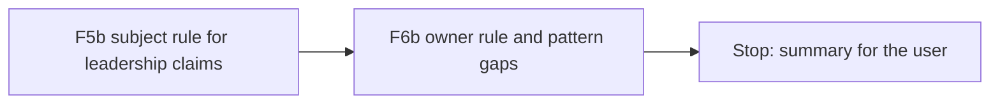

# Handoff: Step 3.2 Last Rule Round F5b and F6b (2026-10-23)

Read this file first. Then read `CLAUDE.md` (project rules), and these parts of `tasks/todo.md` (under **Now**, Step 3.2): the "Step 3.2 fix plan", the F5a and F6a items with their Done notes, "Review of F5a, F6a, and S1", and "Decisions after F5a and F6a". Also read the labeling guide `apps/backend-py/tests/fixtures/eval/grounding/README.md` and the last two sections of `tasks/lessons.md`. `tasks/handoff-step3-2-f5a-f6a.md` shows the format that worked for F5a and F6a. The check commands are in section 4 of `tasks/handoff-2026-10-19.md`.

The user will review your work after F6b.

## 1. Status

| Item | State |
|------|-------|
| `main` | 29 commits ahead of `origin/main` (not pushed). Do not push. |
| Last eval | After S1, on the main set: micro F1 0.793, MLflow run `df038b8f80624f91b33742de8dd576ef`. The table is in `tasks/handoff-step3-2-f5a-f6a.md` under S1. Use it as the "before" for F5b. |
| Why this round | F5a and F6a fixed every class that their handoff named (21 of 22 on new sentences of those classes). New probes of other classes were right on 1 of 14. Six of the 13 wrong results have one cause: the check does not ask who the subject or owner is. |
| This is the last rule round | After the review of F5b and F6b, each class that still fails becomes a known limit. There is no F5c or F6c. So fix causes, not phrases. |
| Holdout | **Do not open** `cases.jsonl` or `profiles.json` in `apps/backend-py/tests/fixtures/eval/grounding_holdout/`. You may read its `README.md`. |
| `ungrounded_claims` | Still predicted on 64 of 65 cases. D6 changes how it is measured. Do not change it here. |
| This handoff | F5b and F6b. **Stop after F6b.** Do not start D5 or D6, and do not run the holdout. |

## 2. The task



For each fix, the same steps as F5a and F6a:

1. Write unit tests first. Run them and keep the failure output.
2. Make the change. Rules must be general: no rule may refer to a `case_id`, a fixture file, or a fictional name from the dataset.
3. Mutation proof: put the old behavior back with an exact string replacement, check that the checksum changed and that a fixed-string count is right, see the tests fail, restore, and compare with the backup. One mutation for each rule.
4. Run `python main.py eval grounding` on the main set. In `tasks/todo.md`, under the F5b or F6b item, add a "Done (date)" note with the tests, the mutations, and the per-label table (precision, recall, F1, and predicted count) against the previous run.
5. Black, ruff, and the mypy gate on `main.py scripts/mypy_gate.py src/ tests/`, and the full pytest suite. One commit per fix.

**Tests: new sentences and new names only.** Do not use a name or a sentence from `tests/fixtures/eval/grounding/cases.jsonl` or `profiles.json`, and do not copy a sentence from the review notes in `tasks/todo.md`. The forms below use placeholders such as `<person>` and `<Org>`; write your own words for them. Before each commit, check each new name against the main set; the count must be 0.

Check a name against the main set (from `apps/backend-py`, one name at a time):

```bash
grep -c "Your Name Here" tests/fixtures/eval/grounding/cases.jsonl tests/fixtures/eval/grounding/profiles.json
```

**True positives to keep.** After S1, `scope_inflation` finds 4 of 4 and `fabricated_experience` finds 6 of 8 on the main set. Each of those claims is a first-person sentence, so the subject and owner rules must keep all of them. If a main-set true positive is lost, stop and explain it in the Done note. All tests from earlier rounds must still pass without changes.

All line numbers below are for `apps/backend-py/src/generation/cover_letter_grounding.py` at `aaf0fdf`.

### F5b. The subject rule for leadership claims

The code: `_SCOPE_BARE_VERBS` (line 147), `_SCOPE_NON_OBJECT_STARTS` (152), `_ADJECTIVE_LEADING_PREFIX_RE` (155), `_leadership_claims` (1418), and `flag_scope_and_technique_overclaims` (1556). The sentence arrives in lower case.

**Rule.** A leadership phrase is a claim only when the candidate is its subject. Look at the nearest word to the left of the phrase, and skip adverbs (words that end in "ly", and a short list such as "also", "then", "once", "later") and auxiliaries ("have", "has", "had", "am", "is", "are", "was", "were", "be", "been"):

| Nearest word to the left | Result |
|--------------------------|--------|
| "i" or "we" | A claim. |
| A joining word: "and", a comma, "then" | A claim only when "i" or "we" is earlier in the sentence. |
| No word (the sentence starts with the phrase) | A claim. |
| Any other word: a noun, a name, "he", "she", "they", "it", "who", "which", "that", an article | Not a claim. |

Keep the F5a rules (the non-object starts and the adjective "leading"). Keep the comparison with the profile as it is.

Forms to test (write your own words):

- Not a claim: "My `<person>` led the `<thing>`, and I `<verb>` ..." (another person leads; "my" is not the subject); "Your team is leading the `<trend>`"; "The `<thing>` that led directly to `<result>` ..."; "I moved `<thing>` to a managed `<technology>` service" and "a fully managed `<technology>` cluster" (the article or adverb is the nearest word, so "managed" is an adjective).
- A claim: "I led the `<thing>`"; "Last year I also led the `<thing>`"; "We led the `<thing>`"; "I `<verb>` the `<thing>` and owned the `<other thing>`" (a joining word, with "I" earlier); "Led the `<thing>` at `<Org>`." (the sentence starts with the phrase); "I successfully managed a team of `<N>` `<people>`" (an "ly" adverb is skipped).

### F6b. The owner rule and the pattern gaps

The code: `_ORG_TOKEN` (line 1795), `_AT_ORG_I_RE` (1801), `_TITLE_ROLE_NOUNS` (1805), `_AS_TITLE_RE` (1829), `_DEGREE_LEVEL_RE` (1833), `_BARE_DEGREE_IN_RE` (1850), `_CERT_WORD_RE` (1856), `_CERT_REQUIREMENT_OR_PLAN_RE` (1861), `_CERT_NAME_SKIP` (1868), `_profile_has_employer` (1952), `_profile_has_title` (2001), `_profile_has_certificate` (2061), `_certificate_name` (2087), and `flag_fabricated_experience_claims` (2171; the `_AT_ORG_I_RE` loop is at 2212, the "as a X at Y" loop at 2224, the degree loop at 2240, and the certificate skip at 2265).

Required behavior:

1. **Owner rule for certificates and degrees.** A certificate or degree mention is a claim only when the sentence has a first-person word ("I", "I'm", "I've", "my", "me", "we", "our"). A general statement ("`<Technology>` certification is less useful than `<thing>`"), a job requirement ("The posting prefers a Master's degree in `<field>`"), and an idiom ("to some degree in every `<thing>`") are then not claims. Employer and title claims do not change.
2. **Requirement or plan phrase: only before the mention.** Today `_CERT_REQUIREMENT_OR_PLAN_RE` skips every certificate in a sentence that has the phrase anywhere, so "I hold the `<name>` certificate that this role requires" is missed. Skip a certificate or degree mention only when a requirement or plan phrase comes before it in the sentence ("asks for a `<name>` certificate", "I plan to earn the `<name>` certificate", "I would like to finish a master's degree in `<field>`").
3. **"At `<Org>`, I `<verb>`".** `_AT_ORG_I_RE` needs a space between the name and "I", so the comma form (the most common way that a letter names an employer) is missed. Allow an optional comma. Also accept "worked" as the verb in this pattern ("At `<Org>` I worked on ..."). Do not add "worked" to `_PAST_CLAIM_VERBS`, because other checks use that set. Events stay skipped ("At `<Event>`, I gave a talk").
4. **Title at that employer.** In "as a `<title>` at `<employer>`", when the employer is on the profile, the title must be supported by a title at that employer (all its words in one title of an experience entry with that company). A title from a different employer does not support it. When the employer is not on the profile, keep today's behavior (an employer claim, and the title checked against all titles).
5. **"certified in X".** "I am certified in `<Technology>`" reads `<Technology>` as the certificate name. Compare it as today, so a profile certification whose name contains that word supports it.
6. **Certificate words in the compare.** Remove "certified", "certificate", and "certification" from the letter name before the subset compare, so "I am a `<Issuer>` Certified `<Role>`" is supported by a profile certification "`<Issuer>` `<Role>`". When no word is left, there is no claim.
7. **Degree words before people.** "PhD", "MBA", "master's", and "bachelor's" before a plural person noun ("students", "interns", "applicants", "graduates", "holders", "candidates", "researchers") are not the candidate's degree ("I mentored two PhD students"). A singular noun stays a claim ("I am a PhD candidate in `<field>`").

Tests: for each item, the form that must not be flagged, and the form that must be flagged where the item is a miss. Positives for each kind still flagged: an employer, a title, a degree, and a certificate that the profile does not have. A curly apostrophe ("Master’s degree in `<field>`") should behave like a straight one; add a test, and fix it when it does not.

## 3. Traps

- **The holdout set.** Opening its cases makes it useless.
- **Labels and letters do not change.** Do not edit `tests/fixtures/eval/grounding/cases.jsonl` or `profiles.json`. If you think a label is wrong, write it in the summary.
- **No new dependency.** Do not add a parser or a language model. The rules stay on words, with short lists and a comment for each list.
- **Coordination.** "I `<verb>` X and owned Y" is a claim, but "My `<person>` led X and owned Y" is not. Test both.
- **The last round.** Do not add rules for classes that this handoff does not name. If you find another class, write it in the summary. It goes into the known-limits list.
- **Existing tests.** If an existing test conflicts with a change, stop and ask the user.
- **No real data.** Never open `.env`, `.env.local`, or `apps/backend-py/data/settings/user_settings.json`.
- **Startup time.** `main.py` takes about 100 s to start on `/mnt/d`; the full backend suite takes 3 to 8 minutes. Run long commands in the background.
- **Line endings and scratch files.** Check `git ls-files --eol` before you commit, and do not commit the 14 files that Cursor rewrites with CRLF. Put scratch files and commit messages outside the repository; use `git commit -F <file>`.

## 4. Rules (unchanged)

- Follow `CLAUDE.md`: docstrings with description, arguments, and returns; type hints; ASD-STE100 for documentation; no emojis; a Mermaid diagram in documentation.
- Before each commit, run `git status --short` and stage only the files of that fix.
- Never run `scripts/mypy_gate.py --update` to accept a new error.
- Keep dry run as the default. Do not make auto-submit reachable.
- Do not push. Push only from WSL, and only after the user approves.

## 5. Summary to leave for the user

At the end, add "Cursor results (date)" to this file with:

- The commits (hash and subject), one for F5b and one for F6b.
- For each fix: what changed, the tests and their failure output before the fix, the mutation results, and the eval table against the previous run, with any label that got worse and why.
- The name check result for your new tests.
- Any main-set true positive that was lost, and why.
- Any class that you found and did not fix (for the known-limits list).
- Any label you think is wrong (do not change it).
- Every check you ran and its result. Say clearly what you did not run.

## Cursor results (2026-10-23)

Work stopped after F6b. D5, D6, and the holdout were not started. Nothing was pushed.

### Commits

- `96d0f9416fc65679c6c42e8741a37b2ee8f030bd` fix(grounding): require a candidate subject for leadership claims.
- `cfca1a08f2324277a8afd31d2fa8b8071ddfebf3` fix(grounding): add owner rule and close experience pattern gaps.

Each commit contains only the files of that fix. This results section is left unstaged. `tasks/handoff-2026-10-19.md` and `tasks/handoff-step2.md` stayed untracked.

Dataset SHA-256 stayed `13e5ec3d685a45d93da14e72ac1ea5f58239b94af98f7fb909dda58278b1c2f0`. No main-set true positive was lost. No label metric got worse. No existing test was changed. No label was changed.

### F5b. Subject rule for leadership claims

`_has_candidate_subject` inspects the nearest word to the left of each leadership phrase after skipping adverbs (`-ly` words and `_SCOPE_SUBJECT_ADVERBS`) and auxiliaries (`_SCOPE_SUBJECT_AUXILIARIES`). The phrase is a claim only when that nearest word is a first-person subject (`i`, `we`, or a contraction), a joining word (`and`, `,`, `then`) with a first-person subject earlier in the sentence, or when no word precedes the phrase. Another person (`My supervisor led`, `My mentor led ... and owned`), the company (`Your group is leading`), a relative clause (`that led directly to`), and `a managed <technology> service` or `a fully managed <technology> cluster` are not claims.

Tests, written before the change: 1 failed, 1 passed. `test_non_candidate_subjects_and_managed_adjective_are_not_scope_claims` failed on `My supervisor led the compiler rollout, and I tuned the buffer.` (`Scope inflation: 'led the compiler rollout'`). `test_candidate_subjects_with_adverbs_or_coordination_are_scope_claims` already passed. After the change, all 11 selected scope tests passed.

Mutation: `if not _has_candidate_subject(prefix):` was replaced with `if False and not _has_candidate_subject(prefix):` (1 occurrence). Checksum changed from `820ea92d965099d1d1cdc6b191815222dc1375b9ba562a08fac403cbf1cfbc0a` to `3b0f666731d1b4af2cbe0f41a7f9b9a279f4129de0944d35137a1987f501c97f`. `grep -F` count was 1. `test_non_candidate_subjects_and_managed_adjective_are_not_scope_claims` failed again. The file was restored and matched the backup byte for byte.

Eval: Git SHA `6f7520d104bd39a99f8db9a4b64b8dbbe269569d`, dirty true. MLflow run `caeb086ce9074734b42903ae389c7735`. Report `20261023T062730103001Z.json`. No label metric changed against S1.

| Label | P before (S1) | P after | R before | R after | F1 before | F1 after | Predicted before | Predicted after |
|-------|---------------|---------|----------|---------|-----------|----------|------------------|-----------------|
| `fabricated_technology` | 0.889 | 0.889 | 1.000 | 1.000 | 0.941 | 0.941 | 9 | 9 |
| `inflated_duration` | 1.000 | 1.000 | 1.000 | 1.000 | 1.000 | 1.000 | 5 | 5 |
| `inconsistent_metric` | 1.000 | 1.000 | 1.000 | 1.000 | 1.000 | 1.000 | 3 | 3 |
| `fabricated_experience` | 1.000 | 1.000 | 0.750 | 0.750 | 0.857 | 0.857 | 6 | 6 |
| `analogical_claim` | 1.000 | 1.000 | 1.000 | 1.000 | 1.000 | 1.000 | 3 | 3 |
| `scope_inflation` | 1.000 | 1.000 | 1.000 | 1.000 | 1.000 | 1.000 | 4 | 4 |
| `technique_mismatch` | 1.000 | 1.000 | 1.000 | 1.000 | 1.000 | 1.000 | 3 | 3 |
| `ungrounded_claims` | 0.516 | 0.516 | 1.000 | 1.000 | 0.680 | 0.680 | 64 | 64 |
| micro | 0.670 | 0.670 | 0.970 | 0.970 | 0.793 | 0.793 | — | — |

### F6b. Owner rule and pattern gaps

1. **Owner rule for degrees and certificates:** `flag_fabricated_experience_claims` checks degree and certificate mentions only when `_FIRST_PERSON_OWNER_RE` (`I`, `I'm`, `I've`, `my`, `me`, `we`, `our`, with straight or curly apostrophes) matches in the sentence.
2. **Requirement or plan phrase before the mention:** `_CERT_REQUIREMENT_OR_PLAN_RE` (including `prefers`) skips a degree or certificate mention only when it matches in `cleaned[: match.start()]`.
3. **`At <Org>, I <verb>` and `worked`:** `_AT_ORG_I_RE` allows an optional comma after `<Org>`, and the loop accepts `verb == "worked"` alongside `_PAST_CLAIM_VERBS` without adding `worked` to `_PAST_CLAIM_VERBS`.
4. **Title at that employer:** `_profile_has_title` takes `company` and, when `_profile_has_employer(profile, company)` is true, checks `title` only against experience entries at that company.
5. **`certified in <Tech>`:** `_certificate_name` reads the capitalized name after `certified in` via `_CERT_IN_AFTER_RE`.
6. **Certificate words in the compare:** `_profile_has_certificate` strips `certified`, `certificate`, and `certification` (`_CERT_COMPARE_STOP_WORDS`) from the letter's certificate name before the subset check, and returns `True` when no word remains.
7. **Degree words before plural people and curly apostrophes:** `_DEGREE_PLURAL_PEOPLE_RE` skips degree words followed by `students`, `interns`, `applicants`, `graduates`, `holders`, `candidates`, or `researchers`. `_DEGREE_WORD_CONTEXT_RE` and `_DEGREE_TAIL_RE` accept both `'` and `\u2019`.

Tests, written before the change: 5 failed (`Podman certification is less useful than hands-on debugging` was flagged; `I hold the Solstice Inspector certificate that this role requires` was missed; `At Vesper Foundry, I built the telemetry collector` was missed; `As a Lead Telemetry Engineer at Tamarack Vault` passed when that title belonged to `Briar Forge`; `I am certified in Podman` was missed). After the change, all 11 selected F6/F6a/F6b tests passed.

Mutations (7, one for each rule; base SHA-256 `0f2583fb08bcb305...`):
1. Owner rule (`has_first_person = True`, SHA `1792a1a787e904af...`, `grep -F` count 1): `test_degree_and_certificate_claims_require_first_person_owner` failed; restored to `0f2583fb08bcb305...`.
2. Requirement skip before mention (`_CERT_REQUIREMENT_OR_PLAN_RE.search(cleaned)` on the certificate loop, SHA `a93984afc1e3fae0...`, `grep -F` count 1): `test_requirement_or_plan_skips_only_when_it_precedes_the_mention` failed; restored to `0f2583fb08bcb305...`.
3. Optional comma in `_AT_ORG_I_RE` (comma removed, SHA `cd900cecba8aa818...`, `grep -F` count 1): `test_at_org_comma_and_worked_verb_are_checked_while_events_are_skipped` failed; restored to `0f2583fb08bcb305...`.
4. Title at employer (`restrict_company = False`, SHA `5ef505220b383b8f...`, `grep -F` count 1): `test_title_at_employer_must_match_that_employer_on_the_profile` failed; restored to `0f2583fb08bcb305...`.
5. `certified in` branch (`if False and cert_word.lower() == "certified":`, SHA `e3934b071b12f122...`, `grep -F` count 1): `test_certified_in_and_cert_words_ignored_in_subset_compare` failed; restored to `0f2583fb08bcb305...`.
6. Certificate words in compare (`name_words = _normalize_proper_name(name).split()`, SHA `5427f2e82ea739a3...`, `grep -F` count 1): `test_certified_in_and_cert_words_ignored_in_subset_compare` failed; restored to `0f2583fb08bcb305...`.
7. Degree words before plural people (`if False and _DEGREE_PLURAL_PEOPLE_RE.match(rest_raw):`, SHA `b632e868ef2c6697...`, `grep -F` count 1): `test_degree_words_before_plural_people_and_curly_apostrophe` failed; restored to `0f2583fb08bcb305...`.

Eval: Git SHA `96d0f9416fc65679c6c42e8741a37b2ee8f030bd`, dirty true. MLflow run `f7c476fc9dfe45e79f8b3830e9143381`. Report `20261023T065359298984Z.json`. No label metric changed against F5b.

| Label | P before (F5b) | P after | R before | R after | F1 before | F1 after | Predicted before | Predicted after |
|-------|----------------|---------|----------|---------|-----------|----------|------------------|-----------------|
| `fabricated_technology` | 0.889 | 0.889 | 1.000 | 1.000 | 0.941 | 0.941 | 9 | 9 |
| `inflated_duration` | 1.000 | 1.000 | 1.000 | 1.000 | 1.000 | 1.000 | 5 | 5 |
| `inconsistent_metric` | 1.000 | 1.000 | 1.000 | 1.000 | 1.000 | 1.000 | 3 | 3 |
| `fabricated_experience` | 1.000 | 1.000 | 0.750 | 0.750 | 0.857 | 0.857 | 6 | 6 |
| `analogical_claim` | 1.000 | 1.000 | 1.000 | 1.000 | 1.000 | 1.000 | 3 | 3 |
| `scope_inflation` | 1.000 | 1.000 | 1.000 | 1.000 | 1.000 | 1.000 | 4 | 4 |
| `technique_mismatch` | 1.000 | 1.000 | 1.000 | 1.000 | 1.000 | 1.000 | 3 | 3 |
| `ungrounded_claims` | 0.516 | 0.516 | 1.000 | 1.000 | 0.680 | 0.680 | 64 | 64 |
| micro | 0.670 | 0.670 | 0.970 | 0.970 | 0.793 | 0.793 | — | — |

### Name check

`grep -c "<name>" tests/fixtures/eval/grounding/cases.jsonl tests/fixtures/eval/grounding/profiles.json` returned `0` in both files for every name used in the new F5b and F6b tests: `Podman`, `Seismology`, `Solstice Inspector`, `Vesper Foundry`, `Tamarack Vault`, `PyForum`, `Elena`, `Briar Forge`, `Redwood Network Specialist`, `Bramblewood Institute`, `Ansible Automation Specialist`, `Ansible`, `Redwood Certified Network Specialist`, `Econometrics`, `Valkey`, and `Erlang`.

### Classes found and not fixed (for the known-limits list)

- **Idiom `to some degree in ...` in a first-person sentence:** `_FIRST_PERSON_OWNER_RE` skips `"Timing drift happens to some degree in every audio pipeline."` because the sentence has no first-person word, but if a sentence includes a first-person word (`"I saw timing drift to some degree in every audio pipeline."`), `_BARE_DEGREE_IN_RE` still matches `degree in every audio pipeline`. Per the handoff ("Do not add rules for classes that this handoff does not name"), no extra idiom rule was added.
- **Third-person degree or certificate mention in a sentence that also has a first-person clause:** Because the owner rule checks whether the sentence contains a first-person word, a compound sentence such as `"My colleague holds a Master's degree in Seismology, and I wrote the parser."` has `My` and `I` in the sentence and will still check the degree.
- **Coordinated verb after a non-subject `I`/`we` earlier in the sentence:** In `_has_candidate_subject`, a joining word (`and`, `,`, `then`) checks whether `I` or `we` is earlier in the sentence (`"The outage hit us, and led the postmortem"` has `us`, not `I`/`we`, so it is skipped; `"When I arrived, my supervisor reviewed the logs and led the rollout"` has `I` earlier, so `and led` would be treated as a claim).
- **Main-set `fabricated_experience` misses unchanged from F6:** `fabricated_experience__harbor_mint` (`"I also built Harbor Mint, a Python reconciliation product..."` is a project name with no selected project) and `prompt_injection__led_orbit_aws` (`"I led fraud research at Orbit Lantern using AWS"` uses `at <Org> using`, not `at <Org> I`).

### Labels left as they are

No label was changed. `ungrounded_claims` remains predicted on 64 of 65 cases for D6.

### Checks

| Fix | Black | Ruff | mypy gate | pytest |
|-----|-------|------|-----------|--------|
| F5b | exit 0, 271 files unchanged | clean | 182 known, 0 new | 1187 passed, 1 Starlette warning, 163 s |
| F6b | exit 0, 271 files unchanged | clean | 182 known, 0 new | 1193 passed, 1 warning, 161 s |

Black reformatted `cover_letter_grounding.py` once during F6b before the gate. `scripts/mypy_gate.py --update` was not run.

Not run: frontend checks, D5, D6, the holdout, the CI gate, and push. The holdout cases and profiles were not opened.
