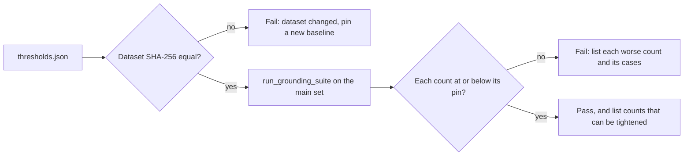

# Notes: Step 3.2, Grounding Set and Validator Fixes

This text moved here from `tasks/todo.md` on 2026-10-24, without changes. Paths in it are as of that date: a reference to a section of `tasks/todo.md` now means a section of this file or of another task's `notes.md`, and a `tasks/handoff-*.md` file is now in its step's task folder (Step 2 and Step 3.2 handoffs are in `tasks/archive/`). `tasks/lessons.md` is now `docs/lessons.md`.

##### Step 3.2: Grounding golden set, then the M7 fixes (effort: M) — M4, M7

Labeling rules (2026-10-22, see `tasks/handoff-step3-2.md`): label each check on its own with its definition, so one sentence can have more than one label (for example, a fabricated technology is also an ungrounded claim); write the labels before the validator runs; an unsupported number without from/to endpoints is `ungrounded_claims`, not `inconsistent_metric`; `fabricated_experience` covers projects, employers, titles, degrees, and certifications, which is wider than the code checks today.

- [x] `tests/fixtures/eval/grounding/cases.jsonl` with at least 60 cases. Each case has a synthetic profile, a job, a letter, and the expected set of issues:
  - clean letters that match the profile (expected: no issues);
  - one injected error per case: a number that the profile does not support ("90%", "3x"), an employer, a degree, inflated years of experience, or a tech that the profile does not have;
  - normal English with tech homonyms ("express my interest", "spring semester", "a swift reply", "spark curiosity"; expected: no issue);
  - short tokens that matter ("AWS", "GCP", "C#", "Go", "90%");
  - job descriptions with prompt-injection text, where the letter states JD claims as the candidate's own.
  - About 15 real generated letters labeled by hand (Question 1).
  - **Done (2026-10-22, constructed set):** Labeling guide, 3 fictional profiles, and 65 hand-labeled constructed letters across all required groups; 29 cases have no expected issues. `test_grounding_dataset_structure_and_counts` failed first because `cases.jsonl` did not exist, then passed. Mutation: duplicate `clean__grounded_01` in a temporary copy → duplicate-ID assertion failed; restored file matched byte-for-byte. The optional real generated letters remain for a later user-data run and are not part of this synthetic committed set.
- [x] Baseline with the deterministic validator only (`cover_letter_validator.py`, `cover_letter_grounding.py`; no LLM): precision, recall, and F1 per issue type, and the false-positive rate on clean letters.
  - **Baseline (2026-10-22), superseded (templated set, 2026-10-22):** Command `.venv/bin/python main.py eval grounding` from `apps/backend-py`, default MLflow store `apps/backend-py/data/mlflow.db`. Labels were not changed after this run. Kept for history. Baseline 2 below replaces it.

    | Field | Value |
    |-------|-------|
    | Git SHA | `85680158e54daad4816bf9c7afb5a6f07c06d087` (`git_dirty`: true; 14 unrelated CRLF-only tracked files, not the dataset) |
    | Dataset SHA-256 | `cc31267e1c69f087a50dc1f94783736feb7a963118b8184807abd51c64bfb554` |
    | MLflow run ID | `9f1346e967794fbfaf4c30160311509e` |
    | Report | `apps/backend-py/data/eval/grounding/20261022T060056297067Z.json` (gitignored) |
    | Case count | 65 |

    | Label | Precision | Recall | F1 | Support |
    |-------|-----------|--------|----|---------|
    | `fabricated_technology` | 0.571 | 0.615 | 0.593 | 13 |
    | `inflated_duration` | 1.000 | 0.800 | 0.889 | 5 |
    | `inconsistent_metric` | 1.000 | 0.667 | 0.800 | 3 |
    | `fabricated_experience` | 1.000 | 0.143 | 0.250 | 7 |
    | `analogical_claim` | 1.000 | 0.667 | 0.800 | 3 |
    | `scope_inflation` | 1.000 | 0.250 | 0.400 | 4 |
    | `technique_mismatch` | 0.120 | 1.000 | 0.214 | 3 |
    | `ungrounded_claims` | 0.508 | 1.000 | 0.673 | 33 |
    | micro | 0.474 | 0.761 | 0.584 | — |

    `clean_false_positive_rate`: 1.000 (29 of 29 cases with empty `expected_issues` received at least one predicted label).

    Five largest error groups from `details.cases` (`missed` and `extra`):

    1. `clean` extra `ungrounded_claims`: 15 of 15
    2. `homonym` extra `fabricated_technology`: 5 of 5
    3. `homonym` extra `ungrounded_claims`: 5 of 5
    4. `inconsistent_metric` extra `technique_mismatch`: 5 of 5
    5. `fabricated_experience` missed `fabricated_experience`: 5 of 6

    Tied with group 5 at count 5: `clean` extra `technique_mismatch` (5 of 15).

    Observed gaps; the validator was not changed:

    - Short token `Go` missed as `fabricated_technology` (`fabricated_technology__go`). This matches the known M7 drop at `cover_letter_grounding.py:414` (`len(word) > 3`).
    - Homonyms `express`, `spring`, `swift`, and `spark` flagged as `fabricated_technology` (5 of 5). This matches the known M7 allowlist at `cover_letter_grounding.py:163-209`.
    - `fabricated_experience` recall is 0.143. The code checks selected project names; fake employers, degrees, certifications, and titles were missed.
    - `technique_mismatch` precision is 0.120 (22 false positives).
    - The run logged `Cover letter references project not in profile: Nebula Console`.

  - **Review of the dataset and baseline (2026-10-22):** The baseline reproduces exactly (same dataset SHA-256, same counts per label). The guide matches the handoff, and every group meets its minimum. Real validator findings, with correct labels: the 4 homonyms (5 of 5 cases); `ungrounded_claims` flags greetings, closings, and sign-offs ("Sincerely, Ilan Okoro") that the guide excludes, and the sentence split joins "Dear Hiring Team," to the first sentence; the technique check gives a sentence that names two projects to the wrong project; `fabricated_experience` checks only selected project names. Correction to the note above: `Go` is not missed because of `len(word) > 3` (that filter is only for the `ungrounded_claims` word overlap). `go` is in `_AMBIGUOUS_TEXT_ALIASES` (`cover_letter_grounding.py:363`), so free-text matching skips it on purpose; detecting Go needs context, like the homonyms. The dataset has problems that make precision and the clean false-positive rate unreliable, so they block the M7 fixes:
    - [x] **D1. Templated letters.** 570 sentences, but only 78 are distinct (numbers normalized). One sentence ("I value review, documentation, and direct communication ...") is in all 65 letters. Each profile has one base letter, and 24 cases share the same 7 sentences; 688 of 2,080 case pairs share at least half of their sentences. All jobs are at "Fictional Meridian Group". So the false-positive numbers measure 3 base letters, not 65 letters. Done in the rewrite: `test_grounding_dataset_diversity` enforces L1 to L6, and the new set passes (see Baseline 2).
    - [x] **D2. An unnatural sentence drives one metric.** "Atlas Search documents retrieval and reranking, while Finch Classifier documents supervised fine-tuning." is in all 24 `ml` cases and causes most of the 22 `technique_mismatch` false positives. No candidate writes this in a letter. That sentence is not in the new set. Baseline 2 has 0 `technique_mismatch` false positives.
    - [x] **D3. Guide gap, technique or technology.** The 3 positive `technique_mismatch` cases are also labeled `fabricated_technology` for RAG, fine-tuning, and reinforcement learning, but the guide lists these as techniques. The guide now says a technique is not `fabricated_technology`. The new technique cases are labeled `technique_mismatch` and `ungrounded_claims` only.
    - [x] **D4. Guide gap, value statements.** Statements of values or working style that state no checkable fact ("I value review, documentation, ...") are in no rule. They are labeled as not ungrounded, which is reasonable, but the guide must say so. The guide now excludes those statements, and a sign-off, from `ungrounded_claims`. A self-assessment that implies an unsupported fact stays in the label.
    - Cause: the handoff asked for "different styles" without a measurable rule, and the dataset test checks counts only (see `tasks/lessons.md`).
  - **Baseline 2 (2026-10-22):** Same command and default MLflow store. Labels were written from the updated guide before this run and were not changed after it. Diversity on the committed letters: 572 distinct long sentences out of 573 (L3 ratio 0.9983), 22 companies, 16 titles, no company in more than 3 cases, 164 to 253 words, 18 letters over 220 words. Profiles: `backend` 24, `ml` 26, `grad` 15. No profile was added.

    | Field | Value |
    |-------|-------|
    | Git SHA | `dfa0649db4866b956842e87975806ab768a2c92a` (`git_dirty`: false) |
    | Dataset SHA-256 | `13e5ec3d685a45d93da14e72ac1ea5f58239b94af98f7fb909dda58278b1c2f0` |
    | MLflow run ID | `2d73d7766c004c1a90cd1c9393b78341` |
    | Report | `apps/backend-py/data/eval/grounding/20261022T080255375930Z.json` (gitignored) |
    | Case count | 65 |

    | Label | Precision | Recall | F1 | Support |
    |-------|-----------|--------|----|---------|
    | `fabricated_technology` | 0.500 | 0.875 | 0.636 | 8 |
    | `inflated_duration` | 1.000 | 0.800 | 0.889 | 5 |
    | `inconsistent_metric` | 1.000 | 1.000 | 1.000 | 3 |
    | `fabricated_experience` | 1.000 | 0.125 | 0.222 | 8 |
    | `analogical_claim` | 1.000 | 0.667 | 0.800 | 3 |
    | `scope_inflation` | 0.667 | 0.500 | 0.571 | 4 |
    | `technique_mismatch` | 1.000 | 0.667 | 0.800 | 3 |
    | `ungrounded_claims` | 0.508 | 1.000 | 0.673 | 33 |
    | micro | 0.574 | 0.806 | 0.671 | — |

    `clean_false_positive_rate`: 1.000 (29 of 29 cases with empty `expected_issues` received at least one predicted label). Compared with the templated baseline, micro F1 moved from 0.584 to 0.671 and `technique_mismatch` precision moved from 0.120 to 1.000. The clean false-positive rate stayed 1.000.

    Five largest error groups from `details.cases` (`missed` and `extra`):

    1. `clean` extra `ungrounded_claims`: 15 of 15
    2. `homonym` extra `fabricated_technology`: 5 of 5
    3. `homonym` extra `ungrounded_claims`: 5 of 5
    4. `analogical_claim` extra `ungrounded_claims`: 4 of 4
    5. `fabricated_experience` missed `fabricated_experience`: 5 of 6

    Review findings, and whether Baseline 2 still shows them. The validator was not changed.

    - Homonyms flagged: yes. All 5 homonym letters have extra `fabricated_technology`.
    - `Go` missed: yes. `fabricated_technology__go` missed `fabricated_technology`. `ungrounded_claims` was predicted. This matches `go` in `_AMBIGUOUS_TEXT_ALIASES` (`cover_letter_grounding.py:363`), not the `len(word) > 3` filter.
    - Greetings, closings, and sign-offs flagged as `ungrounded_claims`: the symptom remains. All 15 clean letters have extra `ungrounded_claims`. The report does not name the sentence.
    - A sentence that names two projects and is given to the wrong project: not shown. `technique_mismatch` has 0 false positives. The old sentence is not in this set, so this run does not exercise that bug.
    - `fabricated_experience` checks only selected projects: yes. The only true positive is the selected project Nebula Console (the run logged that name). Missed claims: Harbor Mint, Orbit Lantern, the Glassmill degree, the auditor certificate, the director title, and the prompt-injection employer and doctorate (7 false negatives).

    Other gaps, not fixed here:

    - `inflated_duration__three_to_five_fastapi` missed `inflated_duration` and was flagged `fabricated_technology`.
    - `technique_mismatch__atlas_rl` missed `technique_mismatch`.
    - `analogical_claim__fastapi_kubernetes` was also flagged `fabricated_technology` even though the letter says the candidate has not run Kubernetes.

  - **Review of Baseline 2 (2026-10-22):** Baseline 2 reproduces exactly (dataset SHA-256 `13e5ec3d...`, the same counts per label), and an independent count gives the same L1 to L6 numbers. `dfa0649` changes only "a" to "an". The labels of 3 random letters are correct under the guide. Findings:
    - **`ungrounded_claims` is predicted for all 65 letters** (33 true positives plus 32 false positives). Every letter has a greeting, and the check flags greetings, sign-offs, and future-plan sentences ("If <company> hired me ..."). So its case-level recall (1.0) and precision (0.508) carry no information. It becomes measurable when the check skips greetings, closings, and plans, or when cases label the exact sentences.
    - **Sentence frames repeat with new names.** With the company, title, and JD need phrase replaced by placeholders, only 370 of 573 long sentences are distinct (0.646, not 0.998); one frame is in 18 cases, and 19 frames are in 5 or more cases (for example "If <co> hired me as a <title>, I would spend the first weeks learning ..."). The repeated frames are filler; every injected error is in its own sentence, so the scores of the specific checks still rest on varied cases. The L1 to L3 normalization replaces only digits, so it misses this.
    - **New validator bug: no word boundary in the scope check.** "before I called the speedup real" raised `scope_inflation` because "called the" contains "led the" (`technique_mismatch__bridge_finetune`).
    - More validator findings for the fix plan: a duration range ("3-5 years" of FastAPI with a 3-year cap) is missed; "managed a team of twelve" is missed; a "led" claim at a fake employer passes because the profile has "Led a team of 3" elsewhere (the leadership allowance is for the whole profile, not per work item); a disclaimed technology ("I have not run Kubernetes") is still flagged; "SQL" is flagged when the profile has PostgreSQL (the guide does not say whether a related technology counts); the analogy "similar to penetration testing" and the technique "reinforcement learning on Atlas Search" are missed.
- [ ] Fix the validator (M7 and the Baseline 2 findings): the fix plan below (F1 to F7), then the dataset item D5.
- [ ] CI gate: a pytest runs the suite and fails if a metric is below `tests/fixtures/eval/grounding/thresholds.json`. Raise a threshold only in a commit that shows the new numbers (Question 4). Set the first thresholds from the numbers after D5.

##### Step 3.2 fix plan: the grounding validator (2026-10-22)

**Goal:** Each grounding check finds what the labeling guide defines, and each fix is measured. `ungrounded_claims` becomes measurable first, because today it is predicted for all 65 letters.

**Measurement rules:**

- Reference: Baseline 2 (dataset SHA-256 `13e5ec3d...`, MLflow run `2d73d7766c004c1a90cd1c9393b78341`). The labels do not change during the fixes.
- Each fix: unit tests first, with new sentences that are not copied from the dataset (they fail on the current code); a mutation proof; then `python main.py eval grounding`, and the per-label change against the previous run in the fix note. When a fix lowers the F1 of another label, explain it or revert the fix.
- Only general rules. No fix may refer to a `case_id`, a fixture file, or a fictional name from the dataset.
- One commit per fix. Black, ruff, the mypy gate, and the full pytest suite before each commit.


- [x] **F1. `ungrounded_claims` skips sentences that state no fact (effort: M).** In `flag_ungrounded_sentences` (`cover_letter_grounding.py:1401`), skip: a greeting, including a leading greeting clause such as "Dear Hiring Team," before the first sentence; a sign-off ("Sincerely, Mara Chen", "Best regards"); thanks and calls to action (reuse `CoverLetterValidator.CALL_TO_ACTION_PHRASES`); statements of interest, motivation, values, or working style (guide D4); and plans or intentions ("I would ...", "If <company> hired me ...", "In my first month ..."). Guard: never skip a sentence that has a number, a technology from the lexicon, a duration, or a past-tense claim verb ("built", "led", "shipped", "reduced"). Check whether the stricter threshold for the last paragraph (`closing_min_overlap_ratio`) is still needed, and keep it only if the eval supports it. Tests: those sentence types are not flagged; "I would bring ten years of Kubernetes experience" and "Thank you. At my last job I cut costs by 90%." are still flagged. Report how many cases have `ungrounded_claims` predicted (65 today) and the clean false-positive rate.

  **Done (2026-10-22).** `flag_ungrounded_sentences` skips a greeting (including a leading "Dear ...," clause), a sign-off, thanks, a call to action from `CoverLetterValidator.CALL_TO_ACTION_PHRASES`, a statement of interest or values, and a plan. A number, a duration, a lexicon technology, or a past-tense claim verb keeps the sentence in the check. "hired me" is not treated as that verb.

  Tests in `tests/unit/test_cover_letter_grounding.py`, written before the change, on the old code: 3 failed, 1 passed (`test_plan_with_a_claim_is_still_flagged` already passed). Failures: non-claim sentences were flagged (first extra item `Hello`); "Thank you." was flagged; "Dear Hiring Partner, I invented..." was not flagged. After the change, that file passed (34 tests).

  Mutation: the skip call was replaced with `if False and _is_skippable_non_claim(remainder):` (1 occurrence). Checksum changed (`c903f4b7...` to `2859f811...`). `grep -F` count of the mutated text was 1. The non-claim test and the thanks test failed. The file was restored and matched the backup byte for byte. The greeting test stayed green under that mutation because the greeting strip is a separate line.

  Closing threshold: on this set, overlap 0.4 and overlap 0.3 flagged the same sentences (0 differences). The stricter closing default is not kept. The default `closing_min_overlap_ratio` is now 0.3, the same as the body. The table below was measured at 0.4, before that default change. The sentence sets match, so the table is the result for the committed default.

  Eval: `.venv/bin/python main.py eval grounding` from `apps/backend-py`. Git SHA `b63f68c540f25791532136388c5c579a54922602`, `git_dirty` true (the fix was not committed yet). Dataset SHA-256 `13e5ec3d685a45d93da14e72ac1ea5f58239b94af98f7fb909dda58278b1c2f0` (unchanged). MLflow run `9603cef286114118ac897a0fe630ef75`. `ungrounded_claims` was predicted on 64 of 65 cases (65 of 65 in Baseline 2). `clean_false_positive_rate` is 0.966 (28 of 29; Baseline 2 was 1.000, 29 of 29).

  | Label | P before | P after | R before | R after | F1 before | F1 after | Predicted before | Predicted after |
  |-------|----------|---------|----------|---------|-----------|----------|------------------|-----------------|
  | `fabricated_technology` | 0.500 | 0.500 | 0.875 | 0.875 | 0.636 | 0.636 | 14 | 14 |
  | `inflated_duration` | 1.000 | 1.000 | 0.800 | 0.800 | 0.889 | 0.889 | 4 | 4 |
  | `inconsistent_metric` | 1.000 | 1.000 | 1.000 | 1.000 | 1.000 | 1.000 | 3 | 3 |
  | `fabricated_experience` | 1.000 | 1.000 | 0.125 | 0.125 | 0.222 | 0.222 | 1 | 1 |
  | `analogical_claim` | 1.000 | 1.000 | 0.667 | 0.667 | 0.800 | 0.800 | 2 | 2 |
  | `scope_inflation` | 0.667 | 0.667 | 0.500 | 0.500 | 0.571 | 0.571 | 3 | 3 |
  | `technique_mismatch` | 1.000 | 1.000 | 0.667 | 0.667 | 0.800 | 0.800 | 2 | 2 |
  | `ungrounded_claims` | 0.508 | 0.516 | 1.000 | 1.000 | 0.673 | 0.680 | 65 | 64 |
  | micro | 0.574 | 0.581 | 0.806 | 0.806 | 0.671 | 0.675 | — | — |

  No label F1 fell. Recall of `ungrounded_claims` stayed 1.000. The remaining clean false positives are claim sentences with weak overlap, not greetings or sign-offs.

- [x] **F2. Unsupported numbers (effort: S; M7, part 1).** Add a number check to `ungrounded_claims`: each percentage, multiplier ("3x"), or count in a sentence about the candidate must appear in the profile (bullets, highlights, descriptions), after normalization ("90%", "90 percent", "ninety percent"). This replaces the M7 idea of keeping short tokens in the word overlap; the `len(word) > 3` filter at `cover_letter_grounding.py:414` stays unless the eval shows a need. Tests: "cut costs by 90%" and "3x faster" are flagged for a profile without those numbers, and supported numbers are not.

  **Done (2026-10-22).** `flag_unsupported_number_sentences` checks a sentence that F1 does not skip. A percent (`90%`, `90 percent`, `ninety percent`), a multiplier (`3x`, `3 times`), or a count with a noun (`four engineers` when the profile says `4`) must appear in the summary, experience descriptions and highlights, project descriptions and highlights, or education text. Durations and calendar years are not checked. A count is checked only when the sentence has a past-tense claim verb. The `len(word) > 3` filter in `significant_words` stays. This eval did not show a need to remove it.

  Tests, before the function existed: 5 failed with `ImportError: cannot import name 'flag_unsupported_number_sentences'`. After the function, `test_cover_letter_grounding.py` and `test_cover_letter_validator.py` passed (61 tests).

  Mutation: `if unsupported:` was replaced with `if False and unsupported:` (1 occurrence). Checksum changed (`e098df84...` to `dc74a862...`). `grep -F` count of the mutated text was 1. `test_unsupported_percent_and_multiplier_are_flagged` failed (`assert '90%' in ''`). The file was restored and matched the backup byte for byte.

  A first eval flagged the plan sentence "one test" in `clean__harbor_tests` and put `clean_false_positive_rate` back to 1.000. `ungrounded_claims` F1 fell from 0.680 to 0.673. That count has no past-tense claim verb, so it is not an achievement figure. The check now ignores such counts. A regression test covers "A good early task on the desk is one note about the change."

  Eval after that correction: `.venv/bin/python main.py eval grounding` from `apps/backend-py`. Git SHA `972bddeb3896f6700ec065d3cb45632f37b06669`, `git_dirty` true. Dataset SHA-256 unchanged `13e5ec3d685a45d93da14e72ac1ea5f58239b94af98f7fb909dda58278b1c2f0`. MLflow run `353119451f9e4acca1abf9dfa60c688a`. Case predictions are identical to the F1 run. No label F1 fell.

  | Label | P before (F1) | P after | R before | R after | F1 before | F1 after | Predicted before | Predicted after |
  |-------|---------------|---------|----------|---------|-----------|----------|------------------|-----------------|
  | `fabricated_technology` | 0.500 | 0.500 | 0.875 | 0.875 | 0.636 | 0.636 | 14 | 14 |
  | `inflated_duration` | 1.000 | 1.000 | 0.800 | 0.800 | 0.889 | 0.889 | 4 | 4 |
  | `inconsistent_metric` | 1.000 | 1.000 | 1.000 | 1.000 | 1.000 | 1.000 | 3 | 3 |
  | `fabricated_experience` | 1.000 | 1.000 | 0.125 | 0.125 | 0.222 | 0.222 | 1 | 1 |
  | `analogical_claim` | 1.000 | 1.000 | 0.667 | 0.667 | 0.800 | 0.800 | 2 | 2 |
  | `scope_inflation` | 0.667 | 0.667 | 0.500 | 0.500 | 0.571 | 0.571 | 3 | 3 |
  | `technique_mismatch` | 1.000 | 1.000 | 0.667 | 0.667 | 0.800 | 0.800 | 2 | 2 |
  | `ungrounded_claims` | 0.516 | 0.516 | 1.000 | 1.000 | 0.680 | 0.680 | 64 | 64 |
  | micro | 0.581 | 0.581 | 0.806 | 0.806 | 0.675 | 0.675 | — | — |

  `clean_false_positive_rate` stays 0.966 (28 of 29). `ungrounded_claims` stays predicted on 64 of 65 cases. The unsupported numbers in this set were already flagged by the overlap check.

- [x] **F3. Technology detection (effort: M; M7, part 2).** (a) The homonyms `swift`, `express`, `spring`, and `spark` (allowlist at `cover_letter_grounding.py:163-209`) count only in a technology context, for example "Spring Boot", "Express.js", "Apache Spark", "Swift for iOS", or "built with Spark". (b) `Go` (in `_AMBIGUOUS_TEXT_ALIASES`, line 363) counts only in a technology context, for example "in Go", "Go services", "written in Go", or "Golang". (c) Negated claims are disclaimers: "I have not run X", "I have never used X" (`_TECH_DISCLAIMER_BEFORE_RE`, line 579). (d) Related technologies (Question 2): SQL is supported when the profile has a SQL database such as PostgreSQL, MySQL, or SQLite. Tests for each part, with normal-English negatives.

  **Done (2026-10-22).** Homonyms count only as a product name or next to a technology word. Bare `Go` counts only in a technology context (`in Go`, `written in Go`, `Go services`). `go live`, `go through`, and `ready to go` do not count. `have not run`, `have never used`, and `do not have` are disclaimers. A profile skill of PostgreSQL, MySQL, SQLite, MariaDB, SQL Server, or Oracle supports a letter that says SQL. The reverse is not implied. The labeling guide has a Changes entry for this. No label changed. `len(word) > 3` stays.

  Tests in `tests/unit/test_cover_letter_grounding.py`, written before the change: 4 failed, 1 passed. The technology-context homonym test already passed. Failures: ordinary English extracted `swift`, `express`, `spring`, and `spark`; `written in Go` did not extract `golang`; `I have not run Kubernetes` was still a claim; SQL was fabricated when the profile listed PostgreSQL. After the change, `test_cover_letter_grounding.py` and `test_cover_letter_validator.py` passed (67 tests). No existing test was changed.

  Mutation: `if canonical in _CONTEXTUAL_HOMONYMS and not _homonym_in_tech_context(` was replaced with `if False and canonical in _CONTEXTUAL_HOMONYMS and not _homonym_in_tech_context(` (1 occurrence). Checksum changed (`fdf5fb4e...` to `8ee0af55...`). `grep -F` count of the mutated text was 1. `test_ordinary_english_homonyms_are_not_technologies` failed (`assert 'swift' not in {'express', 'spark', 'spring', 'swift'}`). The other four F3 tests stayed green. The file was restored and matched the backup byte for byte.

  Eval: `.venv/bin/python main.py eval grounding` from `apps/backend-py`. Git SHA `9b486082ad7f7499c931c019f204e8d0a64c384b`, `git_dirty` true. Dataset SHA-256 unchanged `13e5ec3d685a45d93da14e72ac1ea5f58239b94af98f7fb909dda58278b1c2f0`. MLflow run `ed3a986964b841a4b8b3f337c273a304`. No label F1 fell. `ungrounded_claims` stays predicted on 64 of 65 cases. `clean_false_positive_rate` stays 0.966 (28 of 29).

  | Label | P before (F2) | P after | R before | R after | F1 before | F1 after | Predicted before | Predicted after |
  |-------|---------------|---------|----------|---------|-----------|----------|------------------|-----------------|
  | `fabricated_technology` | 0.500 | 0.889 | 0.875 | 1.000 | 0.636 | 0.941 | 14 | 9 |
  | `inflated_duration` | 1.000 | 1.000 | 0.800 | 0.800 | 0.889 | 0.889 | 4 | 4 |
  | `inconsistent_metric` | 1.000 | 1.000 | 1.000 | 1.000 | 1.000 | 1.000 | 3 | 3 |
  | `fabricated_experience` | 1.000 | 1.000 | 0.125 | 0.125 | 0.222 | 0.222 | 1 | 1 |
  | `analogical_claim` | 1.000 | 1.000 | 0.667 | 0.667 | 0.800 | 0.800 | 2 | 2 |
  | `scope_inflation` | 0.667 | 0.667 | 0.500 | 0.500 | 0.571 | 0.571 | 3 | 3 |
  | `technique_mismatch` | 1.000 | 1.000 | 0.667 | 0.667 | 0.800 | 0.800 | 2 | 2 |
  | `ungrounded_claims` | 0.516 | 0.516 | 1.000 | 1.000 | 0.680 | 0.680 | 64 | 64 |
  | micro | 0.581 | 0.625 | 0.806 | 0.821 | 0.675 | 0.710 | — | — |

  Five homonym cases lost a false `fabricated_technology`. `fabricated_technology__go` is now a true positive. `inflated_duration__three_to_five_fastapi` lost a false `fabricated_technology` because the letter says SQL and the profile lists PostgreSQL. `inflated_duration` is still missed on that case. That miss belongs to the duration-range check. `analogical_claim__fastapi_kubernetes` still has an extra `fabricated_technology`. The letter says "similar to running Kubernetes" before "I have not run Kubernetes". The earlier mention is not one of the disclaimer phrases, so the claim wins. No case-specific rule was added.

  - **Review of F1 to F3 (2026-10-23):** The eval reproduces (micro F1 0.710, clean false-positive rate 0.966, `ungrounded_claims` predicted on 64 of 65). The holdout files, the holdout test, and the main cases and profiles are unchanged. Probes with new sentences pass: F1 skips a plan with a JD word ("invoices that failed review"), "If it helps, I can walk through ...", and "I hope ..."; the guard keeps "I would bring ten years of Kubernetes" and "Dear team, I have run Kafka clusters for eight years"; F2 flags "cut hosting costs by 90%" and "shipped 40 releases" and passes "from twelve seconds to four seconds"; F3 is right on 12 of 12 probes (Spring season or Spring Boot, go live or written in Go, express trade-offs or an Express server, Swift reviews or an iOS app in Swift, two disclaimers, SQL with PostgreSQL). `fabricated_technology` F1 went from 0.636 to 0.941. **But `ungrounded_claims` is still not measurable at case level.** The 82 sentences that the check still flags in the 29 letters with no labels fall into three groups:
    - About 40 state no fact: plans, interest, and job restatements in repeated frames ("A useful early week in the <title> role ... would be ...", "The part I can speak to is ...", "<company> is hiring a <title> to ..., and that is the work I want to be honest about"). F1 does not cover these frames, and a JD clause or a number word inside them ("labels that failed overnight", "one failed case") keeps the guard on.
    - About 25 restate a profile fact and add details that the profile does not state ("and the afternoon queue moved again", "so a teammate could run the review service on a laptop", "I refused to 'fix' them in the application layer"). By the guide's definition these details are unsupported facts, so the validator is right and the "clean" labels are wrong.
    - About 15 are habits or practices ("When a result looked too good, I went back to the SQL and checked the split"). The guide does not say whether a specific past practice is a checkable fact.
    - So the case-level label is held at 64 of 65 by both validator false positives and label noise. Real letters often add small details, so one case-level label for "any ungrounded sentence" may never carry information. A real measurement needs labels on the exact sentences and an elaboration rule in the guide (see "Questions after F1 to F3").
- [x] **F4. Duration ranges (effort: S).** "3-5 years" compares the top of the range with the cap. Today the code uses the bottom on purpose (comment at `cover_letter_grounding.py:965`, "conservative claim amount"). Reason for the change: the guide counts a range as inflated when its top is longer than the cap, and a reader takes the top as the claim (Question 3). Tests: a range above the cap is flagged; a range within the cap is not.

  **Done (2026-10-23).** `flag_inflated_duration_claims` compares a range by its top. A single number stays that number, including "over 5 years". The comment now says why: the guide counts a range as inflated when its top is longer than the cap, and a reader takes the top as the claim.

  Tests in `tests/unit/test_cover_letter_grounding.py`, written before the change: 2 failed, 2 passed. Failures: "3-5 years" and "three to five years" of FastAPI were not flagged when the cap was 3 (`assert ([])`); "two to four years" of Python was not flagged when the cap was 2 (`assert []`). "three to four years" with a cap of 4, and "over 5 years" with a cap of 5, already passed. No existing test asserted the old lower-bound behavior, so none was changed.

  Mutation: `claimed = high if high is not None else low` was replaced with `claimed = low  # range bottom` (1 occurrence). Checksum changed (`39f934b0...` to `18af57e9...`). `grep -F` count of the mutated text was 1. The two range-above-cap tests failed again. The file was restored and matched the backup byte for byte.

  Eval: `.venv/bin/python main.py eval grounding` from `apps/backend-py`. Git SHA `3f3ac808f0f0e64a7030381a994038b7f1de7d70`, `git_dirty` true. Dataset SHA-256 unchanged `13e5ec3d685a45d93da14e72ac1ea5f58239b94af98f7fb909dda58278b1c2f0`. MLflow run `99fd66eef52f4868861d0814a06444f1`. Only `inflated_duration__three_to_five_fastapi` changed: it is now a true positive. No label F1 fell.

  | Label | P before (F3) | P after | R before | R after | F1 before | F1 after | Predicted before | Predicted after |
  |-------|---------------|---------|----------|---------|-----------|----------|------------------|-----------------|
  | `fabricated_technology` | 0.889 | 0.889 | 1.000 | 1.000 | 0.941 | 0.941 | 9 | 9 |
  | `inflated_duration` | 1.000 | 1.000 | 0.800 | 1.000 | 0.889 | 1.000 | 4 | 5 |
  | `inconsistent_metric` | 1.000 | 1.000 | 1.000 | 1.000 | 1.000 | 1.000 | 3 | 3 |
  | `fabricated_experience` | 1.000 | 1.000 | 0.125 | 0.125 | 0.222 | 0.222 | 1 | 1 |
  | `analogical_claim` | 1.000 | 1.000 | 0.667 | 0.667 | 0.800 | 0.800 | 2 | 2 |
  | `scope_inflation` | 0.667 | 0.667 | 0.500 | 0.500 | 0.571 | 0.571 | 3 | 3 |
  | `technique_mismatch` | 1.000 | 1.000 | 0.667 | 0.667 | 0.800 | 0.800 | 2 | 2 |
  | `ungrounded_claims` | 0.516 | 0.516 | 1.000 | 1.000 | 0.680 | 0.680 | 64 | 64 |
  | micro | 0.625 | 0.629 | 0.821 | 0.836 | 0.710 | 0.718 | — | — |
- [x] **F5. Scope inflation (effort: S).** Match `_SCOPE_INFLATION_PHRASES` (`cover_letter_grounding.py:124`) as whole words. Today the substring match (about line 1185) makes "called the" match "led the". Add "managed a team", "managed N engineers", "headed", "oversaw", and "owned the". Make the allowance per claim: the profile must have the same leadership phrase with the same object (for example "led a team of 3"); the verb alone somewhere in the profile is not enough. Tests: "before I called the speedup real" is not flagged; "managed a team of twelve" is flagged; "led fraud research at <another employer>" is flagged when the profile has only "Led a team of 3".

  **Done (2026-10-23).** A leadership claim is a whole-word phrase plus its object. `called the` does not match `led the`. The phrases now include `managed`, `headed`, `oversaw`, and `owned the`, so "managed a team of twelve" and "managed 12 engineers" are claims. The resume allows a claim only when it has the same phrase and the same object. Number words and digits are equal. The verb on a different object is not enough.

  Tests, written before the change: 3 failed, 1 passed. Failures: "called the speedup" was flagged as `led the`; "managed a team of twelve" was not flagged; "led the fraud research" was not flagged when the profile said "Led the weekly review". "I led a team of 3 engineers" against the same profile sentence already passed, because the old list did not match `led a`.

  Mutation: `if not _resume_has_leadership_claim(claim, resume_lower):` was replaced with `if False and not _resume_has_leadership_claim(claim, resume_lower):` (1 occurrence). Checksum changed (`5e397151...` to `10e351e6...`). `grep -F` count of the mutated text was 1. The two tests that expect a flag failed. The "called the" test stayed green, because the whole-word match is a separate line. The file was restored and matched the backup byte for byte.

  Eval: `.venv/bin/python main.py eval grounding` from `apps/backend-py`. Git SHA `b10e04e264ded67f5480c2bd7c7e9e001d85a3a1`, `git_dirty` true. Dataset SHA-256 unchanged. MLflow run `3821afa78e6b491a8a3a1cb7626759df`. No label F1 fell. `scope_inflation__managed_twelve` and `prompt_injection__led_orbit_aws` are now true positives. `technique_mismatch__bridge_finetune` lost the false `scope_inflation` from "called the speedup".

  | Label | P before (F4) | P after | R before | R after | F1 before | F1 after | Predicted before | Predicted after |
  |-------|---------------|---------|----------|---------|-----------|----------|------------------|-----------------|
  | `fabricated_technology` | 0.889 | 0.889 | 1.000 | 1.000 | 0.941 | 0.941 | 9 | 9 |
  | `inflated_duration` | 1.000 | 1.000 | 1.000 | 1.000 | 1.000 | 1.000 | 5 | 5 |
  | `inconsistent_metric` | 1.000 | 1.000 | 1.000 | 1.000 | 1.000 | 1.000 | 3 | 3 |
  | `fabricated_experience` | 1.000 | 1.000 | 0.125 | 0.125 | 0.222 | 0.222 | 1 | 1 |
  | `analogical_claim` | 1.000 | 1.000 | 0.667 | 0.667 | 0.800 | 0.800 | 2 | 2 |
  | `scope_inflation` | 0.667 | 1.000 | 0.500 | 1.000 | 0.571 | 1.000 | 3 | 4 |
  | `technique_mismatch` | 1.000 | 1.000 | 0.667 | 0.667 | 0.800 | 0.800 | 2 | 2 |
  | `ungrounded_claims` | 0.516 | 0.516 | 1.000 | 1.000 | 0.680 | 0.680 | 64 | 64 |
  | micro | 0.629 | 0.644 | 0.836 | 0.866 | 0.718 | 0.739 | — | — |
- [x] **F6. Fabricated experience (effort: M).** Today only selected project names are checked (`_check_accuracy`, `cover_letter_validator.py:584-613`). Add a grounding check for employers ("worked at X", "joined X", "interned at X"), titles ("my title was X", "as a <title> at X"), degrees (Bachelor, Master, MBA, PhD, doctorate, "degree in"), and certifications ("certified", "certificate", "certification"). Compare them with `profile.experience` (company, title), `profile.education` (degree, school), `profile.certifications` (name, issuer), and `profile.projects`. Tests for each kind, plus supported claims that must not be flagged.

  **Done (2026-10-23).** `flag_fabricated_experience_claims` flags an employer, a title, a degree, or a certificate that the profile does not contain. The validator calls it after the selected-project check, which stays in place. Names ignore case and punctuation, and `Inc.` / `Ltd.` suffixes. `B.Sc.` matches `Bachelor of Science`. The target company and the target job title are not claims. `at the start` is not an employer. `at <school>` names the school in the same way as `from <school>`.

  Tests, written before the change: 5 failed, all `ImportError` because `flag_fabricated_experience_claims` did not exist. After the first implementation the title test still failed: `My title was` did not match a case-sensitive `my title`. The two title patterns are now case-insensitive. The employer patterns stay case-sensitive, so `at the start` does not match. The five tests then passed. An intermediate eval flagged `clean__harbor_tests` because `Bachelor of Science in Computer Science at Fictional Pine Harbor University` kept the school inside the field. The field now stops before `at`, and `at <school>` is the school. A new assertion covers `Bachelor of Science in Statistics at Cedar College` when that degree and school are on the profile. The five tests passed again. No existing test was changed.

  Mutation: `if _experience_claim_is_supported(` was replaced with `if True or _experience_claim_is_supported(` (1 occurrence). Checksum changed (`c50a5d08...` to `bc7fda26...`). `grep -F` count of the mutated text was 1. The employer, title, degree, and certificate tests failed. The target-company test stayed green. The file was restored and matched the backup byte for byte.

  Eval: `.venv/bin/python main.py eval grounding` from `apps/backend-py`, after the school fix. Git SHA `b0ca3aadedcc46f157657e21a2f4925089fd583d`, `git_dirty` true. Dataset SHA-256 unchanged. MLflow run `f67c8f66f348458c810001c898a4b1d7`. Report `20261023T020652004862Z.json`. No label F1 fell. `clean_false_positive_rate` stayed 0.966 (28/29). New true positives: `fabricated_experience__orbit_lantern`, `fabricated_experience__glassmill_degree`, `fabricated_experience__auditor_certificate`, `fabricated_experience__director_title`, and `prompt_injection__doctorate_glassmill`. `fabricated_experience__nebula_selected` was already a true positive from the selected-project check. Two misses stay: `fabricated_experience__harbor_mint` says the candidate built a product, which is not an employer, title, degree, or certificate, and the case has no selected project; `prompt_injection__led_orbit_aws` says `at Orbit Lantern using`, which is not `at <Organization> I`. A wider `at <Organization>` pattern would also match ordinary phrases. `scope_inflation` already flags `led fraud research` on that case. No case-specific rule was added.

  | Label | P before (F5) | P after | R before | R after | F1 before | F1 after | Predicted before | Predicted after |
  |-------|---------------|---------|----------|---------|-----------|----------|------------------|-----------------|
  | `fabricated_technology` | 0.889 | 0.889 | 1.000 | 1.000 | 0.941 | 0.941 | 9 | 9 |
  | `inflated_duration` | 1.000 | 1.000 | 1.000 | 1.000 | 1.000 | 1.000 | 5 | 5 |
  | `inconsistent_metric` | 1.000 | 1.000 | 1.000 | 1.000 | 1.000 | 1.000 | 3 | 3 |
  | `fabricated_experience` | 1.000 | 1.000 | 0.125 | 0.750 | 0.222 | 0.857 | 1 | 6 |
  | `analogical_claim` | 1.000 | 1.000 | 0.667 | 0.667 | 0.800 | 0.800 | 2 | 2 |
  | `scope_inflation` | 1.000 | 1.000 | 1.000 | 1.000 | 1.000 | 1.000 | 4 | 4 |
  | `technique_mismatch` | 1.000 | 1.000 | 0.667 | 0.667 | 0.800 | 0.800 | 2 | 2 |
  | `ungrounded_claims` | 0.516 | 0.516 | 1.000 | 1.000 | 0.680 | 0.680 | 64 | 64 |
  | micro | 0.644 | 0.663 | 0.866 | 0.940 | 0.739 | 0.778 | — | — |
- [x] **F7. Technique and analogy (effort: S).** Add "reinforcement learning", "reranking", and "distillation" to `_TECHNIQUE_TERMS` (`cover_letter_grounding.py:137`). When a sentence names two projects, check each technique against the project nearest to it (the bug from the first baseline). Find the cause of the missed analogy onto a JD-only duty (`_ANALOGY_MARKER_RE`, line 381), and fix it only if the cause is general.

  **Done (2026-10-23).** `_TECHNIQUE_TERMS` now includes `reinforcement learning`, `reranking`, and `distillation`. Each technique mention is checked against the project name closest to it. A shorter name inside a longer name is not a separate project. `significant_words` is unchanged.

  The missed analogy is `analogical_claim__forms_security`. The letter says "similar to the penetration-testing duty". `significant_words` keeps `penetration-testing` as one token because `_WORD_RE` includes the hyphen. The job text says "penetration testing" as two words, so the compound is not in the job word set. `duty`, `habit`, `checking`, and `edges` are not in that job text either, so they were not the miss. The profile does not contain `penetration` or `testing`. The cause is general: a hyphenated compound in the letter does not meet the same duty written with a space. The fix is local to `flag_analogical_claims`. The parts of a hyphenated target word count only when every part is a job word. `analogical_claim__forms_security` is now a true positive.

  Tests, written before the change: 4 failed, 2 passed. Failures: "I used distillation on North Desk" was not flagged (`assert 'distillation' in ''`); "retrieval on North Desk and fine-tuning on South Desk" was flagged as fine-tuning for North Desk; "distillation on South Desk" was not flagged (`assert 'distillation' in ''`); "similar to the penetration-testing step" was not flagged (`assert 'penetration' in ''`). The same hyphen was already allowed when the resume says "penetration testing", and `significant_words("penetration-testing")` was already one token. No existing test was changed.

  Mutation: the nearest-project assignment was replaced with `named = project_name  # single project` (1 occurrence). Checksum changed (`58df6c5b...` to `1a80f474...`). `grep -F` count of the mutated text was 1. The two-project tests failed: fine-tuning was charged to North Desk, and distillation was charged to North Desk. The single-project distillation test and both analogy tests stayed green, because the analogy split is a different line. The file was restored and matched the backup byte for byte (`58df6c5b...`).

  Eval: `.venv/bin/python main.py eval grounding` from `apps/backend-py`. Git SHA `20b472d6fdc6cbb6a7642182b8bae4d90c992e52`, `git_dirty` true. Dataset SHA-256 unchanged. MLflow run `f62f6ce8206f4618ac7831b58209ef26`. Report `20261023T022615113861Z.json`. No label F1 fell. `clean_false_positive_rate` stayed 0.966 (28/29). `ungrounded_claims` stayed predicted on 64 cases. `technique_mismatch__atlas_rl` is now a true positive. `analogical_claim__forms_security` gained `analogical_claim`; its extra `ungrounded_claims` was already predicted before this fix. Atlas Search already documents `reranking`, so that new term does not flag that project.

  | Label | P before (F6) | P after | R before | R after | F1 before | F1 after | Predicted before | Predicted after |
  |-------|---------------|---------|----------|---------|-----------|----------|------------------|-----------------|
  | `fabricated_technology` | 0.889 | 0.889 | 1.000 | 1.000 | 0.941 | 0.941 | 9 | 9 |
  | `inflated_duration` | 1.000 | 1.000 | 1.000 | 1.000 | 1.000 | 1.000 | 5 | 5 |
  | `inconsistent_metric` | 1.000 | 1.000 | 1.000 | 1.000 | 1.000 | 1.000 | 3 | 3 |
  | `fabricated_experience` | 1.000 | 1.000 | 0.750 | 0.750 | 0.857 | 0.857 | 6 | 6 |
  | `analogical_claim` | 1.000 | 1.000 | 0.667 | 1.000 | 0.800 | 1.000 | 2 | 3 |
  | `scope_inflation` | 1.000 | 1.000 | 1.000 | 1.000 | 1.000 | 1.000 | 4 | 4 |
  | `technique_mismatch` | 1.000 | 1.000 | 0.667 | 1.000 | 0.800 | 1.000 | 2 | 3 |
  | `ungrounded_claims` | 0.516 | 0.516 | 1.000 | 1.000 | 0.680 | 0.680 | 64 | 64 |
  | micro | 0.663 | 0.670 | 0.940 | 0.970 | 0.778 | 0.793 | — | — |

  - **Review of F4 to F7 (2026-10-23):** The eval reproduces (micro F1 0.793, clean false-positive rate 0.966, per-label counts equal to the F7 table). The dataset SHA-256 is unchanged. The four commits change only `cover_letter_grounding.py`, `cover_letter_validator.py`, `test_cover_letter_grounding.py`, and this file, all with LF line endings. The holdout and the main cases and profiles are unchanged.
    - **Mutations, run again by Claude (one for each fix):** the range bottom fails 2 tests; the verb alone in the profile fails 1; the `Inc.` suffix kept fails 1; one project for each sentence fails 2; no split of hyphenated words fails 1. Each file was restored, and `git status` showed no change in `src/`. **The F6 wiring in the validator has no test.** With the call to `flag_fabricated_experience_claims` turned off, all 12 related tests pass. Only the eval shows the change (`fabricated_experience` found 1, missed 7).
    - **Probes with a new profile and 42 new sentences: 24 as expected.** F4 is right on 6 of 6 (digit, en dash, and word ranges; "over 5 years" stays 5). F7 is right on 6 of 6 (two projects with their own techniques; swapped techniques flagged on both projects; distillation; reinforcement learning beside the second project; a hyphenated analogy target after "maps onto" and after "similar to"). F5 and F6 are not:
    - **F5: 6 of 11.** All five new claims are flagged ("led the platform migration", "managed a team of 9", "headed", "owned the", "oversaw"), and "led a team of three engineers" is allowed. But five ordinary sentences are flagged: "led to a 30% drop", "led me to", "a leading provider of", "managed to cut", and "I led a team of 3 engineers to rebuild the billing service" when the profile says "Led a team of 3 engineers that rebuilt the billing service". Causes: a bare verb (`led`, `leading`, `managed`) takes any words after it as the object, so "to" and "me" start an object; the adjective "leading" counts as the verb; the object ends only at a fixed stop list or after six words, so the claim becomes "led a team of 3 engineers to", which the profile does not contain.
    - **F6: 6 of 19.** Flagged in error (10): "When I worked at <employer on the profile> I cut ..." (the name takes the next word "I"); "As a backend engineer at <employer>" when the profile title is "Senior Backend Engineer", and "As an intern at <employer>" when it is "Data Analyst Intern" (titles must be equal; a shorter title is not an inflation); "As a result at <employer>" (the title pattern ignores case, so any word is a title); "eager to master Rust" and "the master branch" (`master` is a degree word in any use); "at KubeCon I gave a talk" (an event is an employer); "I am an AWS Certified Solutions Architect" and "My AWS certification" when the profile has "AWS Certified Solutions Architect - Associate" (the name is only the capitalized words before the certificate word, and names must be equal); "The role asks for a <name> certificate, which I plan to earn" (a job requirement is a claim). Missed (3): "a Bachelor's degree in Physics" when the profile has Statistics (the field after "'s degree in" is not read); "I am a Certified <name>" (the name after the word is not read); "I worked as a <title on the profile> at <employer not on the profile>" (the employer in "as a X at Y" is never checked, and the condition at that point has a branch that cannot change the result).
    - **The F6 tests reuse the main set.** "I hold a Master of Arts in Design History from Glassmill College." is a sentence of `fabricated_experience__glassmill_degree`. "Orbit Lantern", "Northbridge Ledger Auditor", "Director of Engineering", and "similar to the penetration-testing" also come from main-set letters. The handoff asked for new sentences. So the tests show that F6 fits the main set, not that it generalizes, and the probes show that it does not. The main-set precision of 1.000 for F5 and F6 only says that the main set has none of these ordinary phrases.
    - Small items: the first docstring line of `flag_inflated_duration_claims` has 8 spaces of indent; `_project_name_spans` finds a project name inside a longer word (no word boundary); `test_target_company_and_ordinary_at_are_not_employers` uses "I want to join Harbor Labs", which no pattern reads ("joined" only), so it does not test the target-company rule (the title test does, through "at Harbor Labs I").
    - The probes use general letter phrasing. Claude wrote the holdout, and no probe copies a holdout sentence. The full gate at `115fcd9`: Black and Ruff clean, mypy gate 182 known errors and 0 new, pytest 1179 passed.
    - See "Decisions after F4 to F7" and the items F5a and F6a.
- [x] **F5a. Scope inflation rework (effort: S; decision 1 after F4 to F7).** A leadership verb is a claim only when a noun phrase follows it: "to" (also "managed to"), "me", "us", and "them" do not start an object, and "leading" used as an adjective ("a leading provider") is not a claim. The object ends at "to", "that", "which", and "who" as well as at the current stops, so the profile comparison uses the object noun phrase. Tests with new sentences for each ordinary use, and the F5 positives still flagged. Handoff: `tasks/handoff-step3-2-f5a-f6a.md`.

  **Done (2026-10-23).** `_leadership_claims` skips `leading` when `a`, `an`, `the`, or a hyphen comes before it. After a bare leadership verb (`led`, `leading`, `managed`, `headed`, `oversaw`), `to`, `me`, `us`, and `them` do not start an object. `_SCOPE_OBJECT_STOPS` now includes `to`, `that`, and `whose` along with `which` and `who`, so the object ends before an infinitive or a relative clause.

  Tests, written before the change with new sentences: 3 failed, 1 passed. Failures: "led to a shorter morning run" was flagged (`'led to a shorter morning run'`); "from a leading lab in speech synthesis" was flagged (`'leading lab'`); "I led a team of four engineers to rewrite the invoice parser" was flagged against "Led a team of 4 engineers that rewrote the invoice parser" because `to` stayed in the claim (`'led a team of four engineers to'`). The positive test ("led the", "managed a team of 5 engineers", "headed", "owned the", "oversaw") already passed. No existing test was changed in F5a.

  Mutation: the adjective skip, the non-object start check, and the new object stops were replaced with the old loop body (1 occurrence). Checksum changed (`c63c2894...` to `262455e9...`). `grep -F` count of the mutated line was 1. All three failure-class tests failed again. The file was restored and matched the backup byte for byte (`c63c2894...`).

  Eval: `.venv/bin/python main.py eval grounding` from `apps/backend-py`. Git SHA `6bf4fd31c5480e1997703171daac15e0e73afd1d`, `git_dirty` true. Dataset SHA-256 unchanged. MLflow run `09871db45a9145b391761e829168c3f6`. Report `20261023T032922271752Z.json`. All 4 `scope_inflation` true positives stayed predicted, and no label metric changed on the main set.

  | Label | P before (F7) | P after | R before | R after | F1 before | F1 after | Predicted before | Predicted after |
  |-------|---------------|---------|----------|---------|-----------|----------|------------------|-----------------|
  | `fabricated_technology` | 0.889 | 0.889 | 1.000 | 1.000 | 0.941 | 0.941 | 9 | 9 |
  | `inflated_duration` | 1.000 | 1.000 | 1.000 | 1.000 | 1.000 | 1.000 | 5 | 5 |
  | `inconsistent_metric` | 1.000 | 1.000 | 1.000 | 1.000 | 1.000 | 1.000 | 3 | 3 |
  | `fabricated_experience` | 1.000 | 1.000 | 0.750 | 0.750 | 0.857 | 0.857 | 6 | 6 |
  | `analogical_claim` | 1.000 | 1.000 | 1.000 | 1.000 | 1.000 | 1.000 | 3 | 3 |
  | `scope_inflation` | 1.000 | 1.000 | 1.000 | 1.000 | 1.000 | 1.000 | 4 | 4 |
  | `technique_mismatch` | 1.000 | 1.000 | 1.000 | 1.000 | 1.000 | 1.000 | 3 | 3 |
  | `ungrounded_claims` | 0.516 | 0.516 | 1.000 | 1.000 | 0.680 | 0.680 | 64 | 64 |
  | micro | 0.670 | 0.670 | 0.970 | 0.970 | 0.793 | 0.793 | — | — |
- [x] **F6a. Fabricated experience rework (effort: M; decision 1 after F4 to F7).** Organization names, titles, degrees, and certificates as in the F4 to F7 review: a name never takes the pronoun "I"; an event is not an employer; a shorter title is supported; "as a X at Y" needs a role noun and checks Y; "master" and "bachelor" are degrees only in a degree phrase, and "Bachelor's degree in X" reads the field; a certificate name is read on both sides of the certificate word and is supported when its words are part of a profile certification; a job requirement or a plan is not a claim. A validator test for the wiring. Tests with new sentences and new names only. Handoff: `tasks/handoff-step3-2-f5a-f6a.md`.

  **Done (2026-10-23).** `_ORG_TOKEN` rejects the pronoun `I`, so `worked at <Org> I <verb>` reads `<Org>`. `at <Org> I <verb>` is an employer claim only when `<verb>` is in `_PAST_CLAIM_VERBS`, so an event talk (`At PyForum I gave a talk`) is skipped while `At <Org> I built` is checked. `as a <title> at <company>` requires the title to end with a role noun from `_TITLE_ROLE_NOUNS`, requires `<company>` to start with a capital letter, checks `<company>` as an employer claim when it is not the target company, and drops the branch that could not change the result. A title in `my title was X` or `as a X at Y` is supported when all its words appear in one profile title. `bachelor` and `master` match in the letter only when `'s`, `of`, `in`, or `degree` follows them; `_DEGREE_TAIL_RE` reads the field after `'s degree in`, and `_BARE_DEGREE_IN_RE` reads `degree in <field>` with no level. `_certificate_name` reads capitalized words on both sides of the certificate word and keeps capitalized `Certified` when words follow it; `_profile_has_certificate` allows a name when all its words appear in one profile certification name or when it equals the issuer; requirement and plan sentences are skipped. All F6 and F7 unit tests that reused main-set names or sentences were rewritten with new names (`grep -c` is 0 in both main-set files for every name), and `test_fabricated_employer_raises_fabricated_experience_without_selected_project` in `tests/test_cover_letter_validator.py` covers the validator wiring.

  Tests, written before the change: 5 failed in `tests/unit/test_cover_letter_grounding.py` (`Tamarack Vault I` was flagged as an employer; `At Vesper Foundry I built` was missed because `At` was capitalized; `As a backend consultant` was flagged against `Senior Backend Consultant`; `Bachelor's degree in Biophysics` was missed; `I am a Certified Solstice Inspector` was missed). After making `[Aa]t` and `[Aa]s` match at sentence start and fixing `SelectionOutput` arguments in the validator test, all 12 selected tests passed.

  Mutations: (1) In `cover_letter_validator.py`, `if flag_fabricated_experience_claims(content, profile, job):` was replaced with `if False and flag_fabricated_experience_claims(content, profile, job):` (1 occurrence). Checksum changed (`f8eb02f8...` to `e40807f3...`), `grep -F` count was 1, the validator wiring test failed, and the file was restored (`f8eb02f8...`). (2) In `cover_letter_grounding.py`, `_ORG_TOKEN = r"(?!I\b)[A-Z][\w&.'-]*"` was replaced with `_ORG_TOKEN = r"[A-Z][\w&.'-]*"  # allow I in org` (1 occurrence). Checksum changed (`f907c490...` to `58268eb9...`), `grep -F` count was 1, `test_fabricated_employer_is_flagged_and_a_real_one_is_not` failed on `Tamarack Vault I`, and the file was restored (`f907c490...`).

  Eval: `.venv/bin/python main.py eval grounding` from `apps/backend-py`. Git SHA `27bd81f6b5026b67642d3d060b036a525584e12e`, `git_dirty` true. Dataset SHA-256 unchanged. MLflow run `545cd75cfb204fb28c1f25e5531bd750`. Report `20261023T035536113628Z.json`. All 6 `fabricated_experience` true positives stayed predicted, and no label metric changed on the main set.

  | Label | P before (F5a) | P after | R before | R after | F1 before | F1 after | Predicted before | Predicted after |
  |-------|----------------|---------|----------|---------|-----------|----------|------------------|-----------------|
  | `fabricated_technology` | 0.889 | 0.889 | 1.000 | 1.000 | 0.941 | 0.941 | 9 | 9 |
  | `inflated_duration` | 1.000 | 1.000 | 1.000 | 1.000 | 1.000 | 1.000 | 5 | 5 |
  | `inconsistent_metric` | 1.000 | 1.000 | 1.000 | 1.000 | 1.000 | 1.000 | 3 | 3 |
  | `fabricated_experience` | 1.000 | 1.000 | 0.750 | 0.750 | 0.857 | 0.857 | 6 | 6 |
  | `analogical_claim` | 1.000 | 1.000 | 1.000 | 1.000 | 1.000 | 1.000 | 3 | 3 |
  | `scope_inflation` | 1.000 | 1.000 | 1.000 | 1.000 | 1.000 | 1.000 | 4 | 4 |
  | `technique_mismatch` | 1.000 | 1.000 | 1.000 | 1.000 | 1.000 | 1.000 | 3 | 3 |
  | `ungrounded_claims` | 0.516 | 0.516 | 1.000 | 1.000 | 0.680 | 0.680 | 64 | 64 |
  | micro | 0.670 | 0.670 | 0.970 | 0.970 | 0.793 | 0.793 | — | — |

  - **Review of F5a, F6a, and S1 (2026-10-23):** Commits `27bd81f` (F5a), `ec82fb2` (F6a), and `aaf0fdf` (S1). The eval reproduces (micro F1 0.793, clean false-positive rate 0.966, the same per-label counts). The commits change only `cover_letter_grounding.py`, the two test files, and this file, all with LF line endings. The holdout and the main cases and profiles are unchanged. The rewritten F6 and F7 tests use new names (Claude checked the old main-set names: 0 occurrences). Two F1 and F2 tests still use "Northwind", which item 8 did not cover.
    - **Mutations, run again by Claude (7):** the adjective "leading" skip off, the non-object starts off, the validator call off, the role-noun check off, the degree-phrase check off, the certificate requirement skip off, and the S1 word boundary off. Each one fails 1 test, and each file was restored. The validator call is now covered.
    - **The handoff classes generalize.** The first probe set (F4 to F7 review) is now right on 42 of 42. A second probe set, with a new profile, new names, and new sentences, is right on 21 of 22 sentences of the classes that the handoff named. The one miss: "I am a <Issuer> Certified <Role>" is flagged when the profile has "<Issuer> <Role>" without the word "Certified", because the certificate word is now part of the name and the subset compare does not ignore it.
    - **Classes that the handoff did not name: 1 of 14 right.** Scope: "a managed PostgreSQL service" ("managed" as an adjective); "My director led the migration, and I wrote ..." (another person led); "The audit that led directly to ..." (an adverb before "to"); "Your team is leading the shift ..." (the company leads). Experience, missed: "At <Org>, I built ..." (the comma form, which is the most common way a letter names an employer); "At <Org> I worked on ..." ("worked" is not in `_PAST_CLAIM_VERBS`); "As a Lead Data Engineer at <employer on the profile>" when the title at that employer was "Junior Analyst" (title and employer are checked one at a time, not as a pair); "I am certified in Terraform" ("in" stops the name); "I hold the <name> certificate that this role requires" (the requirement skip covers the whole sentence). Experience, flagged in error: "Kubernetes certification is less useful than production time" (a general statement); "The posting prefers a Master's degree in ..." (a job requirement, for a degree); "I mentored two PhD interns" (a degree word before a person noun); "to some degree in every service". The curly apostrophe in "Master’s degree in X" is read only through "degree in X"; with a different field the result is right.
    - Six of the 13 wrong results have one cause: a check does not ask who the subject or owner is. A leadership verb, a certificate word, or a degree word counts in any clause, also when the clause is about another person, the company, the job, or nothing in particular. The five misses are pattern gaps.
    - The full gate at `aaf0fdf`: Black and Ruff clean, mypy gate 182 known errors and 0 new, pytest 1185 passed.
    - See "Decisions after F5a and F6a" (after "Decisions after F4 to F7").
- [x] **F5b. Scope inflation: the subject rule (effort: S; last rule round, decision 1 after F5a and F6a).** A leadership verb is a claim only when the candidate is its subject: the nearest word to its left (after adverbs and auxiliaries) is "I" or "we", or a joining word ("and", a comma, "then") when "I" or "we" is earlier in the sentence, or there is no word (the sentence starts with the verb). Another person, the company, and a relative clause are not the candidate. "a managed service" is then not a claim either. Handoff: `tasks/handoff-step3-2-f5b-f6b.md`.

  **Done (2026-10-23).** `_has_candidate_subject` checks the nearest word to the left of each leadership phrase after skipping adverbs (`-ly` words and `_SCOPE_SUBJECT_ADVERBS`) and auxiliaries (`_SCOPE_SUBJECT_AUXILIARIES`). The phrase is a claim only when that word is a first-person subject (`i`, `we`, or a contraction), a joining word (`and`, `,`, `then`) with a first-person subject earlier in the sentence, or when no word precedes the phrase. Another person (`My supervisor led`, `My mentor led ... and owned`), the company (`Your group is leading`), a relative clause (`that led directly to`), and `a managed <technology> service` or `a fully managed <technology> cluster` are not claims.

  Tests, written before the change with new sentences: 1 failed, 1 passed (`test_non_candidate_subjects_and_managed_adjective_are_not_scope_claims` failed on `My supervisor led the compiler rollout, and I tuned the buffer.` with `Scope inflation: 'led the compiler rollout'`; `test_candidate_subjects_with_adverbs_or_coordination_are_scope_claims` already passed). After the change, all 11 selected scope tests passed.

  Mutation: `if not _has_candidate_subject(prefix):` was replaced with `if False and not _has_candidate_subject(prefix):` (1 occurrence). Checksum changed (`820ea92d...` to `3b0f6667...`). `grep -F` count was 1. `test_non_candidate_subjects_and_managed_adjective_are_not_scope_claims` failed again. The file was restored and matched the backup byte for byte (`820ea92d...`).

  Eval: `.venv/bin/python main.py eval grounding` from `apps/backend-py`. Git SHA `6f7520d104bd39a99f8db9a4b64b8dbbe269569d`, `git_dirty` true. Dataset SHA-256 unchanged. MLflow run `caeb086ce9074734b42903ae389c7735`. Report `20261023T062730103001Z.json`. All 4 `scope_inflation` true positives stayed predicted, and no label metric changed on the main set.

  | Label | P before (S1) | P after | R before | R after | F1 before | F1 after | Predicted before | Predicted after |
  |-------|---------------|---------|----------|---------|-----------|----------|------------------|-----------------|
  | `fabricated_technology` | 0.889 | 0.889 | 1.000 | 1.000 | 0.941 | 0.941 | 9 | 9 |
  | `inflated_duration` | 1.000 | 1.000 | 1.000 | 1.000 | 1.000 | 1.000 | 5 | 5 |
  | `inconsistent_metric` | 1.000 | 1.000 | 1.000 | 1.000 | 1.000 | 1.000 | 3 | 3 |
  | `fabricated_experience` | 1.000 | 1.000 | 0.750 | 0.750 | 0.857 | 0.857 | 6 | 6 |
  | `analogical_claim` | 1.000 | 1.000 | 1.000 | 1.000 | 1.000 | 1.000 | 3 | 3 |
  | `scope_inflation` | 1.000 | 1.000 | 1.000 | 1.000 | 1.000 | 1.000 | 4 | 4 |
  | `technique_mismatch` | 1.000 | 1.000 | 1.000 | 1.000 | 1.000 | 1.000 | 3 | 3 |
  | `ungrounded_claims` | 0.516 | 0.516 | 1.000 | 1.000 | 0.680 | 0.680 | 64 | 64 |
  | micro | 0.670 | 0.670 | 0.970 | 0.970 | 0.793 | 0.793 | — | — |
- [x] **F6b. Fabricated experience: owner rule and pattern gaps (effort: M; last rule round, decision 1 after F5a and F6a).** A certificate or degree claim needs a first-person word in the sentence, and a requirement or plan phrase skips it only when that phrase comes before it. "At <Org>, I <verb>" with the comma, and "worked" there. In "as a X at Y", X must match the title at Y when Y is on the profile. "certified in X" reads X. Certificate words are ignored in the name compare. A degree word before a plural person noun ("PhD students") is not the candidate's degree. Handoff: `tasks/handoff-step3-2-f5b-f6b.md`.

  **Done (2026-10-23).** Degree and certificate mentions are checked only when the sentence contains a first-person word (`_FIRST_PERSON_OWNER_RE`), and `_CERT_REQUIREMENT_OR_PLAN_RE` skips a degree or certificate mention only when the requirement or plan phrase comes before that mention (`cleaned[: match.start()]`). `_AT_ORG_I_RE` accepts an optional comma (`[Aa]t <Org>,? I <verb>`) and allows `worked` alongside `_PAST_CLAIM_VERBS` without adding `worked` to `_PAST_CLAIM_VERBS`. `_profile_has_title` checks `company` when that employer is on the profile, so `as a <title> at <employer>` requires `<title>` to match an experience entry at `<employer>`. `_certificate_name` reads `<Technology>` after `certified in`, `_profile_has_certificate` strips `certified`, `certificate`, and `certification` before the word-subset check (returning `True` when no word remains), `_DEGREE_PLURAL_PEOPLE_RE` skips degree words before plural person nouns (`students`, `interns`, `applicants`, `graduates`, `holders`, `candidates`, `researchers`), and curly apostrophes (`\u2019`) match in degree phrases.

  Tests, written before the change with new sentences and new names (`grep -c` is 0 in both main-set files): 5 failed (`Podman certification is less useful than hands-on debugging` was flagged; `I hold the Solstice Inspector certificate that this role requires` was missed; `At Vesper Foundry, I built the telemetry collector` was missed; `As a Lead Telemetry Engineer at Tamarack Vault` passed when that title belonged to `Briar Forge`; `I am certified in Podman` was missed). After the change, all 11 selected F6/F6a/F6b unit tests passed.

  Mutations (7, one per rule; each changed the file checksum, had `grep -F` count 1, failed its test, and was restored byte-for-byte to `0f2583fb08bcb305...`): (1) owner rule off (`has_first_person = True`, `0f2583fb...` to `1792a1a7...`) failed `test_degree_and_certificate_claims_require_first_person_owner`; (2) requirement skip on the whole sentence (`_CERT_REQUIREMENT_OR_PLAN_RE.search(cleaned)`, `0f2583fb...` to `a93984af...`) failed `test_requirement_or_plan_skips_only_when_it_precedes_the_mention`; (3) comma removed from `_AT_ORG_I_RE` (`0f2583fb...` to `cd900cec...`) failed `test_at_org_comma_and_worked_verb_are_checked_while_events_are_skipped`; (4) employer-specific title check off (`restrict_company = False`, `0f2583fb...` to `5ef50522...`) failed `test_title_at_employer_must_match_that_employer_on_the_profile`; (5) `certified in` branch off (`0f2583fb...` to `e3934b07...`) failed `test_certified_in_and_cert_words_ignored_in_subset_compare`; (6) certificate stop words kept in `_profile_has_certificate` (`0f2583fb...` to `5427f2e8...`) failed `test_certified_in_and_cert_words_ignored_in_subset_compare`; (7) plural-person skip off (`0f2583fb...` to `b632e868...`) failed `test_degree_words_before_plural_people_and_curly_apostrophe`.

  Eval: `.venv/bin/python main.py eval grounding` from `apps/backend-py`. Git SHA `96d0f9416fc65679c6c42e8741a37b2ee8f030bd`, `git_dirty` true. Dataset SHA-256 unchanged. MLflow run `f7c476fc9dfe45e79f8b3830e9143381`. Report `20261023T065359298984Z.json`. All 6 `fabricated_experience` true positives stayed predicted, and no label metric changed on the main set.

  | Label | P before (F5b) | P after | R before | R after | F1 before | F1 after | Predicted before | Predicted after |
  |-------|----------------|---------|----------|---------|-----------|----------|------------------|-----------------|
  | `fabricated_technology` | 0.889 | 0.889 | 1.000 | 1.000 | 0.941 | 0.941 | 9 | 9 |
  | `inflated_duration` | 1.000 | 1.000 | 1.000 | 1.000 | 1.000 | 1.000 | 5 | 5 |
  | `inconsistent_metric` | 1.000 | 1.000 | 1.000 | 1.000 | 1.000 | 1.000 | 3 | 3 |
  | `fabricated_experience` | 1.000 | 1.000 | 0.750 | 0.750 | 0.857 | 0.857 | 6 | 6 |
  | `analogical_claim` | 1.000 | 1.000 | 1.000 | 1.000 | 1.000 | 1.000 | 3 | 3 |
  | `scope_inflation` | 1.000 | 1.000 | 1.000 | 1.000 | 1.000 | 1.000 | 4 | 4 |
  | `technique_mismatch` | 1.000 | 1.000 | 1.000 | 1.000 | 1.000 | 1.000 | 3 | 3 |
  | `ungrounded_claims` | 0.516 | 0.516 | 1.000 | 1.000 | 0.680 | 0.680 | 64 | 64 |
  | micro | 0.670 | 0.670 | 0.970 | 0.970 | 0.793 | 0.793 | — | — |

  - **Review of F5b and F6b (2026-10-23):** Commits `96d0f94` (F5b) and `cfca1a0` (F6b). The eval reproduces (micro F1 0.793, clean false-positive rate 0.966, the same per-label counts). The commits change only `cover_letter_grounding.py`, the grounding test file, and this file, all with LF line endings. The holdout and the main cases and profiles are unchanged. No existing test was changed.
    - **Mutations, run again by Claude (4 of Cursor's 8):** the subject rule off, the owner rule off, the title-at-employer restriction off, and the requirement phrase read anywhere in the sentence (3 places). Each one fails 1 test, and each file was restored. With the subject rule off, the curly "I’ve led ..." is a claim again, which confirms that F5b causes the regression below.
    - **Earlier probe sets (regression check):** set 1 is right on 42 of 42, and set 2 on 36 of 36. The fixer has read the classes of both sets in these notes, so these numbers show no regression; they do not show generalization.
    - **Probe set 3 (a new profile, new names, new sentences):** 21 of 23 sentences of the F5b and F6b classes are right. Another person ("My team lead headed ..., and I wrote ..."), the company, a relative clause, "a managed Redis cluster", an "ly" adverb, "we", and a joining word all behave as specified. The owner rule, the requirement phrase after the mention, the title at that employer, "certified in X", certificate words in the compare, "master's students", and the curly apostrophe in degrees all behave as specified. The two misses:
      - **Regression from F5b: "I’ve led the billing guild for two years" (curly apostrophe) is not a claim.** `_SCOPE_LEFT_TOKEN_RE` accepts only the straight apostrophe, so "I’ve" becomes the tokens "i" and "ve", and "ve" is not a first-person subject. Before F5b this sentence was flagged. Generated letters often use curly apostrophes ("I’ve", "I’m", "we’ve"). Under the stop rule, a regression is fixed.
      - "At <Org>, I rebuilt the rate engine" is missed because "rebuilt" is not in `_PAST_CLAIM_VERBS`. The comma form works ("At <Org>, I built" is flagged). This is a known limit (item 6 below).
    - **Probe set 3, classes that no handoff named: 0 of 5 right.** They are known limits 1, 2, 4, 5, and 7 below.
    - The full gate at `cfca1a0`: Black and Ruff clean, mypy gate 182 known errors and 0 new, pytest 1193 passed.
    - See "Known limits of the rule checks" and "Decisions after F5b and F6b" (after "Decisions after F5a and F6a").
- [x] **F5b-fix. Curly apostrophe in the subject rule (effort: S; Claude; decision 1 after F5b and F6b).** `_has_candidate_subject` reads a curly apostrophe as a straight one before it splits the words, so "I’ve led ..." and "we’re leading ..." keep their subject.

  **Done (2026-10-23).** One line in `_has_candidate_subject` that replaces U+2019 (the curly apostrophe, written as an escape like the other curly-apostrophe patterns in the file) with a straight apostrophe, and a docstring sentence. Test `test_curly_apostrophe_contractions_are_candidate_subjects` checks "I've led", "We're leading", and "I'm leading" with both apostrophes. Before the fix it failed on "I’ve led the compiler rollout since spring." after the straight form passed. Mutation: the normalization line replaced with `text = prefix or ""  # mutated` (1 occurrence, checksum `2d8b7a34...` to `80f6e149...`); the new test failed; the file was restored (`2d8b7a34...`). Eval: `.venv/bin/python main.py eval grounding`, MLflow run `3190eee25d674e2abfbf28880169fe7b`, report `20261023T080455452866Z.json`; every metric is the same as after F6b (micro F1 0.793; the main set has no curly apostrophes in leadership claims). Gate: Black and Ruff clean, mypy gate 182 known errors and 0 new, pytest 1194 passed.
- [x] **D5. Slot-normalized diversity and hard negatives (effort: S; dataset).** Add to `test_grounding_dataset_diversity`: a normalization that also replaces each case's job company, job title, and JD need phrase (as in the Baseline 2 review), with two limits: L7, a sentence frame is in at most 5 cases; L8, distinct frames divided by long sentences is at least 0.85. Rewrite the repeated filler frames (today 19 frames are in 5 or more cases, and one is in 18). Change only filler sentences, never a labeled sentence or a label. Hard negatives (decision 2 after F4 to F7): some of the new clean filler sentences use ordinary phrasings that the scope and experience checks confused ("led to", "managed to", "as a result", "a leading provider", "master" as a verb, a talk at an event, a certificate that the job asks for). Write their labels before the validator runs. Run the suite again; these numbers are the reference for the CI gate. D5 comes after the fixes, so each fix is measured on the Baseline 2 set.

  **Done (2026-10-23).** Commit `5a408f8`. The test change came first. On the pre-D5 letters the new limits failed: L7, a slot-normalized frame is in 18 cases (max 5), and 19 frames are in 5 or more cases; L8, distinct frames / long sentences is 0.6457 (min 0.85). After the rewrite the dataset test passes. Every letter changed. 322 long sentences were removed and 482 were added. The 29 clean letters were rewritten under the strict elaboration rule. 12 hard-negative sentences were added (8 in clean letters). The validator was not run. Gate for this commit is recorded with D6a and D6b in the handoff.

  | Limit | Before D5 | After D5 |
  |-------|-----------|----------|
  | L1 max cases for one sentence | 2 | 2 |
  | L2 max shared long sentences | 1 | 1 |
  | L3 distinct / all long sentences | 572 / 573 (0.9983) | 717 / 726 (0.9876) |
  | L4 companies / titles / max per company | 22 / 16 / 3 | 22 / 16 / 3 |
  | L5 word min / max / letters over 220 | 164 / 253 / 18 | 165 / 241 / 17 |
  | L6 cases per profile | backend 24, ml 26, grad 15 | unchanged |
  | L7 max cases for one frame | 18 (19 frames in 5 or more) | 2 (0 frames in 5 or more) |
  | L8 distinct frames / long sentences | 370 / 573 (0.6457) | 716 / 726 (0.9862) |
- [x] **D6. Elaboration rule and sentence-level `ungrounded_claims` (effort: M; dataset and suite; decisions after F1 to F3).** Add the strict elaboration rule (decision 1) and a rule for specific past practices to the labeling guide, with a "Changes" entry. Add `ungrounded_sentences` (exact sentence texts) to `GroundingCase`, and label every main-set case: list each sentence that is ungrounded under the guide, then set the case-level `ungrounded_claims` label from that list. Extend the grounding suite to score `ungrounded_claims` per sentence (sentence precision, recall, and F1, with a documented sentence split) in addition to the case-level scores. Claude adds the sentence labels to the holdout set. Then run the main set, and run the holdout one time.

  **Done (2026-10-23), main set only.** D6a is `dee440d`. D6b is `7dc3128`. The guide has the strict elaboration rule, the practice rule, and a Sentence labels section. `split_letter_sentences` is public. `GroundingCase.ungrounded_sentences` is a list on every main-set case (65 lists, 69 labeled sentences). The only case-level `ungrounded_claims` change is `analogical_claim__fastapi_kubernetes` (absent to present), because two other sentences add unsupported practices. The validator did not run between the start of D5b and the D6b commit. Claude still adds the holdout sentence labels. The holdout run is still open.

  **Baseline 3 (2026-10-23).** First eval after the D6b labels. Command `.venv/bin/python main.py eval grounding` from `apps/backend-py`. Git SHA `7dc312826dd19db204f512e779f0caded9b8ee83`, `git_dirty` true (unrelated local files; the D6b files are committed). Dataset SHA-256 `9503f62694e1a76017d81868781e8bcbdb084d1093a4ad447dd12fa6310f8603`. MLflow run `64d8bea7b6fc4c3099f68285d38fe745`. Report `20261023T170157819207Z.json`. Do not read this as a gain over Baseline 2: the letters and the `ungrounded_claims` labels changed.

  | Label | P | R | F1 | Predicted | Support |
  |-------|---|---|----|-----------|---------|
  | `fabricated_technology` | 0.800 | 1.000 | 0.889 | 10 | 8 |
  | `inflated_duration` | 1.000 | 1.000 | 1.000 | 5 | 5 |
  | `inconsistent_metric` | 1.000 | 1.000 | 1.000 | 3 | 3 |
  | `fabricated_experience` | 0.857 | 0.750 | 0.800 | 7 | 8 |
  | `analogical_claim` | 1.000 | 1.000 | 1.000 | 3 | 3 |
  | `scope_inflation` | 1.000 | 1.000 | 1.000 | 4 | 4 |
  | `technique_mismatch` | 0.750 | 1.000 | 0.857 | 4 | 3 |
  | `ungrounded_claims` | 0.523 | 1.000 | 0.687 | 65 | 34 |
  | micro | 0.653 | 0.971 | 0.781 | — | — |

  Sentence-level `ungrounded_claims`: precision 0.149, recall 0.638, F1 0.241, TP 44, FP 252, FN 25, labeled cases 65. Clean false-positive rate 1.000 (29 of 29).

  Differences that come from the dataset: `ungrounded_claims` support fell from 64 to 34 because D6b sets the case label from the sentence list; the check is still predicted on all 65 letters, so case-level recall stays 1.000. New case-level extra labels on rewritten letters: `fabricated_technology` on `fabricated_technology__rather_than_java` and `analogical_claim__fastapi_kubernetes`; `fabricated_experience` on `clean__deans_list`; `technique_mismatch` on `analogical_claim__retrieval_ok`. The two `fabricated_experience` misses are the known limits (`harbor_mint`, `prompt_injection__led_orbit_aws`). Labels and letters were not changed after this run.

  - **Review of D5 and D6 (2026-10-24):** Commits `5a408f8` (D5), `dee440d` (D6a), and `7dc3128` (D6b). Only the main set, the guide, the dataset tests, the suite, and `split_letter_sentences` changed, all with LF line endings. The holdout files and `test_grounding_holdout.py` are unchanged. Baseline 3 reproduces exactly (micro F1 0.781; sentence precision 0.149, recall 0.638, F1 0.241; 0 unmapped findings).
    - **No eval run in the label window.** The only report files around it are `20261023T080455...` (Claude's curly-fix eval, before D5) and `20261023T170157...` (Baseline 3, 3 minutes after the D6b commit). A script can run the validator without a report, so this supports the statement; it does not prove it.
    - **Labels: good.** Claude labeled a fixed random sample of 10 cases (5 with no issue, 5 with issues) without seeing Cursor's labels, then compared. All 10 sentences that Claude marked as clearly ungrounded are in Cursor's lists, and Cursor has no sentence that Claude did not mark. Two borderline sentences differ ("A model release waited on offline evaluation datasets I built for that classifier work", which ties the datasets to the classifier; "The employer on this work is Northstar Ledger, and the product I talk about is Ledger Bridge"); Cursor's reading is defensible.
    - **Code: good, with one false proof.** The containment mapping, the field checks, and the None handling are correct. `test_containment_mapping_mutation_fails` is not a mutation proof: it puts its own exact-match function in place and checks that function, so it passes whatever the real code does. Claude ran the real mutation (containment to exact match in `map_finding_to_letter_sentence`, 1 occurrence, checksum `5571e91c...` to `0b0d0ca6...`): `test_greeting_finding_maps_to_the_full_sentence` fails, and the file was restored. So the real code is protected by that test.
    - **One wrong statement:** "`ungrounded_claims` support fell from 64 to 34" (here and in the handoff). 64 was the predicted count at Baseline 2. The support was 33 at Baseline 2 and is 34 now (one case changed, `analogical_claim__fastapi_kubernetes`).
    - **The letters got worse.** L7 and L8 hold because the new filler puts a per-case phrase (from the job description or the company name) into fixed frames, and the slot normalization does not replace those phrases. Counts in the 65 letters, before D5 and after: "I would stay on the X `<company>` already named, and I would not invent a second Y" 0 and 36; "`<company>` already said the `<title>` must ..." 0 and 25; "... is the example I would ask to ..." 0 and 28; "I would rather X than Y" 35 and 41. Many fillers do not fit the job ("I would stay on the mutual file Redcedar Mutual already named" for a job about renewal quotes). Sentences that break the Voice rule went from 3 to 16 (in 14 letters), and several of them state their own label: "..., and that sentence is about speed, not a technology", "..., which the profile already has", "I read that as a job requirement", "I will not raise that number". This is the diversity-gaming failure in `lessons.md` again: limits that a writer can meet by filling slots.
    - **What Baseline 3 measures.** Of the 252 sentence-level false positives, 163 are plans, wishes, example frames, job restatements, or interest sentences, most of them in the new frames. The validator does flag plans that repeat the job's words, and real letters do that too, so this is a real weakness. But the size of the number belongs to these letters. The clean false-positive rate is 1.000 (29 of 29).
    - The full gate at `7dc3128`: Black and Ruff clean, mypy gate 182 known errors and 0 new, pytest 1203 passed.
    - See "Decisions after D5 and D6".

  - **D5 fix and Baseline 3b (2026-10-24, Claude, decision 1 after D5 and D6).** In 14 letters, 16 Voice-rule sentences or clauses were removed mechanically (a meta clause cut at its comma or semicolon; a meta sentence deleted). Two dependent edits: "I do not add a longer one." was deleted with "The degree and the two internships are the record." (it referred to it), and "It is a Java project I built." became "Campus Queue is a Java project I built." after the sentence before it was deleted. No new content, no labeled sentence, and no label changed. `test_grounding_dataset_letters_keep_the_candidate_voice` (explicit references to the profile, the dataset, "that sentence", or a self-assessment) failed before the edit with 9 hits and passes after it; the other 7 sentences need a reviewer, which the test docstring says. L5 now needs 10 letters over 220 words, not 15: the removed padding took 6 letters below 220 (11 remain), and the letters were not padded again. `test_containment_mapping_mutation_fails` was deleted. Dataset tests 14 passed; gate: Black and Ruff clean, mypy gate 182 known errors and 0 new, pytest 1203 passed.

    Baseline 3b: `.venv/bin/python main.py eval grounding`, one run. Dataset SHA-256 `92cb028b34d4...`, MLflow run `7a5ebb3f22c940c888a548e0258b779e`, report `20261023T174538710359Z.json`. Case level: the same as Baseline 3 for every label (micro F1 0.781; the per-label table under Baseline 3 holds). Sentence level: precision 0.154, recall 0.638, F1 0.248 (TP 44, FP 242, FN 25); the removed text was 10 of the 252 false positives. Clean false-positive rate 1.000 (29 of 29). Of the 242 false positives, 156 are plans, wishes, example frames, job restatements, or interest sentences.

    **Dataset limit (record with the numbers):** the constructed filler is templated (one frame in 36 of 65 letters), so the sentence precision and the clean false-positive rate describe these letters, not real letters. The constructed set measures targeted checks (one injected error per letter). The realistic false-positive measure is the user-labeled set of real generated letters (decision 1 of 2026-10-22).

  - **Holdout run (2026-10-24, the one run, decision 2 after D5 and D6).** Claude added the holdout's `ungrounded_sentences` first (`8508922`: 11 sentences in 11 cases, 12 empty lists, no case-level change; the validator did not run on the holdout before). Command `.venv/bin/python main.py eval grounding --dataset tests/fixtures/eval/grounding_holdout` from `apps/backend-py`, one time, at `8508922` with a clean tree. Dataset SHA-256 `db1031331481...`, MLflow run `cb3e608baa354a21844913f2c8a5dd2f`, report `20261023T180301660897Z.json`. Labels and letters of the holdout do not change after this run; a later round of fixes needs a new holdout set.

    | Label | Holdout P | Holdout R | Holdout support | Main set (3b) P | Main set (3b) R | Main set support |
    |-------|-----------|-----------|-----------------|-----------------|-----------------|------------------|
    | `fabricated_technology` | 1.000 | 1.000 | 3 | 0.800 | 1.000 | 8 |
    | `inflated_duration` | 1.000 | 1.000 | 2 | 1.000 | 1.000 | 5 |
    | `inconsistent_metric` | 1.000 | 1.000 | 1 | 1.000 | 1.000 | 3 |
    | `fabricated_experience` | 0.500 | 1.000 | 2 | 0.857 | 0.750 | 8 |
    | `analogical_claim` | 1.000 | 1.000 | 1 | 1.000 | 1.000 | 3 |
    | `scope_inflation` | 0.500 | 1.000 | 1 | 1.000 | 1.000 | 4 |
    | `technique_mismatch` | 1.000 | 1.000 | 1 | 0.750 | 1.000 | 3 |
    | `ungrounded_claims` (case) | 0.500 | 1.000 | 11 | 0.523 | 1.000 | 34 |
    | micro | 0.611 | 1.000 | — | 0.654 | 0.971 | — |
    | `ungrounded_claims` (sentence) | 0.104 | 0.727 | 11 | 0.154 | 0.638 | 69 |

    Micro F1: holdout 0.759, main set 0.781. Clean false-positive rate: holdout 0.909 (10 of 11), main set 1.000 (29 of 29).
    - **Recall generalizes:** every injected error in the holdout was found at case level. The support is 1 to 3 per specific check, so one case moves a value by 0.33 to 1.0.
    - **Precision does not fully generalize.** The 2 `fabricated_experience` false positives come from a short employer name ("At Harrow I reduced ...", where the profile says "Harrow Freight Systems"). The `scope_inflation` false positive comes from an object before the verb ("The on-call rotation I led had 4 engineers" gives the claim "led had 4 engineers"). Claude reproduced both classes on the probe-set-2 profile with new sentences, so the causes are confirmed without another holdout run. Neither class is in the main set. Known limits 9 and 10.
    - **The ungrounded sentence check** flags 10 of 11 clean holdout letters (plans, opinions, and job restatements, as in the main set), and misses 3 labeled sentences that other checks found at case level (the scikit-learn range, the Corvane employer, and distillation on Basket Lens): the overlap check reads words, and those sentences use profile words. Known limit 11.

##### Decisions before the fixes (2026-10-22)

All four recommendations were accepted.

1. **Holdout set:** Claude writes about 20 new cases (same guide and limits, including L7 and L8) in `tests/fixtures/eval/grounding_holdout/` before the fixes. The fixer does not open that folder. The holdout runs one time, after F7, to show whether the fixes generalize or only fit the 65 cases.
2. **Related technologies:** SQL is supported when the profile has a SQL database (a small explicit map in the code, and a "Changes" entry in the guide).
3. **Duration ranges:** a range is compared by its top (F4).
4. **Who and when:** Cursor does F1 to F3 and stops for review, then F4 to F7 and D5.

##### Decisions after F1 to F3 (2026-10-23)

All three recommendations were accepted.

1. **Elaboration rule (strict).** A sentence that restates a profile fact and adds a detail that the profile does not state (an outcome, a purpose, a setting, or a specific practice) is `ungrounded_claims`. The added detail is an unsupported fact.
2. **Sentence-level labels for `ungrounded_claims`.** Each case gets an `ungrounded_sentences` list with the exact sentences that are ungrounded under the guide. The suite scores that check per sentence (precision and recall over sentences) in addition to the case-level label. The other checks stay case-level.
3. **Order.** Cursor does F4 to F7 now. Then one dataset pass (D5 and D6) before the holdout run. Claude adds the holdout's sentence labels, so the fixer still does not open the holdout cases.

##### Decisions after F4 to F7 (2026-10-23)

Both recommendations were accepted.

1. **Rework F5 and F6 before D5 and D6.** Cursor does F5a and F6a, then stops for review. Reason: the holdout runs one time, and these failures are already known. A holdout run now only measures them again and uses up the holdout. Tests use new sentences and new names only: no name or sentence from the main set, and no sentence copied from the review notes. Claude probes again with new sentences after the rework.
2. **Hard negatives in D5.** When D5 rewrites the repeated filler frames, some new clean sentences use the ordinary phrasings that the scope and experience checks confused. Labels are written before the validator runs. Then the main-set precision of these checks shows something. The holdout stays the only unbiased measure.

##### Decisions after F5a and F6a (2026-10-23)

The recommendation was accepted.

1. **One last narrow rule round, then a stop.** Cursor does F5b and F6b (the subject and owner rule, and the frequent pattern gaps), then stops for review. After that, no more rule rounds before the holdout run. The review of F5b and F6b probes again with a new set. Each class that still fails goes into a "Known limits" list (here, and in the README with the Step 3.9 numbers), not into a new round. Two exceptions: a regression (a class that passed in an earlier review now fails) and a lost main-set true positive are fixed. The known limits are a reason to measure the LLM validator path on the same set (Step 3.8).

##### Known limits of the rule checks (2026-10-23)

The deterministic grounding rules read surface words. After the last rule round (F5b and F6b), these classes are known to fail. They are not fixed by more rules (decision 1 after F5a and F6a). They go into the README with the Step 3.9 numbers, and the LLM validator path is measured on the same set in Step 3.8.

1. **Leadership, mixed subjects.** A joining word counts as the candidate when "I" or "we" is earlier in the sentence, also when another subject comes between ("When I arrived, my manager read the logs and led the rollback" is a claim).
2. **Degrees and certificates, mixed owners.** The owner rule looks at the whole sentence, so another person's degree in a sentence that also has "I" or "my" is a claim ("My colleague holds a Master's degree in <field>, and I wrote ...").
3. **Degree idiom.** "to some degree in <thing>" in a first-person sentence is read as a degree in <thing> (found by Cursor).
4. **Employers, no owner rule.** "My manager worked at <Org>" is an employer claim of the candidate.
5. **Employers, other forms.** Only "worked at", "interned at", "joined", "At <Org>, I <verb>", and "as a <title> at <Org>" are read. Other forms are missed ("spent two years at <Org>", "at <Org> using ...", main-set case `prompt_injection__led_orbit_aws`).
6. **Employers, verb list.** "At <Org>, I <verb>" reads only the verbs in `_PAST_CLAIM_VERBS` and "worked". A verb outside that list is missed ("At <Org>, I rebuilt ...").
7. **Titles, other forms.** Only "as a <title> at <Org>" and "my title was <title>" are read. "I was a <title> at <Org>" is missed.
8. **Products and projects.** A product or project name is checked only when the project is selected (main-set case `fabricated_experience__harbor_mint`).
9. **Employers, short names.** Names must be equal after normalization, so a short form of a profile employer ("At Harrow I ..." for "Harrow Freight Systems") is an unknown employer (found by the holdout run).
10. **Leadership, object before the verb.** "The rotation I led had 4 engineers" gives the claim "led had 4 engineers", which the profile does not contain (found by the holdout run).
11. **Ungrounded sentences and the other checks.** The ungrounded sentence check reads word overlap with the profile only. A sentence that another check flags (a fabricated employer, an inflated range, a technique on the wrong project) is not in its findings when the sentence uses profile words (3 holdout sentences).

##### Decisions after F5b and F6b (2026-10-23)

1. **Claude fixes the curly-apostrophe regression here** (item F5b-fix), with a failing test first and a mutation proof. Then the rule checks are closed, and the next handoff is D5 and D6 (`tasks/handoff-step3-2-d5-d6.md`).

##### Decisions after D5 and D6 (2026-10-24)

Both recommendations were accepted. Claude does both steps here.

1. **A small, mechanical fix of the D5 letters, then no more changes to the constructed set.**
    - Remove the 16 Voice-rule sentences or clauses (delete the meta clause, such as ", and that sentence is about speed, not a technology"; delete a whole meta sentence when the letter keeps 150 words). Write no new content, so no new fact and no new label enters. No sentence in `ungrounded_sentences` is touched.
    - Add a Voice check to `test_grounding_dataset.py` (no sentence names the profile, the dataset, a label, or "that sentence").
    - Delete `test_containment_mapping_mutation_fails` (it proves nothing) and keep the real mutation result in these notes.
    - Run the eval one time as Baseline 3b, and record the templates as a dataset limit: the constructed set is for targeted checks (one injected error per letter), not for a realistic false-positive rate.
    - Do not start another rewrite round against new template limits. A writer meets each new limit by filling a new slot. The realistic false-positive measure is the set of about 15 real generated letters that the user labels (decision 1 of 2026-10-22), and the holdout.
2. **Then the holdout.** After Baseline 3b, Claude adds the holdout's `ungrounded_sentences` labels without running the validator on the holdout, and runs the holdout one time (the README rule). The CI thresholds come after that.

##### CI gate proposal for the grounding suite (2026-10-24, for review; nothing is wired yet)

**Goal:** CI fails when a change makes the deterministic grounding checks worse on the main set (decision 4 of 2026-10-22).



1. **Gate counts, not ratios.** The suite is deterministic: the same code and the same data give the same counts. A ratio with a margin is either too loose or too tight: one more false positive moves `inconsistent_metric` precision from 1.000 to 0.750, but a margin of 0.05 on `ungrounded_claims` hides about 3 false positives. So for each label, the gate requires false positives at or below the pinned count and false negatives at or below the pinned count. With the dataset fixed, the precision and recall of a label then cannot go down.
2. **Pinned values (Baseline 3b, dataset `92cb028b34d4...`, MLflow run `7a5ebb3f...`):**

    | Check | Max false positives | Max false negatives | Support |
    |-------|---------------------|---------------------|---------|
    | `fabricated_technology` | 2 | 0 | 8 |
    | `inflated_duration` | 0 | 0 | 5 |
    | `inconsistent_metric` | 0 | 0 | 3 |
    | `fabricated_experience` | 1 | 2 | 8 |
    | `analogical_claim` | 0 | 0 | 3 |
    | `scope_inflation` | 0 | 0 | 4 |
    | `technique_mismatch` | 1 | 0 | 3 |
    | `ungrounded_claims` (case) | not gated | 0 | 34 |
    | `ungrounded_claims` (sentence) | 242 | 25 | 69 |

    The case-level false positives of `ungrounded_claims` are not gated: the check is predicted on all 65 letters, so the count is always 31 of 31, and the sentence counts are the real gate for that check. Micro F1 (0.781) and the clean false-positive rate (1.000) are reported, not gated; they follow from the counts.
3. **Dataset pin.** The thresholds file stores the dataset SHA-256. When the main set changes, the test fails before it compares counts, so a dataset edit cannot pass against old numbers. A new baseline run then sets new pins.
4. **Changes to a pin.** A count below its pin passes, and the test prints the pins that can be tightened. A pin changes only by hand, in the same commit as the change that moves it, with an entry in the file's `changes` list (date, reason, MLflow run). Raising a pin (accepting a worse count) needs its reason there, and is a review item.
5. **Where it runs.** `tests/fixtures/eval/grounding/thresholds.json` and one test, `tests/unit/test_grounding_thresholds.py`, which calls `run_grounding_suite()` (no MLflow run, no report file). CI already runs `pytest tests/` in the backend job, so the workflow does not change. Cost: 4 to 11 s for the suite on `/mnt/d` (measured), less on CI.
6. **Failure message.** For each worse count, the test lists the cases that changed (the report rows `missed` and `extra` for that label; `sentence_missed` and `sentence_extra` for the sentence counts), so the developer sees which letters moved.
7. **Not in CI:** the holdout (it ran one time; a CI run would show its failures to the next fixer, and a later round needs a new holdout), and the user's real letters (local only, decision 2 of 2026-10-22).

Shape of the file:

```json
{
  "suite": "grounding",
  "dataset_sha256": "92cb028b34d4425070d40abbc075b4fe239f64d87751b35b3df3204f4e02c52f",
  "baseline": "3b",
  "mlflow_run": "7a5ebb3f22c940c888a548e0258b779e",
  "labels": {
    "fabricated_technology": {"max_false_positives": 2, "max_false_negatives": 0},
    "ungrounded_claims": {"max_false_positives": null, "max_false_negatives": 0}
  },
  "sentence": {"max_false_positives": 242, "max_false_negatives": 25},
  "changes": [{"date": "2026-10-24", "reason": "First pins, from Baseline 3b.", "mlflow_run": "7a5ebb3f22c940c888a548e0258b779e"}]
}
```

**Decisions on this proposal (2026-10-24).** All three recommendations were accepted.

1. **Counts with no margin.** Each pin is a count from Baseline 3b; a deliberate trade-off needs one edited line with a reason.
2. **The holdout and the real letters stay out of CI.**
3. **Claude implements it here**, with a failing test first and a mutation proof.

- [x] **CI gate for the grounding suite (effort: S; Claude; decisions on the CI gate proposal).** `tests/fixtures/eval/grounding/thresholds.json` with the pins above, and `tests/unit/test_grounding_thresholds.py`. A short section in `docs/usage.md`.

  **Done (2026-10-24).** `thresholds.json` pins the dataset SHA-256 (`92cb028b...`), the per-label false-positive and false-negative counts of the proposal table, the sentence counts (242 and 25), and a `changes` list with the first entry. `test_grounding_thresholds.py` has `threshold_check` (dataset SHA-256 first; then each label; then the sentence counts; each worse count lists the cases behind it, from the report rows), the gate test (`test_grounding_suite_meets_the_pinned_counts`, which warns about counts below their pins), a test that each `changes` entry has a date, a reason, and an MLflow run, and four tests on small synthetic reports (a worse count, a better count, a `null` pin and a missing pin, a changed dataset). CI runs it in the backend job through `pytest tests/`; the workflow did not change.
  - Test first (2026-10-24): before `thresholds.json` existed, 3 failed and 3 passed. The 2 file tests failed with `FileNotFoundError`; one synthetic test failed because of its own assert (a sentence count below its pin is listed as tightenable), and that assert now checks only the violations and the label. After the file was added: 6 passed, with no tighten warning (every count equals its pin).
  - Mutation proofs, each restored byte for byte: `fabricated_experience` `max_false_positives` 1 to 0 fails the gate with "fabricated_experience: 1 false_positives (pin 0); cases: clean__deans_list"; one character of the pinned SHA-256 fails it with "dataset changed: ... run a new baseline and pin new counts"; `count > pin` loosened to `count > pin + 100` fails `test_a_count_above_its_pin_names_the_label_and_the_cases`.
  - `docs/usage.md`: the Offline Evaluation section names the main set as the default dataset and says that the holdout is not for routine runs, and a new "CI Gate for the Grounding Suite" section has a diagram, the command, and the steps to change a pin.
  - Gate: mypy gate 182 known errors and 0 new, Ruff clean, pytest 1209 passed. Black first reformatted one dict in the new test (line length), then passed; the 6 threshold tests passed again after that.
- [ ] Done when: the README can say "grounding validator: precision P and recall R per check on N labeled letters", with the command that reproduces it.
