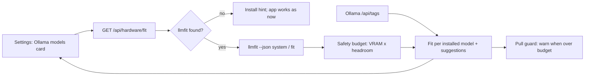

# Task: Step 6, Hardware Fit with llmfit

## Goal
Let each user see which local models their hardware can run, so they choose their own models with evidence. llmfit is optional and recommended: when it is installed, the app shows hardware fit; when it is not installed, the app works as it does now and shows how to install it.

## Constraints & Context
- llmfit is never required. A missing binary, an old version, a timeout, or bad JSON gives "not available", not an error, and every current feature works.
- The app only reads. It runs only the read-only subcommands `system`, `fit`, and `plan`, with no shell, and with a timeout. It never runs `bench --share`, downloads, or serve. llmfit contacts only the local Ollama for these commands.
- Our own safety budget decides the label, not llmfit's `fit_level` alone. The measure shows why: llmfit labels a model "Perfect" at 99% of VRAM, and this machine had blue screens under heavy GPU load.
- The user decides. The app does not pull, delete, or switch models by itself. The existing 9B pull limit stays.
- GPU limits for the checks: llmfit loads no model, so its commands give no GPU load. Tests use saved JSON samples, not the real binary.
- The demo site uses a saved sample, so no hardware is read in the browser.
- Each step needs the user's "Yes, apply it". Push only after the user approves.

## Acceptance Criteria
- [x] Plan approved by the user, with the decisions on the safety margin, the setup default, and the pull guard. (2026-11-08: 75% VRAM budget; installed by default; warn and confirm)
- [x] MH-1: the pinned llmfit version is measured on this machine: JSON samples, Ollama mapping coverage, run time, and the PyPI wheel. Test fixtures use made-up hardware values. (2026-11-08: v1.1.20; fixtures are made in MH-2)
- [x] MH-2: a backend client finds llmfit, checks its version, runs it safely, and parses only the fields we use. Tests cover missing binary, old version, timeout, bad JSON, and a good sample. (`9b7b2be`, 12 of 12 mutants)
- [x] MH-3: `GET /api/hardware/fit` gives the hardware, the safety budget, a label for each installed Ollama model, and suggestions that map to Ollama tags. The pull route warns when a model is over the budget. (`1f96f22`, 12 of 12 mutants)
- [x] MH-4: the Ollama models card shows the fit labels, the suggestions, and an install hint when llmfit is missing. Unit tests, E2E with the mock, and the demo pass. (`1b1939a`, 15 of 15 mutants)
- [x] MH-5: `setup.sh` installs the pinned llmfit by default, with a flag to skip it, and a failure does not stop setup. A docs page with a flow diagram explains the feature. The README names it. (`1535e07`, 5 of 5 mutants)
- [x] MH-6 (optional): MLflow evaluation runs record the hardware profile, so results from different machines can be compared. (`2aa6127`, 5 of 5 mutants)

## Status
`done` (2026-11-09: all criteria met; CI run 42616304211 green)
