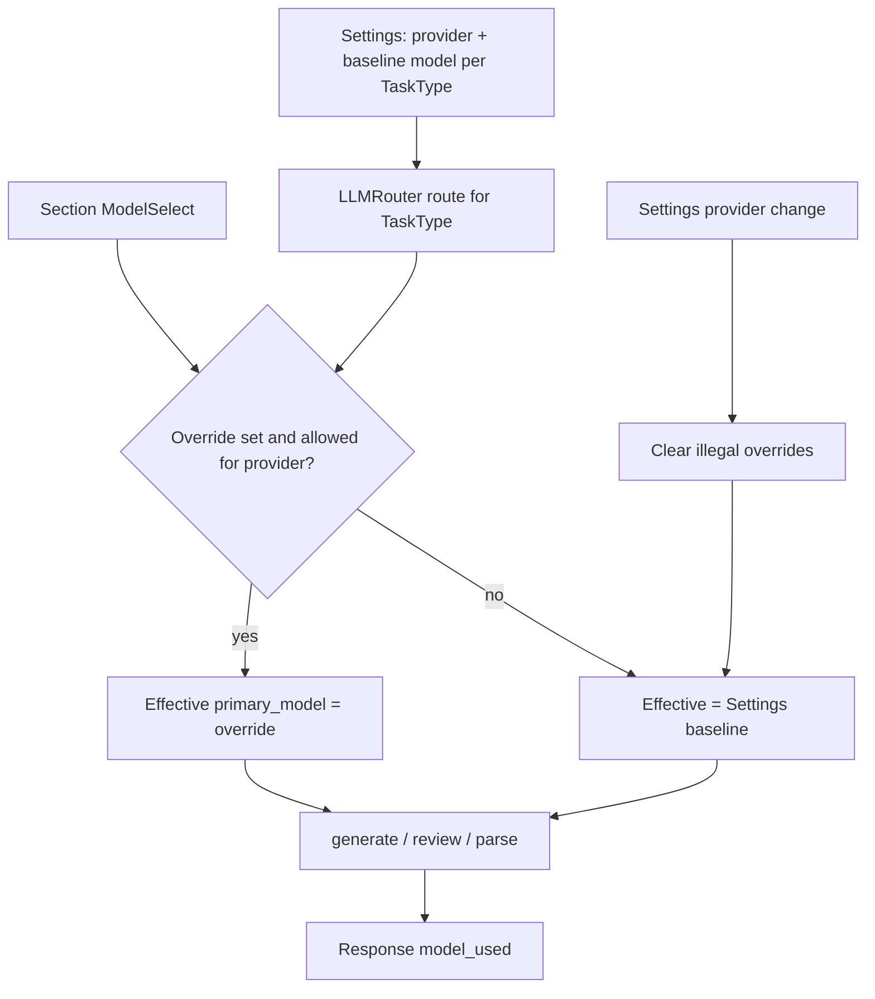
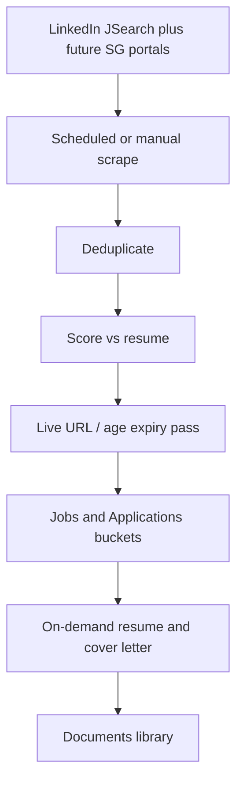
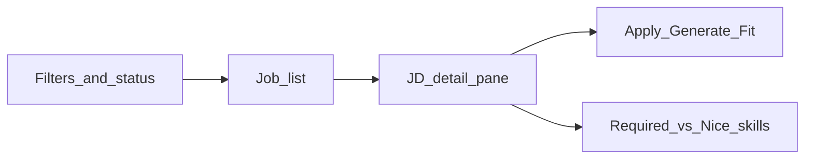
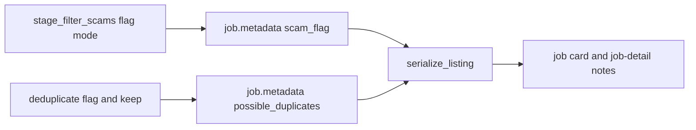

# Backlog

Parked work and design notes. Read this file only when you choose new work (`tasks/index.md`). To start an item, add it to `tasks/todo.md` and create its task folder in `tasks/active/`.

The items below moved here from the Backlog section of `tasks/todo.md` on 2026-10-24, without changes.

### Open questions

- Allow LinkedIn country hosts such as `sg.linkedin.com`? (Step 2, not blocking.)

### Flaky Mobile Chrome navigation smoke test (2026-10-19)

`tests/e2e/smoke.spec.ts:86` ("Primary navigation", Mobile Chrome project) times out after 30 s while it waits for `locator('nav').getByRole('link', { name })`. It passes on retry. The page is different each run, and it also fails on commits with no frontend change:

| Commit | Flaky | Pages |
|--------|-------|-------|
| `63e5e0a` | 0 | none |
| `39ce749` | 2 | Dashboard, Assessment |
| `3ae8a9e` | 1 | LinkedIn Analysis |
| `428977c` | 0 | none |
| `ca030d2` | 2 | Dashboard, Resume Analysis |
| `b5ecfed` | 1 | Metrics |
| `5a8232f` | 2 | Jobs, Career Coach |

- [x] Step 1: Find the root cause. Candidates: the mobile navigation sheet is not open or not ready when the test clicks; `next dev` compiles the route on first visit.
- [x] Step 2: Fix the test or the navigation, so that the test does not need a retry. Do not only raise the timeout.

**Root cause:** On mobile, `locator("nav")` also matched the desktop sidebar `nav` that stays in the DOM under `hidden md:flex`. The test clicked the hamburger and then raced that hidden nav before the sheet dialog was ready.

- [x] Step 3 (reopened 2026-10-20): The test flaked again in a local full run (Docker `node:20` from Windows, after the R2 fix; E2E mocks the API, so the fix does not touch this path). Mobile Chrome "opens the Settings page": a `toBeVisible` check in `navigateTo` failed after 7.1 s, then the test passed on retry. The dialog-scoped locator fixed the hidden `nav` race, but a tap on "Open navigation" before hydration can still be lost, so the sheet does not open. Candidate fix: repeat the open click until the dialog is visible (`expect(...).toPass()`), or wait for a hydration signal before the click. Watch the next CI runs.

**Review (2026-10-19):** Added a screen-reader `SheetTitle` ("Navigation") on the mobile sheet. The smoke helper opens the sheet, waits for `getByRole("dialog", { name: "Navigation" })`, and clicks the link inside that dialog. Desktop clicks use `aside`. `--repeat-each=10` on Mobile Chrome smoke: 140 passed, 0 flaky. Full Playwright suite: 42 passed.

**Done (2026-10-21):** `navigateTo` retries open until the Navigation dialog is visible (`expect(...).toPass`), and skips a second click when the dialog is already open. Soft-nav and 404 gotos also allow up to 60 s on cold `next dev` (Docker bind mounts). Proof under load (Vitest in a second container): Mobile Chrome smoke `--repeat-each=20 --retries=0` → 280 passed, 0 failed. Full Playwright suite (clean `.next`): 42 passed, 0 failed.

### Test and E2E hardening (2026-10-21)

- [ ] `tests/unit/agents/test_task_store.py::test_records_expire_after_ttl` flaked once in a full run. `TaskStore` (`src/agents/task_store.py`) measures age with `datetime.now()`, the wall clock, which can jump in WSL2, and the test leaves a 50 ms margin (TTL 1.05 s, sleep 1.1 s). Use `time.monotonic()` for the TTL check.
- [ ] Run Playwright against a production build (`next build` and `next start`) instead of `next dev`, so tests do not wait for on-demand compiles. Then set the navigation timeouts in `tests/e2e/smoke.spec.ts` and `basic.spec.ts` back to 15 s.

### Full-mode resume generation (2026-10-28)

Found in the Step 3.6 real runs (Docker, dry run, MyCareersFuture). They belong to the Step 1 manual check.

- [ ] With `qwen2.5:14b` as the writing model, resume generation failed with `'dict' object has no attribute 'lower'` (run `run_4a13f7167ed1`, first job). **Cause found (2026-10-28):** the writer prompt says "Group by category", the model returns skills as a list of objects, and `validator.py:116` calls `.lower()` on each one. Fix in progress: `tasks/active/resume-generation-fix/` (MH-1, MH-2).
- [ ] With `qwen2.5:3b` and `qwen2.5:7b`, the resume validator rejected both drafts (`MISSING_PROJECT`, `HALLUCINATED_SKILL`; run `run_9743c03ff714`), so the run generated 0 resumes. **Causes found (2026-10-28):** the selector must return 3 projects and pads a 2-project profile with `"None"` or an invented name; a dict of skill categories makes the validator check the category names; project names must match exactly. Fix in progress: `tasks/active/resume-generation-fix/` (MH-1 to MH-4).
- [ ] `docker compose up` started from WSL gave the backend container an empty data folder: the bind mount used the WSL path `/mnt/d/...`, which Docker Desktop did not map to the D: drive here. The container had no profile, settings, listings, or catalog, and its writes did not reach the disk. Started from PowerShell, the same mount works. Document "start Compose from PowerShell" (or a mount check at startup that fails when `data/profiles/` is empty but the host folder is not) in the README. *(Source: 2026-10-28)*
- [ ] The GPU monitor printed "VRAM usage at 96%, falling back to CPU" during resume generation, so some calls ran on the CPU while other processes held GPU memory. Check the threshold and say on the page when a call falls back to the CPU. *(Source: 2026-10-28)*
- [ ] Settings allow a writing model (`qwen2.5:14b`, 9.0 GB) that does not fit in an 8 GB GPU next to the selection model, so Ollama changes models for each call (about 2 to 4 minutes for each resume). Show a warning in Settings when the two models do not fit in the GPU memory together.

### Tests write into the real data folder (2026-10-28)

- [ ] Three tests in `apps/backend-py/tests/integration/test_pipeline.py` (`test_pipeline_with_mock_scraping`, `test_pipeline_hooks`, `test_pipeline_result_summary`) run `PipelineOrchestrator.run` with no `results_dir`, so each test run writes `pipeline_run_*.json` into the real `apps/backend-py/data/results/` and empty `all_*.json` files into `data/listings/`. Give them temporary folders, and add a check like the Step 3.6 data proof that covers all of `data/` (not only `data/metrics/` and `data/mlflow.db`). *(Source: Step 3.6 real run, 2026-10-28; these files were first taken for a user run)*

### Small follow-ups from completed work (2026-10-18)

These items were still open inside completed sections. Each line names its source in the archive.

- [ ] mypy reports pre-existing typing issues across the backend. *(Source: Phase 47; 195 mypy errors on 2026-10-18; review Step 1 covers this)*
- [ ] Test DISC assessment end-to-end *(Source: Phase 36 backlog; no E2E spec covers DISC on 2026-10-18)*
- [ ] Expand fixtures from real pastes during job hunt (keep PII out) *(Source: Paste-JD unstructured to structured (2026-08-07))*
- [x] Metrics: cache hit rate already sketched on cost tracker — make real *(Source: LLM caching strategy; `CostTracker.track_call` is never called on 2026-10-18. Done in Step 3.6, 2026-10-28: the router records each cache hit, and the run files and MLflow have the cache hit rate.)*
- [ ] Prefer YAML single source where Python duplicates templates *(Source: LLM caching strategy)*
- [ ] Document minimum token thresholds / providers that no-op below size *(Source: LLM caching strategy)*
- [ ] Gemini CachedContent only if fallback volume justifies it *(Source: LLM caching strategy)*
- [ ] Document VRAM tradeoff *(Source: LLM caching strategy)*
- [ ] Abandon if idle CPU / main-thread cost is noticeable; do not add Three.js *(Source: Optional cinematic atmosphere)*
- [ ] Handle non-Easy Apply jobs (external site redirect) — flag, surface in UI, pre-fill clipboard *(Source: Phase 31 backlog; decide on Easy Apply first; see review Step 5)*
- [ ] Add resume upload handling in form filler *(Source: Phase 31 backlog; decide on Easy Apply first; see review Step 5)*
- [ ] Add frontend UI for LinkedIn auto-apply configuration and monitoring *(Source: Phase 31 backlog; decide on Easy Apply first; see review Step 5)*
- [ ] `src/submission/submitter.py:201` and `:210` call `info.job.source.value`, but `JobListing` stores enum values (`use_enum_values=True`), so `source` is a string and these lines raise `AttributeError`. Only the real auto-submit path reaches them; a dry run returns earlier (`submitter.py:113`). Fix them with the Easy Apply decision. *(Source: Step 3.6 real run, 2026-10-28; the same bug in `stage_present_selection` is fixed; see review Step 5)*
- [ ] DISC: Extra results visualizations (radar on results, bars toggle, match-gap charts, view toggle) *(Source: DISC assessment improvements, standby ideas)*
- [ ] DISC: Richer role recommendations aligned to AI Eng / SWE+AI / DA ladder with trait-driven explanations *(Source: DISC assessment improvements, standby ideas)*

### Pipeline duration / progress honesty

**Status:** Deferred — do after Discover → Jobs is stable.

**Idea:** Improve scrape/run feedback beyond the existing stage progress bar.

- [ ] Cancel does not stop `generate_resumes`: the cancel check runs only between stages, so a cancelled 20-job run kept generating for about an hour and shared the GPU with the next runs. Check the cancel flag between jobs in the resume loop, and say on the page that the run stops after the current job. *(Source: Step 3.6 real runs, 2026-10-28)*
- [ ] Elapsed timer on live monitor while a run is active
- [ ] Final `duration_seconds` surfaced clearly on complete + history rows
- [ ] Optional: per-stage timings (scrape usually dominates)
- [ ] Optional later: ETA from prior runs (stage-weighted; avoid fake global %)

**Note:** A smoother 0–100% bar alone is lower value than elapsed + stage timings for network-bound scraping.

### Ops and quality ideas (2026-07-21)

Source: archive, "Future-Considerations Plan (2026-07-21)", items 4 to 10. None of these items has started.

#### Frontend E2E coverage for the audit area

**Why:** The pipeline start fix and profile state are exactly the kind of cross-system behavior that should be covered by Playwright.

- Add a Playwright spec that uploads a resume, waits for profile load, starts a pipeline, and asserts a run id is returned.
- Run the spec in CI against the local backend (`make dev` stack).

#### Dependency lock file

**Why:** Fresh installs currently resolve against `requirements.txt` ranges, which can drift between machines and CI runs.

- Generate `apps/backend-py/uv.lock` or `requirements-lock.txt` from a working environment.
- Update CI to install from the lock file in the test/lint jobs.
- Keep `requirements.txt` as the human-editable source of truth.

#### Re-enable shared services (Ollama / MLflow) as opt-in

**Why:** The audit removed the external `shared-services` network to make `docker compose up` work out of the box, but the shared-services pattern is still valuable for advanced users.

- Add an override file `docker-compose.shared-services.yml` that re-attaches backend to `shared-services` and disables the internal `mlflow` service.
- Document the two modes: standalone (default) and shared-services (advanced).

#### Health-check consolidation

**Why:** Health endpoints exist in FastAPI and Docker but are not exercised automatically.

- Add a lightweight `scripts/health-check.sh` that polls `/api/health`, `/api/jobs/sources`, and the frontend proxy until all return 200.
- Call it from `make dev` after startup and from CI as a final smoke step.

#### CI artifact retention

**Why:** CI uploads Playwright reports and screenshots but the retention policy and artifact names are basic.

- Add unique artifact names per run (e.g., `playwright-report-${{ github.run_id }}`) and a 7-day retention.
- Only upload screenshots on failure to keep artifact sizes small.

#### Documentation debt sweep

**Why:** Several docs still reference the Streamlit frontend or outdated project paths.

- Audit `docs/usage.md`, `docs/architecture.md`, `docs/troubleshooting.md`, and `DOCKER.md` for stale references to `frontend-py/`, `backend-py/`, or removed files.
- Update diagrams to the current Next.js + FastAPI + shared-services/standalone layout.

#### Observability basics

**Why:** The system has Sentry and MLflow hooks but no local tracing for debugging user-reported issues.

- Add structured request logging middleware in FastAPI with correlation IDs.
- Expose a `/api/health/details` endpoint with git commit, Python version, and dependency versions.
- Add a frontend error boundary report that captures the correlation ID.

### Appearance presets UX (Odysseus-inspired, Settings-housed)

**Status:** Roadmap only — keep themes inside Settings (not a separate Theme mini-window).

**Inspired by Odysseus (display / structure, not a clone):**
- Themes tab: grid of preset cards with 3 overlapping color swatches + name; clear selected border
- Customize tab (later): Colors (bg/panel/border/text/sidebar/accent), Color harmony (accent + complementary/etc.), Font & layout (font, density, optional frost), Reset / save-export optional

**Job Raider differences:**
- Live under Settings — Appearance (same place as cinematic), not a popped Theme window
- Curated Raid-branded catalog (include our own presets Odysseus does not have)
- Still remap CSS tokens via ``data-scheme`` (+ optional overrides later)

#### Preset catalog (curated)

| Preset | Status | Notes |
|--------|--------|-------|
| Raid (default) | Shipped | Current red ops look |
| Neon | Shipped | Cyan / magenta |
| Retrowave | Shipped | Hot pink / electric blue |
| Gunmetal | Shipped | Steel ops (ours) |
| Terminal | Shipped | Console green |
| Hackerman | Shipped | Black / neon-green matrix ops |
| Midnight | Shipped | Calm dark blue |
| Paper | Shipped | Light print-like |
| Forest | Shipped | Nature green |
| Ocean | Shipped | Teal / deep blue |
| Copper | Shipped | Warm metal |
| Stained glass | Shipped | Jewel gold / violet (token remap; frost later) |
| Skip / deprioritize | - | gpt, claude, cute, organs, lavender unless novelty pack wanted |

#### Phased checklist

- [x] Replace Appearance scheme Select with swatch-card grid (Raid / Neon / Retrowave first)
- [x] Add remaining curated presets (Gunmetal through Stained glass)
- [ ] Settings Appearance sub-tabs: Themes | Customize (Customize behind feature completeness)
- [ ] Customize: token color pickers writing CSS variables; Reset to preset
- [ ] Optional later: harmony generate, density, frost (cinematic already covers motion wash)
- [ ] Stained glass frost: optional backdrop-filter on cards/sidebar only

#### Review (2026-08-06)

- Curated catalog shipped: Raid, Neon, Retrowave, Gunmetal, Terminal, Hackerman, Midnight, Paper, Forest, Ocean, Copper, Stained glass.
- Light + dark CSS token packs via ``data-scheme``; Settings swatch-card grid (3–4 cols).
- Frontend CI (Node 20 Docker): lint, type-check, format, scheme tests (8), build passed.

### ScrapeGraphAI / LLM detail enricher (standby)

**Status:** Considerations captured; **not implementing yet**.

**Problem to solve (only):** empty LinkedIn (etc.) job descriptions after selector/JSON-LD enrich fails.

#### Coupling rules (required if ever built)

- [ ] `JobDetailEnricher` (or equivalent) port — not imports of scrapegraphai inside scrapers
- [ ] Fallback-only after CSS/JSON-LD; never default for every listing
- [ ] Soft/optional dependency; feature flag + per-run cap
- [ ] Keep `JobListing.description` contract for score/RAG/shortlist
- [ ] Leave JSearch and search-card scrape unchanged

#### Go / no-go before any PR

- [ ] Measured win on empty-JD rate vs current enrich
- [ ] Latency/VRAM acceptable under Ollama load
- [ ] Session/auth story clear (reuse Playwright context or document out of scope)
- [ ] Schema-constrained output (no invented fields)

#### Notes

See `docs/decision-log.md` (2026-08-05). Stars are not a go signal; loose coupling is the firebreak.

### Design backlog: Per-section model dropdowns (Settings = baseline) (2026-08-13)

**Status:** Pilot in progress (2026-08-13) — Cover Letter **writer** ModelSelect shipped for testing the waters. Session-only override; no Save-as-default; provider stays in Settings. Inventories: Anthropic + Gemini catalogs selectable when those providers are active; Ollama = installed tags only; foreign models greyed.

**Problem:** Model choice today is global via Settings ``routing[TaskType]``. Switching models to A/B a cover letter (or try a larger tag for one write) forces a Settings trip and risks changing behavior for resume parse, selection, review, etc.

**Goal:** Convenient, low-friction per-surface model choice without turning every page into a second Settings panel. Settings remains the single place for **provider** and **baseline model**; surfaces may override **model name only**. Learn from a narrow pilot before generalizing.

#### Layering (locked)

| Layer | Owns | Does not own |
|---|---|---|
| Settings | Provider per task (or tier defaults), baseline model, fallbacks, Ollama host, API keys | Per-request experimentation UI |
| Section dropdown | Model name for that surface’s TaskType(s), scoped to Settings provider | Provider switch, host, keys |
| Response | ``model_used`` (and provider if useful) for audit | Mutating saved settings |

**Provider stays in Settings only.** Changing Ollama ↔ Anthropic ↔ Gemini never happens from Cover Letter / Profile / Assessment. The dropdown reacts to whatever provider Settings already set for that ``TaskType``.

#### Dropdown UX (locked direction)

When Settings primary provider for the relevant task is **Anthropic** (example):

- **Selectable (normal):** Anthropic models in the known catalog for that provider.
- **Visible but disabled (grey):** models belonging to other providers (e.g. installed Ollama tags, Gemini IDs) — still listed so the user understands why they cannot pick ``qwen2.5:7b`` until Settings switches back.
- Same pattern for Gemini and Ollama: current-provider set is the allowlist; cross-provider entries are grey denylist, not omitted silently.

**After a Settings provider swap:**

1. Recompute allowlist for every open surface.
2. If the section override is no longer in the allowlist, **clear the override** and fall back to Settings baseline for that task.
3. Optional short hint: “Previous model unavailable for Anthropic — using Settings default.”

**Grey-list composition (mostly locked; size still open):**

- Foreign provider entries come from the **Anthropic** and **Gemini (GCP)** curated catalogs, plus **installed** Ollama tags only.
- **Still open:** grey = full foreign inventories vs only baselines / last-used (full is clearer; last-used is quieter).

#### Surface → TaskType mapping (efficiency)

Do **not** put one “LLM model” control on a page that runs multiple tasks. Wire dropdowns to ``TaskType``:

| Surface (pilot candidates) | Dropdown(s) | TaskType |
|---|---|---|
| Cover Letter | Writer | ``cover_letter_writing`` |
| Cover Letter (when review on) | Reviewer | ``cover_letter_review`` |
| Profile / resume upload | Parse | ``resume_parsing`` |
| Resume generation | Selection + Writing | ``selection``, ``resume_writing`` |
| Assessment | Gen / Eval | ``assessment_generation``, ``assessment_evaluation`` |

**Efficiency rules:**

- Default selection = Settings baseline for that TaskType (label: “Settings default (qwen2.5:7b)” or equivalent).
- One-click **Reset to Settings default** clears the override.
- Show current effective model near Generate (and keep ``model_used`` in results).
- Do not require opening Settings to confirm what will run.
- Only show a dropdown on surfaces where model choice actually changes outcomes users care about (start with Cover Letter writer ± reviewer). Background/pipeline tasks can stay Settings-only longer.

#### Override persistence (open — pick before implement)

| Option | Pros | Cons |
|---|---|---|
| **A. Session / tab only** (local React state or sessionStorage) | Safest; no surprise tomorrow | Lost on refresh |
| **B. Per-surface sticky** (localStorage, not backend settings) | Convenient for multi-day A/B | Can drift from Settings; must invalidate on provider change |
| **C. Persist into Settings routing** on every change | Single source of truth | Destroys “baseline vs experiment”; not recommended |

**Recommendation for pilot:** **A**, with optional promote control “Save as Settings default” that writes that TaskType’s ``primary_model`` only (provider unchanged).

#### API / router contract (when built)

- Request body optional ``model`` (or ``model_overrides: { task_type: model }``) for generate/validate/review endpoints that need it.
- Router: for that call only, if override is non-empty **and** allowed for the route’s ``primary_provider``, use it as ``primary_model``; else ignore and use Settings route.
- **Never** change saved Settings from a generate call unless the user explicitly hits “Save as default.”
- Reject or ignore cross-provider model names server-side (UI greying is not enough).
- Kind-A response cache keys must include the effective model so overrides do not return another model’s cached body.

#### Model inventories (locked 2026-08-13)

External providers for v1 are **only** Anthropic and Google (GCP / Gemini). No other cloud providers in the section dropdown.

| Provider (Settings) | Selectable models in section dropdown |
|---|---|
| **Anthropic** | Curated Anthropic console / API model IDs from Job Raider’s model catalog (``model_config.yaml`` / Settings models API ``anthropic`` list) — not free-text |
| **Gemini (GCP)** | Curated Google Gemini / GCP model IDs from the same catalog (``gemini`` list) — not free-text |
| **Ollama** | **Installed tags only** from live discovery (``ollama_installed`` via ``resolve_effective_ollama_host``). Do **not** offer YAML-catalogued Ollama names that are not actually pulled |

**Grey / disabled entries** when the Settings provider is e.g. Anthropic: show Gemini catalog models + currently installed Ollama tags as grey text (and vice versa). Do not invent uninstalled Ollama tags just to fill the grey list.

**Settings vs section (pilot stance):** For the experiment, only the **section dropdown** must follow the inventories above (Ollama = installed-only; Anthropic / Gemini = curated catalogs). Whether Settings’ own Ollama picker stays catalog∪installed or also goes installed-only is **deferred** — decide after the pilot. Do not block Cover Letter on Settings UI consistency.

Dropdown disabled or linked to Settings when the provider has no usable inventory (empty install list, missing API key, unreachable Ollama host).

#### Non-goals (v1)

- Per-page provider switcher.
- Free-text arbitrary model IDs.
- Overriding fallback provider/model from the section UI.
- Changing Ollama host or API keys from a feature page.
- Forcing every pipeline stage to expose a dropdown on day one.
- Offering uninstalled Ollama catalog entries as selectable (or as “available”) in the section UI.
- Adding Azure OpenAI / other clouds until explicitly productized.

#### Open questions (resolve before coding; OK to stay soft during pilot)

1. Session-only vs sticky localStorage for overrides? (**Lean A / session for pilot** so a failed experiment leaves no sticky mess.)
2. Grey list = foreign full catalogs + installed Ollama, or only baselines / last-used?
3. Cover Letter pilot: writer only, or writer + reviewer as two controls? (**Lean writer-only first.**)
4. Should “Save as Settings default” exist in v1 at all? (**Lean no for first pilot** — Settings remains the only way to change baseline.)
5. Writer override applies to review rewrite that reuses ``COVER_LETTER_WRITING``? (Yes if rewrite shares that TaskType.)
6. Align Settings Ollama picker with installed-only? (**Deferred** — not part of testing the waters.)

#### Suggested pilot order

1. [x] Ship the smallest Cover Letter **writer** ModelSelect + optional request ``writer_model`` override + router allowlist (inventories above).
2. Use it for a few real letters; note friction (grey list noise, wrong default, provider swap confusion).
3. Only then: reviewer dropdown, sticky persistence, Save-as-default, other surfaces, Settings picker alignment.
4. If the pattern feels wrong, remove the section control and keep Settings-only — low sunk cost by design.

#### Flow

**Priority:** Medium — UX quality / workflow efficiency; not blocking job-search use of current Settings routing.

### Design backlog: Learnings from SG Jobs Dashboard (2026-08-13)

**Note (2026-10-18):** Items 1 to 3 of the suggested order below have shipped: listing lifecycle v1, MyCareersFuture, Careers@Gov, and JobStreet Singapore. See the archive. Items 4 and 5 are still open.

**Status:** Future plan only — **do not start new job portals until the current LinkedIn / JSearch / Cover Letter / Profile stack is solid.** MyCareersFuture, Careers@Gov, and JobStreet are **important** next sources (not optional nice-to-haves), but they wait on current-state quality.

**Source (public, personal project):**
- Post: multi-portal SG scrape + resume scoring + ATS resume/cover letter + daily expire cleanup
- Dashboard: [JunRong19/SG-Jobs-Dashboard](https://github.com/JunRong19/SG-Jobs-Dashboard)
- Pipeline: [JunRong19/SG-Jobs-Scraper](https://github.com/JunRong19/SG-Jobs-Scraper)

**Do not copy their code.** Use the shape of the product as a checklist against Job Raider. Their stack (Supabase + LiteLLM + OpenAI) is not a migration target; Job Raider already has local Ollama routing, FastAPI, Next.js, and file-backed storage.

#### Overlap (Job Raider already covers)

| Their feature | Job Raider today |
|---|---|
| Scrape LinkedIn into one dashboard | LinkedIn + JSearch + manual paste |
| Score listings vs resume 0–100 | Score / rank + semantic re-rank + fit explain |
| Tailored resume + cover letter | Resume generation + Cover Letter (grounded) |
| Track applications | Applications dashboard + custom statuses |
| Next.js + Python | Same shape (frontend-ts + backend-py) |

#### Gaps worth learning from (priority order)

1. **Job lifecycle (highest product value, source-agnostic)**
   - Auto-expire stale listings (age / last-seen).
   - Recheck whether a posting is still live on the source URL.
   - Hide or bucket expired jobs instead of leaving dead cards in Jobs / Applications.
   - Their UI: buckets Total / Applied / In-progress / Not interested / Rejected / **Expired**, plus a **Scraped Today** toggle.
   - Job Raider has no listing `expired` / live-status pass today (`JobSource` is linkedin / jsearch / manual / other only).

2. **Singapore-local sources (important — after current state is solid)**
   - **Must consider (not optional):** MyCareersFuture, Careers@Gov, JobStreet.
   - These are first-class SG search channels that LinkedIn + JSearch do not fully cover (public sector, gov portal, Seek/JobStreet inventory).
   - Treat as new ``JobSource`` adapters behind the existing scraper manager, not a second dashboard.
   - **Constraint:** scraping may violate site ToS. Prefer official/public APIs where they exist (especially MyCareersFuture). Same legal caution Job Raider already takes on LinkedIn.
   - **Sequence lock:** do not add adapters until Discover, scoring, cover-letter grounding, profile parse, and listing hygiene on the current two sources feel reliable in daily use.

3. **Scheduled daily pipeline (ops, not UI)**
   - Their scripts: scrape → score → generate top-match docs → expire/delete inactive.
   - Job Raider pipeline is operator-triggered. A daily schedule (Discover + score + expire) would match “set and forget” without changing generation quality.
   - Keep generation on-demand unless we explicitly want auto-docs for top-N (cost / grounding review risk).

4. **Documents library**
   - One place for every generated resume and cover letter, with in-browser PDF preview.
   - Job Raider generates per job / Cover Letter page but does not present a global library of artefacts.

5. **Re-score after customizing a resume**
   - Their `score_jobs.py` re-scores jobs that already have a tailored resume.
   - Useful later: after generating a tailored resume, refresh fit score against that variant, not only the base profile.

#### Explicit non-goals (from this comparison)

- Replacing the LLM router with LiteLLM / locking to OpenAI.
- Moving storage to Supabase.
- Cloning their junior/entry-level-only filter as a hard default (Job Raider already has target-job + apprenticeship constraints).
- Auto-generating a resume PDF for every scrape hit (wasteful; keep generate-on-apply).

#### Suggested future order (when current state is solid)

0. **Now:** Perfect current sources and generation (LinkedIn, JSearch, manual paste, scoring, grounded cover letters, profile SoT, model-select pilot). No new portal work in this phase.
1. Listing lifecycle on **existing** listings: last-seen, expire, live URL check, Expired bucket + Scraped Today filter (pays off before new scrapers). **v1 done 2026-08-13:** catalog last-seen, age/deadline expire, Jobs hide-expired + Scraped today. **Applications Expired bucket done 2026-08-14.** Still open: live URL HEAD check (optional; ToS / flaky LinkedIn).
2. MyCareersFuture adapter (structured expiry; important SG inventory).
3. Careers@Gov and JobStreet adapters after MCF proves the pattern and ToS stance.
4. Documents library of generated artefacts.
5. Optional daily schedule wrapping existing pipeline stages.

#### Flow (target, not current)

**Priority:** Medium — those three SG boards matter for coverage, but **current-state quality is the gate**. Not blocking job search on LinkedIn/JSearch today.

### Jobs desk inspired by SupCareer (parked)

Preferred direction when Jobs UX is next opened. Not the next mandatory sprint.
Roadmap: `C:/Users/James/.cursor/plans/jobs_desk_future_073ad2df.plan.md`

**Grounding rule:** Prefer structured JD skill extractor output. Use description heuristics only when structured skills are empty, and always treat them as inferred. Never present heuristic skills with the same confidence as extractor-backed skills.

**Pause gate:** Pure UI/layout (Step A shell, pane chrome, nav clustering that only moves links) may proceed alone. Any work that changes cover-letter generate, JobMatcher/fit scoring, or skill extractor / JD skill claims requires a deliberate pause and re-approve before Step B or C starts (or before merge if exploration already began).

#### When Jobs UX is next opened

- [ ] **Step A (UI-only):** Jobs master–detail shell + open-in-pane. No claim/fit/skill changes. May start without the pause gate.
- [ ] **Pause checkpoint:** Before Step B or C, stop for review if the work touches generate wiring, JobMatcher/fit, or skill extractor / claim presentation.
- [ ] **Step B:** Prefill Cover Letter / resume generate from the selected listing. Pause if any generator or matcher change goes beyond prefill handoff.
- [ ] **Step C:** Required / nice-to-have skill chips; inferred flag on heuristic fallback. Pause before extractor or fit-facing skill claims. Tests must cover the inferred path.
- [ ] **Step D:** Saved / Applied / Not applied + seniority chips. Reuse Applications state; pause if scoring changes.
- [ ] **Step E (UI-only):** Cluster analysis tools under secondary nav so primary stays Profile → Jobs → Applications → generate tools.

Each step is its own small PR with tests. Do not start Step A until Jobs UX work is explicitly opened.

**On first implementation:** Add a short decision-log entry: Jobs desk follows SupCareer-style master–detail and on-job actions; keep Job Raider grounding and local-first identity; inferred skills never share confidence with extractor skills.

**Existing hooks:** `apps/frontend-ts/src/app/jobs/page.tsx`; Applications tracker; Cover Letter paths + assess / explain fit APIs; `apps/backend-py/src/extractors/paste_job.py` and listing models.

**Out of scope to copy:** Purple consumer SaaS theming, Headshot, Premium upsell, Community chrome; shallow match CTAs that replace Pipeline / Metrics / grounding depth; three-pane layout on every page; heuristic JD skills shown as structured extraction facts.

**Related parked item (separate):** Fresh-grad assess routing (auto-detect via `career_stage` vs explicit UI/API toggle for `fresh_grad_mode`).

### Scam detector refinement — evolving outreach patterns (parked)

Not the next mandatory sprint. Keep as a living backlog because scam tactics change faster than static rules.

**Source cue (2026-09):** Field report of polished HR-impersonation after a real company apply: offer without interview, WhatsApp as easy contact, SMS follow-up on email. Company and copy looked legit; behaviour did not match real HR. Suspected job-portal CV harvest (email + phone + target role). Singapore retrenchment context raises seeker urgency.

**Gap vs current detector:** Listing `JobScamDetector` and cover-letter `_scan_scam_flags` already cover messaging apps, personal email, no-interview / immediate-hire, and weak grammar or fake company. They miss (1) offer / contract language without a hiring process, (2) legit company + AI-clean copy, (3) multi-channel chase after apply (email → WhatsApp → SMS), (4) portal data-exposure product questions.

#### When scam detection is next opened

- [ ] **Listing / assess flags (cheap):** Add patterns for offer-before-interview, contract / onboarding without assessment, and HR contact via WhatsApp/Telegram paired with urgency or “we received your application.” Keep results as flags to review, not a hard “employer is fake” verdict. Extend tests so new patterns do not regress.
- [ ] **Separate surface (later):** Optional screening or tips for inbound recruiter email/SMS (offer without interview, SMS chase, lookalike domains). Not a JD-only change.
- [ ] **Product / privacy note (later):** Document that portals can expose CV contact data; seeker guidance when saving or applying. Out of scope for regex scoring alone.
- [ ] **Review cadence:** Revisit indicator set when new field reports land; prefer small PRs and evaluation notebook updates over a big rewrite.

**Existing hooks:** `apps/backend-py/src/scoring/scam_detector.py`; cover-letter `_scan_scam_flags` in `apps/backend-py/src/api/routes/cover_letter.py`; pipeline `filter_scams`; `notebooks/scam_detector_evaluation.ipynb`.

**Input from Step 3.3 (2026-10-25):** the "Known limits of B1" and the findings in "Review of the B1 fix round" (Step 3.3 `notes.md`) list what the R3 patterns still miss or flag: the closed contact-verb list, the negation guards, the phrase anchors, and the shapes outside the B1 list. Start a later rule change from that list, with phrase tests first and a probe set that the fixer has not seen.

**Do not start** until scam-detection work is explicitly opened. Prefer additive indicators and clearer seeker-facing copy over lowering the bar with noisy false positives.

#### Learned classifier on EMSCAD (parked 2026-10-25, Step 3.3 option c)

The EMSCAD tuning baseline of 2026-10-25 (`tasks/archive/step-3-3-scam-set/notes.md`) shows that the rule detector does not detect EMSCAD frauds: recall 0.007 at 0.7, and no threshold beats flagging every row. Step 3.3 fixes only the false positives (option a). If a detection number is wanted later, open a separate step:

- Train a simple classifier (for example TF-IDF and logistic regression) on the EMSCAD tuning part only, and judge it one time on a held-out part. The Step 3.3 held-out part is used up after Stage B, so this needs a new split decision.
- State the limit: EMSCAD postings are from 2012 to 2014, mostly from the US, and their emails and links are masked, so the result does not transfer directly to current postings in Singapore.
- Decide how a model output enters the pipeline (flag to review, not a silent drop) before any code.

#### Show the scam flag to the user (parked 2026-10-25, Step 3.3 decision 9)

Since Step 3.3 Stage B, the pipeline default is `flag`: it keeps every posting and writes `job.metadata["scam_flag"]` (`quick_filter`, `confidence`, `reasons`). The user does not see this flag:

- `serialize_listing` in `apps/backend-py/src/pipeline/shortlist.py` does not send `metadata` to the frontend.
- The job-detail badge (`apps/frontend-ts/src/components/jobs/job-detail.tsx`, near line 226) reads `scam_score`, and nothing in the backend sets that field. The badge also has its own limits (0.5 "Review", 0.7 "High Risk"), which differ from `DEFAULT_SCAM_THRESHOLD`.

Before you show the flag, measure it. On the EMSCAD tuning part, all 28 quick-filter flags were on legitimate postings, so a badge on today's flags shows only false warnings. Steps when opened:

- [ ] Measure the precision of the quick filter and of the detector at `DEFAULT_SCAM_THRESHOLD` on the EMSCAD tuning part. If the flags are mostly false, fix the flag source first.
- [ ] Send `scam_flag` in the listing response, and remove the unused `scam_score` field or set it from `scam_flag`.
- [ ] Show the badge text from the flag reasons ("Review" and the reasons), not a "High Risk" verdict. Read the limit from the shared default, not from a second number in the frontend.
- [ ] Tests: the serializer sends the flag, and the badge shows only when the flag is present.
- [ ] **Possible duplicates (added 2026-10-26, Step 3.5 decision 6).** After Step 3.5 Stage B, `deduplicate` keeps possible duplicates and writes `job.metadata["possible_duplicates"]` (the other `job_id` and the reason). Show it on the job card and the job-detail page ("Possibly the same as ..." with a link), through the same serializer change. The user applies to each listing, so the note informs and does not hide a listing.

#### Employer and recruiter verification (later)

- [ ] **Deterministic checks first:** Recruiter email domain vs official company domain, lookalike-domain detection (for example `companyx-careers.com`), domain age via WHOIS, and role present on the official careers page. Small Python checks; same answer every run.
- [ ] **Agent research layer (optional, on request only):** Evaluate DeerFlow (ByteDance, v2.0 rewrite released February 2026, built on LangGraph and LangChain) or a similar agent harness when it matures. Use cases: verify a specific employer or recruiter contact with cited sources, and periodic research on new scam tactics to propose indicators for human review.

**Agent layer rules:** Never run inside `filter_scams` or cover-letter assess (volume, latency, cost, and non-deterministic output). Findings show as sourced flags to review, never an automatic scam verdict. New indicators need human review before they enter `scam_detector.py`. Re-assess DeerFlow maturity, sandbox security (bash access), and local-model performance before any spike. Borrowing ideas (Markdown skills, isolated research sub-agents) without the framework is also an option.
