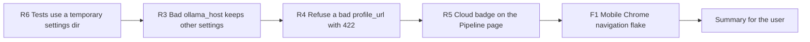

# Handoff: Step 2 Review Follow-ups R3 to R6 and the Mobile Chrome Flake (2026-10-20)

Read this file first. Then read `CLAUDE.md` (project rules), "Step 2 review (2026-10-20)" in `tasks/todo.md` (under **Now**), the Backlog item "Flaky Mobile Chrome navigation smoke test" in `tasks/todo.md`, and `tasks/lessons.md` (the last section, "Reviewing security changes"). The check commands are in section 4 of `tasks/handoff-2026-10-19.md`. Section 4 of this file changes how to run Docker.

The user will review your work after you finish.

## 1. Status

| Item | State |
|------|-------|
| `main` | `295df21`, pushed to `origin/main` on 2026-10-20. |
| CI | Run 39440831220 for `295df21` passed all 11 jobs (Docker build skipped by design): backend 1,087 passed, mypy gate 182 known and 0 new, Vitest 43 files passed, Playwright 42 passed and 0 flaky. The flake in F1 showed up in a local run, not in this CI run. |
| Step 2 | Steps 2.1 to 2.6 and the review blockers R1 (`931c83d`) and R2 (`295df21`) are done and pushed. |
| Open review items | R3 to R10 in `tasks/todo.md`. This handoff covers R3, R4, R5, R6, and the flake. R7 to R10 stay open. |

## 2. The task

Do the items in this order. R6 is first because, until it is fixed, every pytest run resets the user's real settings file (`apps/backend-py/data/settings/user_settings.json`), and you will run pytest for every other item.



For each item:

1. Write a test that fails on the current code. Run it and keep the failure output for the summary. Then make the change.
2. Prove the test with a mutation: put the old behavior back, see the test fail, restore the file, and compare the restored file with your version.
3. Where this file asks for a runtime proof, run it against the real program, not only a unit test. A unit test that builds its own input can repeat a wrong assumption (see the lesson in `tasks/lessons.md`).
4. Run all checks (section 4).
5. Tick the item in `tasks/todo.md` and add a short "Done (date)" note with the test name, the mutation, and the runtime proof.
6. Make one commit per item with a conventional subject. Do not push.

Stop and ask the user if a change needs a decision that this file does not cover.

### R6: Tests must not write the real settings file

**Problem:** `tests/unit/test_settings_api.py` calls `PUT /api/settings/`, `POST /api/settings/reset`, and `POST /api/settings/ollama-defaults`. These use `get_storage()` in `src/api/settings.py`, a module singleton that defaults to `SettingsStorage()` with the relative directory `data/settings`. Pytest runs from `apps/backend-py`, so each run rewrites the user's real file. After Step 2.4 that file also holds saved cloud API keys.

**Required behavior:** No test reads or writes `apps/backend-py/data/settings/`.

**Suggested change:** In `tests/conftest.py`, add an autouse fixture that sets `src.api.settings._storage` to `SettingsStorage(settings_dir=tmp_path / "settings")` for each test and restores the previous value after the test. Tests that patch `get_storage` themselves keep working.

**Test:** A test that asserts `get_storage().settings_file` is inside the pytest temporary directory. Before the fix it points at `data/settings/user_settings.json`.

**Mutation:** Remove the fixture. The test must fail.

**Runtime proof:** Record the modification time of `apps/backend-py/data/settings/user_settings.json` (`stat -c %y`) before and after a full pytest run. It must not change. Do not open or print the file; it can contain API keys.

### R3: A stored `ollama_host` outside the allowlist must not drop all settings

**Problem:** Step 2.6 added the `ollama_host` allowlist as a validator on `APIConfig` in `src/api/settings.py`. The validator also runs when settings load. `SettingsStorage.load_settings` catches every exception and returns defaults (and uses `print`). So a stored file with a host such as `192.168.1.5:11434` silently loses all saved settings, and the next `PUT /api/settings/` saves defaults without the stored API keys.

**Required behavior:**

- Keep the validator, so API request bodies (PUT, `/validate`, `/ollama-defaults`) still reject a host that is not allowed.
- In `load_settings`, when validation fails only because of `api_config.ollama_host`, replace that host with the default (`host.docker.internal:11434`), log a warning with the logger (not `print`), and keep every other stored field.
- Keep the current behavior for other load errors in this item. If you see a simple fix for them, write it in the summary; do not make it.

**Test:** Write a settings file to a temporary directory with `ollama_host: "192.168.1.5:11434"`, a stored `anthropic_api_key` (a fake value such as `test-key`), and one non-default routing entry. Load it. Assert that the host is the default, the key and the routing entry are kept, and a warning was logged. Before the fix the key is `None`.

**Mutation:** Restore the old `load_settings`. The test must fail.

### R4: Refuse a bad LinkedIn `profile_url` with a clear error

**Problem:** `POST /api/profile/analyze-linkedin` (check the exact path in `src/api/routes/profile.py`) takes `LinkedInProfileInput` (`src/models/linkedin_analysis.py`, line 18). A bad `profile_url` reaches `_fetch_linkedin_profile_text_sync`, which first opens a LinkedIn session and then catches the `ValueError` from `validate_linkedin_profile_url`, logs a warning, and continues with empty text. The URL is not fetched, but the user gets no error.

**Required behavior:**

- Add a `field_validator` for `profile_url` on `LinkedInProfileInput` that calls `validate_linkedin_profile_url` from `src/linkedin/profile_url.py`. A missing or blank value stays allowed (the model already requires one of the inputs). A bad value returns 422 with the validator message.
- Keep the check in `src/linkedin/session.py` (defense in depth).
- Line 162 of `src/models/linkedin_analysis.py` has another `profile_url` field. If that model is request input, validate it the same way; if it is output only, leave it.
- Do not change the allowed hosts (`linkedin.com`, `www.linkedin.com`). Country hosts such as `sg.linkedin.com` are refused today. If you think they should be allowed, ask the user; do not change it.

**Test:** Through `TestClient`: `file:///etc/passwd`, `http://www.linkedin.com/in/x`, and `https://evil.example/in/x` each return 422, and `_get_linkedin_session` is not called (patch it and assert `assert_not_called`). A valid `https://www.linkedin.com/in/someone` with `raw_text` does not return 422 (mock the analyzer and the session).

**Mutation:** Remove the validator. The 422 tests must fail.

### R5: "Cloud" badge on the Pipeline page

**Problem:** Decision 6 (Step 2) asks for a "Cloud" badge on results when the provider was not Ollama. Step 2.1 added it to the Cover Letter page only. The router already sets `LLMResponse.provider` on every response (`src/llm/router.py`, `_stamp_provider`).

**Required behavior:**

- `src/generation/resume_writer.py`: add `provider_used: Optional[str] = None` to `GeneratedResume` and set it from the `LLMResponse` returned at about line 136. The template fallback (about line 340) leaves it `None`.
- `src/pipeline/stages.py`: `_generate_cover_letter` (about line 883) also returns `provider_used` from `response.cover_letter.get("provider_used")`. The generate stage metadata (about line 833) gets `cloud_documents`: the number of generated resumes and cover letters whose provider is set and is not `ollama`.
- The Pipeline page (`src/app/pipeline/page.tsx`) uses the status response, not `/results`. Add `cloud_documents` to `PipelineStatusResponse` (`src/api/models/responses.py`), filled from the generate stage metadata when that stage has run, and show the badge next to the run state when it is greater than 0. If another way is clearly smaller, use it and explain why in the summary.
- Move the Cover Letter badge markup (`src/app/cover-letter/page.tsx`, the span with the text "Cloud") into one small shared component and use it on both pages.

**Tests:** A backend test where a fake router response has `provider="anthropic"` gives `cloud_documents == 1`, and `provider="ollama"` gives 0. A Vitest test shows the badge on the Pipeline page when `cloud_documents > 0` and hides it at 0.

**Mutation:** Do not copy the provider into the stage result. The backend test must fail.

### F1: Mobile Chrome navigation flake

**Problem:** The Backlog item "Flaky Mobile Chrome navigation smoke test" in `tasks/todo.md` was fixed on 2026-10-19 (`8e64b04`), but it flaked again on 2026-10-20 in a local full Playwright run: Mobile Chrome "opens the Settings page" failed a `toBeVisible` check in `navigateTo` (`tests/e2e/smoke.spec.ts`, about line 33) after 7.1 s, then passed on retry. The likely cause: a tap on "Open navigation" before hydration does nothing, so the sheet does not open.

**Required behavior:** The test passes without retries. Do not only raise a timeout.

**Suggested change:** In `navigateTo`, repeat the open click until the dialog is visible, and do not click again when the dialog is already open (a second click can hit the overlay):

```ts
await expect(async () => {
  if (!(await dialog.isVisible())) {
    await openNav.click({ timeout: 2_000 });
  }
  await expect(dialog).toBeVisible({ timeout: 2_000 });
}).toPass({ timeout: 15_000 });
```

If you find the real cause is different, fix that cause and explain it in the summary.

**Proof:** Run the Mobile Chrome smoke spec with `--repeat-each=20 --retries=0`. Run it while the full Vitest suite runs in a second container, so the machine is under load (the flake showed up on a slow run). Report passed and failed counts. Then run the full Playwright suite.

## 3. Traps

- **Settings file.** Never open, print, or commit `apps/backend-py/data/settings/user_settings.json`. It can contain API keys. Use `stat` only.
- **`.env` files.** Never open `.env` or `.env.local`. `scripts/dev.sh` now loads `apps/backend-py/.env` through `uvicorn --env-file` (R1).
- **R5 and Step 2.4.** Do not put API keys or prompt text in the status response or in logs.
- **Proxy guard (R2).** E2E mocks the API, so Playwright does not exercise the proxy guard or backend auth. If you change either, probe a real server as R2 did (see `tasks/lessons.md`).

## 4. Environment after the 2026-10-20 crash

- **Docker in WSL works again** (checked after the reboot on 2026-10-20: `docker run --rm node:20 node --version` printed `v20.20.2`). Use the commands in section 4.2 of `tasks/handoff-2026-10-19.md`. After the crash, `/usr/bin/docker` in WSL was a broken link (its target `/mnt/wsl/docker-desktop/cli-tools/usr/bin/docker` was missing), so `docker` fell back to the Windows stub and printed "could not be found in this WSL 2 distro". If that happens again, ask the user to restart Docker Desktop. Until then, run the frontend container from PowerShell with Windows paths, and put helper scripts in a temporary directory outside the repository.

Fallback only: run the frontend checks from PowerShell:

```powershell
docker run --rm -e CI=true -v "D:\GitHub\job-raider\apps\frontend-ts:/app" -w /app node:20 bash -c "npm run lint && npm run type-check && npm run format:check && npx vitest run && npm run build"
```

- **Backend checks** still run in WSL through a script file (section 4.1 of `tasks/handoff-2026-10-19.md`). A full pytest run takes about 3 minutes; the first test waits about 90 s for imports on `/mnt/d`.
- **Commit messages from PowerShell.** `git commit -F - @'...'@` does not pass the text on standard input. Write the message to a file outside the repository and use `git commit -F <file>`.
- **Line endings.** The same 14 files keep getting CRLF on disk (for example `apps/backend-py/scripts/__init__.py` and `apps/frontend-ts/src/lib/skills-radar.ts`). They differ only in line endings. On 2026-10-20 all 14 were rewritten at 23:26, in the same minute that Cursor started after a reboot, so Cursor writes them at startup. They are files Cursor edited in the Step 2 session. If Cursor shows pending agent edits or a review bar for these files, clear it (accept or reject); the content on disk already matches `HEAD`. Do not commit them. Set Cursor to `"files.eol": "\n"`. To count carriage returns, use `tr -dc '\r' < file | wc -c` or `git ls-files --eol`. In Git Bash, `grep -c $'\r'` inside `$(...)` returns the line count, not the CR count.
- **No scratch files in the repository.** The last session left 12 `tasks/_*.sh` files and `tasks/_commit_msg.txt` (review item R10). Put temporary scripts and messages outside the repository.

## 5. Rules (unchanged)

- Follow `CLAUDE.md`: docstrings with description, arguments, and returns; type hints; ASD-STE100 for documentation; no emojis; a Mermaid diagram in documentation.
- Before each commit, run `git status --short` and stage only the files of that item.
- Never run `scripts/mypy_gate.py --update` to accept a new error. A change that fixes errors can shrink the baseline with `--update`.
- Run Black and ruff only on `main.py scripts/mypy_gate.py src/ tests/`.
- Use Docker `node:20` for frontend checks.
- Keep dry run as the default. Do not make auto-submit reachable.
- Push only from WSL, and only after the user approves.

## 6. Summary to leave for the user

At the end, add "Cursor results (date)" to this file with:

- The commits (hash and subject), one per item.
- For each item: what changed, the test that proves it with its failure output before the fix, the mutation result, and the runtime proof where this file asks for one.
- Every check you ran and its result. Say clearly what you did not run and why.
- Any question for the user (for example LinkedIn country hosts).

## Cursor results (2026-10-21)

Order completed: R6 → R3 → R4 → R5 → F1. Not pushed (await approval).

### Commits

| Hash | Subject |
|------|---------|
| `33ef439` | fix(test): isolate settings storage under pytest tmp_path |
| `2823160` | fix(settings): keep stored settings when ollama_host is disallowed |
| `4fff3c2` | fix(api): reject unsafe LinkedIn profile URLs with 422 |
| `53bdb7e` | feat(pipeline): show Cloud badge when generate used a cloud provider |
| (this commit) | fix(test): retry mobile nav open until the sheet is visible |

### R6 — Tests use a temporary settings dir

- **Change:** Autouse `_isolate_settings_storage` in `tests/conftest.py` points `SettingsStorage` at `tmp_path / "settings"`.
- **Test:** `test_get_storage_uses_pytest_temporary_directory` (failed before: path under `data/settings/`).
- **Mutation:** Remove fixture → test fails; restore → passes.
- **Runtime:** `stat` mtime of `apps/backend-py/data/settings/user_settings.json` unchanged across settings API tests and a full pytest run (`2026-10-20 22:27:07.458114300 +0800`). File contents were not opened.

### R3 — Bad `ollama_host` keeps other settings

- **Change:** `load_settings` replaces a disallowed host with the default, logs a warning, keeps keys and routing. PUT/validate still reject bad hosts.
- **Test:** `test_settings_load_bad_ollama_host.py` (failed before: key became `None`).
- **Mutation:** Old `load_settings` → test fails; restore → passes.

### R4 — Refuse bad `profile_url` with 422

- **Change:** `field_validator` on `LinkedInProfileInput.profile_url` calls `validate_linkedin_profile_url`.
- **Test:** `test_linkedin_profile_url_validation.py` — `file:///`, `http://`, evil host → 422 and session not opened; valid HTTPS with `raw_text` ok.
- **Mutation:** Remove validator → 422 tests fail.
- **Question:** Country hosts such as `sg.linkedin.com` stay refused. Say if they should be allowed.

### R5 — Cloud badge on Pipeline

- **Change:** `GeneratedResume.provider_used`; generate stage `cloud_documents`; `PipelineStatusResponse.cloud_documents`; shared `CloudBadge` on Pipeline and Cover Letter.
- **Tests:** Backend cloud_documents count; Vitest Pipeline Cloud badge show/hide.
- **Mutation:** Skip copying provider into stage result → backend test fails.

### F1 — Mobile Chrome navigation flake

- **Change:** `navigateTo` uses `expect(...).toPass` to open the Navigation sheet and does not click again when it is already open. Soft-nav URL wait and 404 `goto` allow 60 s / `domcontentloaded` for cold `next dev` on Docker bind mounts (separate from the hydration flake; needed for a green full suite on this host).
- **Proof under load:** Vitest in a second container + Mobile Chrome smoke `--repeat-each=20 --retries=0` → **280 passed, 0 failed**.
- **Full Playwright:** After clearing `.next`, **42 passed, 0 failed** (`FULL_PW2_EXIT=0`). Earlier full runs without the timeout budget failed 10 tests (404 timeouts + Pipeline/Cover Letter/Profile sticky on `/dashboard`); desktop path was unchanged by the toPass fix, so those were compile-budget / filesystem issues.

### Checks run

| Check | Result |
|-------|--------|
| R6–R5 item tests + mutations | Pass (each item) |
| R6 runtime `stat` on real settings | Unchanged |
| Backend full pytest (R6 era) | Pass aside from one unrelated TTL flake when deselected in some runs |
| Frontend Vitest (R5 Cloud badge) | Pass |
| F1 Mobile Chrome smoke ×20 under Vitest load | 280 passed |
| F1 full Playwright (clean `.next`) | 42 passed |

**Not re-run for F1 alone:** full backend ruff/Black/mypy/pytest and full frontend lint/type-check/build (last green for R5 at `53bdb7e`). Say if you want a full gate before push.

### Open (out of scope)

R7 to R10 in `tasks/todo.md`.
