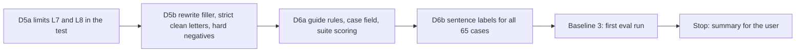

# Handoff: Step 3.2 Dataset Pass D5 and D6 (2026-10-23)

Read this file first. Then read `CLAUDE.md` (project rules), and these parts of `tasks/todo.md` (under **Now**, Step 3.2): "Baseline 2" and its review, "Review of F1 to F3" (the three groups of flagged sentences), the D5 and D6 items, "Decisions after F1 to F3", "Decisions after F4 to F7", and "Known limits of the rule checks". Also read the labeling guide `apps/backend-py/tests/fixtures/eval/grounding/README.md` and the last four sections of `tasks/lessons.md`. The check commands are in section 4 of `tasks/handoff-2026-10-19.md`.

The user will review your work after D6.

## 1. Status

| Item | State |
|------|-------|
| `main` | 34 commits ahead of `origin/main` (not pushed). Do not push. |
| Validator | The rule checks are closed. Do not change validator behavior. The only change in `src/generation/` is the new `split_letter_sentences` function (D6a). Known limits are listed in `tasks/todo.md`. |
| Last eval | After the curly-apostrophe fix: micro F1 0.793, MLflow run `3190eee25d674e2abfbf28880169fe7b`, dataset SHA-256 `13e5ec3d...`. D5 and D6 change the dataset, so the next eval is a new baseline (Baseline 3), not a comparison. |
| `ungrounded_claims` | Predicted on 64 of 65 cases, so the case-level label carries no information. D6 adds sentence-level labels and scoring. |
| Holdout | **Do not open** `cases.jsonl` or `profiles.json` in `apps/backend-py/tests/fixtures/eval/grounding_holdout/`. You may read its `README.md`. Do not change its files or `tests/unit/test_grounding_holdout.py`. |
| This handoff | D5 and D6. **Stop after the Baseline 3 run.** Do not label or run the holdout. |

## 2. The task

**The rule that matters most: no validator output before the labels are frozen.** From the start of D5b until the D6b labels are committed, do not run `main.py eval`, the validator, or any script that prints validator findings for the main set. Decide every rewrite and every label from the guide and the profile only. Do not use what you remember about which sentences the validator flagged in earlier rounds. The first eval run is Baseline 3, after the D6b commit. The unit tests and the dataset tests do not run the validator on the main set, so you can run them at any time.

Three commits: D5 (D5a and D5b together, because the new limits fail on the current set), D6a, and D6b. Black, ruff, the mypy gate on `main.py scripts/mypy_gate.py src/ tests/`, and the full pytest suite before each commit.

### D5a. Limits L7 and L8 in the dataset test

- In `tests/unit/test_grounding_dataset.py`, add a slot-normalized form of the long sentences (next to `normalize_long_sentences`, line 102): in each case, replace the job company with `<co>`, the job title with `<title>` (also "a/an `<title>`" as "a `<title>`"), and the phrase after "the need to" up to the next `,`, `.`, `:`, or `;` with `<need>`, before the lowercase and digit steps. `tests/unit/test_grounding_holdout.py` (`_long_sentences`, line 30) does the same for the holdout. Copy the logic; do not import it from that file, and do not change that file.
- Add two limits to `diversity_violations` (line 126) and its stats: **L7**, a slot-normalized frame is in at most 5 cases; **L8**, distinct frames divided by all long sentences is at least 0.85.
- The test fails on the current set (today 19 frames are in 5 or more cases, and one is in 18). Keep that failure output for the summary. Commit the test change with D5b, not alone, so `main` never has a failing test. Say in the D5 commit message that the test came first, and put the failure output in the summary.

### D5b. Rewrite filler, strict clean letters, hard negatives

The letters change in three ways. Labeled sentences (the sentence that carries a case's injected error) and labels do not change.

1. **Filler frames.** Rewrite the repeated filler sentences (plans, interest, and job restatements in repeated frames, such as "A useful early week in the `<title>` role ... would be ...") until L7 and L8 hold. Each new sentence is written for its letter. Do not satisfy the limits by swapping words in one frame.
2. **Strict clean letters.** In each letter with no expected issue, apply the strict elaboration rule (decision 1 after F1 to F3): a sentence that restates a profile fact and adds a detail that the profile does not state (an outcome, a purpose, a setting, or a specific practice) is ungrounded. Rewrite each such sentence so it states only what the profile states, or replace it with a sentence that states no fact about the candidate. Decide from the guide and the profile only. The "Review of F1 to F3" in `tasks/todo.md` describes this group (about 25 sentences). After this step, every clean letter is clean under the D6 guide.
3. **Hard negatives** (decision 2 after F4 to F7). Some new sentences use ordinary phrasings that the scope and experience checks used to confuse. Each hard negative carries no label: it is about the company, the job, or another person, or it states a candidate fact that the profile states exactly. Use at least 12 hard-negative sentences, at least 6 of them in clean letters, and cover each of these forms at least once (write your own words):
    - "led to `<result>`" or "led `<someone>` to `<verb>`" with a subject that is not the candidate;
    - "managed to `<verb>`";
    - "a/the leading `<noun>`" or "industry-leading `<noun>`" about the company;
    - a person at the company who led or headed something ("the migration that your platform lead headed"); not a person from the candidate's past, because that adds a setting that the profile does not state;
    - "a managed `<technology>` service" in a sentence about the company ("your team runs a managed `<technology>` service");
    - "master" as a verb, or a non-degree "master" (a branch, a copy);
    - a certificate or degree that the job asks for ("The posting asks for ...");
    - "As a result at `<company>` ..." or another "as a `<word>` at" phrase that is not a title.
    Add "hard negative: `<form>`" to the case `note` for each one, so the review can find them.

Checks for D5b:

- `test_grounding_dataset.py` passes, with L1 to L8, the group counts, and at least 15 clean letters.
- `test_grounding_holdout.py` still passes. Its overlap test compares long sentences with the main set. If it fails, its message shows the shared sentence. That sentence is one of yours, so rewrite it; do not look for anything else in the holdout.
- In the summary: the L1 to L8 stats before and after, the number of sentences rewritten in each of the three groups, and the list of hard negatives (case, form, and sentence).

### D6a. Guide rules, the case field, and suite scoring

1. **Guide.** In `tests/fixtures/eval/grounding/README.md`:
    - Under `ungrounded_claims`, add the strict elaboration rule (decision 1 after F1 to F3), with one example.
    - Add a rule for practices: a specific past practice ("After the nightly import failed twice, I added a retry and a log line") is a fact about the candidate, so it is `ungrounded_claims` unless the profile states it. A present-tense preference or working style with no specific past event ("I prefer to write the test first") stays a value statement (D4).
    - Add a "Sentence labels" section: what `ungrounded_sentences` holds, how sentences are split, and that a sentence with another label (for example `fabricated_technology`) is also listed when it is ungrounded (Rule 1).
    - Add a "Changes" entry with the date and the reason (decisions 1 and 2 after F1 to F3).
    - Keep the Mermaid diagram, and add the sentence step to it.
2. **Sentence split.** Add a public function `split_letter_sentences(text: str) -> List[str]` to `src/generation/cover_letter_grounding.py`, next to `_SENTENCE_SPLIT` (line 448). It joins whitespace and splits with `_SENTENCE_SPLIT`, so it returns the sentences that the validator reads. Do not change any validator behavior. A greeting without a full stop stays joined to the next sentence ("Dear team, I ..."); that is how the validator reads it, and the labels follow it.
3. **Case field.** In `GroundingCase` (`src/evaluation/suites/grounding.py`, line 53), add `ungrounded_sentences: Optional[List[str]] = None`. `None` means "not labeled at sentence level" (the holdout today). When it is a list:
    - each item must be equal to one sentence of `split_letter_sentences(letter)` after whitespace is joined (raise `ValueError` with the case and the item when it is not);
    - `ungrounded_claims` must be in `expected_issues` exactly when the list is not empty.
4. **Suite scoring.** In `run_grounding_suite` (line 148), for each case whose `ungrounded_sentences` is not `None`:
    - get the validator's findings from `result.details["ungrounded_sentences"]` (`cover_letter_validator.py:420`; they are strings);
    - map each finding to the letter sentence that contains it, after both are normalized (whitespace joined, lowercase, end punctuation removed). Containment is needed because the validator removes a leading greeting clause before it reports a sentence (`_strip_leading_greeting`, line 2637). A finding that maps to no sentence counts as a false positive, and the report lists it;
    - count true positives, false positives, and false negatives over sentences, and report `sentence.precision`, `sentence.recall`, `sentence.f1`, and `sentence.labeled_cases` (use `LabelScores` from `src/evaluation/metrics.py`, line 18). Add per-case `sentence_missed` and `sentence_extra` to the case rows.
    - The case-level scores do not change. A dataset with no labeled case reports `None` for the sentence metrics, as the other zero-denominator metrics do.
5. **Tests.** Unit tests for the field checks and for the scoring, on a small dataset that the test writes to `tmp_path` (new profile, new letters, new names): a finding after a greeting clause maps to its sentence; a finding that maps to nothing is a false positive; a case with `None` is not scored; the metric values for a known example. A mutation proof for the containment mapping (exact match instead of containment fails a test). In the dataset test, require that every main-set case has a list (not `None`).

The main set has no sentence labels yet, so the new dataset-test requirement fails until D6b. Commit D6a with that one assertion marked `xfail(strict=True)` and a reason that names D6b, and remove the marker in D6b.

### D6b. Sentence labels for all 65 cases

- For each case: print `split_letter_sentences(letter)`, decide each sentence with the guide (Rule 1, the strict elaboration rule, the practice rule, and D4), and write the ungrounded ones in `ungrounded_sentences`, copied exactly. Then set `ungrounded_claims` in `expected_issues` from that list, and add one line to the `note` for each listed sentence (why it is ungrounded).
- Do not run the validator while you label (section 2).
- A case-level label can change only for `ungrounded_claims`, and only because of the list. Report every case whose `ungrounded_claims` label changed, with the reason.
- After the labels, remove the `xfail` marker. The dataset test, the holdout test, and the full suite pass. Commit the labels before the first eval run.

### Baseline 3

- Run `.venv/bin/python main.py eval grounding` from `apps/backend-py` one time after the D6b commit.
- In `tasks/todo.md`, add "Baseline 3 (date)" under the D6 item: the dataset SHA-256, the MLflow run ID, the report file, the per-label table (precision, recall, F1, predicted count, support), the sentence-level numbers, and the clean false-positive rate. Do not compare it with Baseline 2 as a gain: the letters and labels changed. Say which differences come from the dataset.
- Do not change a label or a letter after this run.

## 3. Traps

- **The holdout set.** Opening its cases makes it useless.
- **No validator output while you write or label** (section 2). This is the reason Baseline 3 can be trusted.
- **Do not fit the labels to the rules.** The known limits in `tasks/todo.md` describe what the rules miss. Label by the guide, also when you know that a rule will miss a sentence or flag a sentence in error.
- **Labeled sentences stay.** Do not change the sentence that carries a case's injected error, and do not change a label except `ungrounded_claims` in D6b.
- **Hard negatives are clean.** A hard negative that states an unsupported fact about the candidate is not a hard negative. Rewrite it.
- **No real data.** Never open `.env`, `.env.local`, or `apps/backend-py/data/settings/user_settings.json`.
- **Startup time.** `main.py` takes about 100 s to start on `/mnt/d`; the full backend suite takes 3 to 8 minutes. Run long commands in the background.
- **Line endings and scratch files.** `*.jsonl` files are LF (`.gitattributes`). Check `git ls-files --eol` before you commit, and do not commit the 14 files that Cursor rewrites with CRLF. Put scratch files and commit messages outside the repository; use `git commit -F <file>`.

## 4. Rules (unchanged)

- Follow `CLAUDE.md`: docstrings with description, arguments, and returns; type hints; ASD-STE100 for documentation; no emojis; a Mermaid diagram in documentation.
- Before each commit, run `git status --short` and stage only the files of that step.
- Never run `scripts/mypy_gate.py --update` to accept a new error.
- Keep dry run as the default. Do not make auto-submit reachable.
- Do not push. Push only from WSL, and only after the user approves.

## 5. Summary to leave for the user

At the end, add "Cursor results (date)" to this file with:

- The commits (hash and subject): D5, D6a, and D6b.
- D5: the L7 and L8 failure output before the rewrite, the L1 to L8 stats before and after, the rewrite counts for each group, and the hard-negative list.
- D6a: the guide changes, the tests and their failure output before the change, and the mutation result.
- D6b: the number of labeled sentences, the cases whose `ungrounded_claims` label changed and why, and a statement that the validator did not run between the start of D5b and the D6b commit.
- Baseline 3: the table and the sentence-level numbers.
- Any label or letter you think is wrong (after Baseline 3, do not change it).
- Every check you ran and its result. Say clearly what you did not run.
