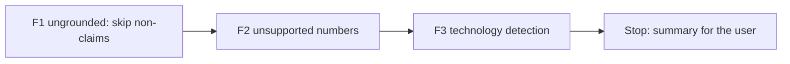

# Handoff: Step 3.2 Validator Fixes F1 to F3 (2026-10-22)

Read this file first. Then read `CLAUDE.md` (project rules), the "Step 3.2 fix plan" and "Decisions before the fixes (2026-10-22)" in `tasks/todo.md` (under **Now**, Step 3.2), the labeling guide `apps/backend-py/tests/fixtures/eval/grounding/README.md`, and `tasks/lessons.md` (the last four sections). The check commands are in section 4 of `tasks/handoff-2026-10-19.md`.

The user will review your work after F3.

## 1. Status

| Item | State |
|------|-------|
| `main` | `a1c818a`, 11 commits ahead of `origin/main` (not pushed). Do not push. |
| Reference | Baseline 2 on the main set: dataset SHA-256 `13e5ec3d...`, MLflow run `2d73d7766c004c1a90cd1c9393b78341`. The table is in `tasks/todo.md`. |
| Holdout | `apps/backend-py/tests/fixtures/eval/grounding_holdout/` holds 23 cases for one run after F7. **Do not open `cases.jsonl` or `profiles.json` in that folder.** You may read its `README.md`. `tests/unit/test_grounding_holdout.py` checks its format and is part of the normal suite. |
| This handoff | F1, F2, and F3 of the fix plan. **Stop after F3.** Do not start F4 to F7 or D5. |

## 2. The task

For each fix:

1. Write unit tests first, with new sentences that you write yourself. Do not copy sentences from the dataset. Run them and keep the failure output.
2. Make the change. Rules must be general: no rule may refer to a `case_id`, a fixture file, or a fictional name from the dataset.
3. Mutation proof. Put the old behavior back with an exact string replacement, check that the file checksum changed and that a fixed-string count of the mutated text is right, run the tests, see them fail, restore the file, and compare it with the backup (`tasks/lessons.md`, "Prove that a mutation was applied").
4. Run `python main.py eval grounding` on the main set (the default dataset). In `tasks/todo.md`, under the fix item, add a "Done (date)" note with the tests, the mutation, and a table of per-label precision, recall, F1, and **predicted count** against the previous run. When a fix lowers the F1 of another label, explain why or revert the fix.
5. Black, ruff, and the mypy gate on `main.py scripts/mypy_gate.py src/ tests/`, and the full pytest suite. One commit per fix.

### F1. `ungrounded_claims` skips sentences that state no fact

Where: `flag_ungrounded_sentences` in `apps/backend-py/src/generation/cover_letter_grounding.py` (about line 1401).

- Skip these sentence types: a greeting, including a leading greeting clause such as "Dear Hiring Team," in front of the first sentence; a sign-off ("Sincerely, Mara Chen", "Best regards"); thanks and calls to action (reuse `CoverLetterValidator.CALL_TO_ACTION_PHRASES` in `cover_letter_validator.py`, plus "thank you"); statements of interest, motivation, values, or working style (guide D4); and plans or intentions ("I would ...", "If <company> hired me ...", "In my first month ...").
- **Guard:** never skip a sentence that contains a number, a technology from the lexicon, a duration, or a past-tense claim verb ("built", "led", "shipped", "reduced", "managed", "rewrote", and similar). A plan sentence with a claim inside it ("I would bring ten years of Kubernetes experience") must still be checked.
- The last paragraph uses a stricter overlap threshold today (`closing_min_overlap_ratio`). Keep it only if the eval supports it, and say which.
- Tests, at least: each skipped type is not flagged; "I would bring ten years of Kubernetes experience" is still flagged for a profile without Kubernetes; "Thank you. At my last job I cut costs by 90%." still flags the second sentence; a greeting clause before the first sentence does not hide that sentence's claim.
- In the eval note, report how many cases have `ungrounded_claims` predicted (65 of 65 in Baseline 2) and the clean false-positive rate.

### F2. Unsupported numbers

- In a sentence about the candidate (one that F1 does not skip), each percentage, multiplier ("3x", "3 times"), or count with a noun ("8 teams", "140 stores") must appear in the profile text: summary, experience descriptions and highlights, project descriptions and highlights, and education. A number that does not appear flags `ungrounded_claims`.
- Normalize before you compare: "90%", "90 percent", and "ninety percent" are the same; "four" and "4" are the same.
- Do not check durations ("five years of ...", handled by the duration check) or calendar years ("in 2021").
- This replaces the M7 idea of keeping short tokens in the word overlap. Keep the `len(word) > 3` filter at about line 414 unless the eval shows a need.
- Tests: "cut costs by 90%" and "3x faster" are flagged for a profile without those numbers; a supported number in other words ("a rotation of four engineers" when the profile says 4) is not flagged; a duration and a calendar year are not checked here.

### F3. Technology detection

- **(a) Homonyms.** `swift`, `express`, `spring`, and `spark` (the allowlist at about lines 163 to 209) count as technologies only in a technology context: the product name ("Spring Boot", "Express.js", "Apache Spark", "SwiftUI"), or the word next to technology words ("built with Spark", "Swift for iOS", "an Express server"). Normal English ("spring semester", "a swift reply", "spark curiosity", "express my interest") is not a technology.
- **(b) Go.** `go` is in `_AMBIGUOUS_TEXT_ALIASES` (about line 363), so free text never matches it today. Match "Go" only in a technology context ("in Go", "written in Go", "Go services", "a Go service", "Golang"). "go live", "go through", and "ready to go" are not technologies.
- **(c) Negated claims.** "I have not run X", "I have never used X", and "I do not have X experience" are disclaimers (`_TECH_DISCLAIMER_BEFORE_RE`, about line 579).
- **(d) Related technologies (decision 2).** SQL is supported when the profile has a SQL database (PostgreSQL, MySQL, SQLite, MariaDB, SQL Server, or Oracle). Use a small explicit map in the code with a comment. Add a "Changes" entry with the date and the reason to the labeling guide (`tests/fixtures/eval/grounding/README.md`). Do not change any label: the current labels already treat SQL this way.
- Tests for each part, with normal-English negatives.

## 3. Traps

- **The holdout set.** Opening its cases makes it useless. The suite runs it only through `test_grounding_holdout.py`, which does not run the validator.
- **Labels and letters do not change.** Do not edit `tests/fixtures/eval/grounding/cases.jsonl` or `profiles.json`. If you think a label is wrong, write it in the summary.
- **Existing tests.** The grounding module has many unit tests. If an existing test asserts the old behavior that a decision changes (for example that "spring" in normal English is a technology), change the test and explain it in the summary. If no decision covers the conflict, stop and ask the user.
- **Wide skip rules hide claims.** F1 is the risky fix. Prefer a narrow rule with the guard over a wide one.
- **No real data.** Never open `.env`, `.env.local`, or `apps/backend-py/data/settings/user_settings.json`.
- **Startup time.** `main.py` takes about 100 s to start on `/mnt/d`; the full backend suite takes 4 to 8 minutes. Run long commands in the background.
- **Line endings and scratch files.** Check `git ls-files --eol` before you commit, and do not commit the 14 files that Cursor rewrites with CRLF. Put scratch files and commit messages outside the repository; use `git commit -F <file>`.

## 4. Rules (unchanged)

- Follow `CLAUDE.md`: docstrings with description, arguments, and returns; type hints; ASD-STE100 for documentation; no emojis; a Mermaid diagram in documentation.
- Before each commit, run `git status --short` and stage only the files of that fix.
- Never run `scripts/mypy_gate.py --update` to accept a new error. A fix that removes errors may shrink the baseline with `--update`.
- Keep dry run as the default. Do not make auto-submit reachable.
- Do not push. Push only from WSL, and only after the user approves.

## 5. Summary to leave for the user

At the end, add "Cursor results (date)" to this file with:

- The commits (hash and subject), one per fix.
- For each fix: what changed, the tests and their failure output before the fix, the mutation result, and the eval table against the previous run (precision, recall, F1, and predicted count per label), with any label that got worse and why.
- Any existing test you changed, and why.
- Any label you think is wrong (do not change it).
- Every check you ran and its result. Say clearly what you did not run.
