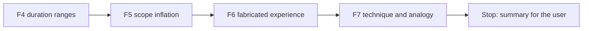

# Handoff: Step 3.2 Validator Fixes F4 to F7 (2026-10-23)

Read this file first. Then read `CLAUDE.md` (project rules), the "Step 3.2 fix plan", "Decisions before the fixes (2026-10-22)", "Review of F1 to F3", and "Decisions after F1 to F3 (2026-10-23)" in `tasks/todo.md` (under **Now**, Step 3.2), the labeling guide `apps/backend-py/tests/fixtures/eval/grounding/README.md`, and `tasks/lessons.md` (the last four sections). `tasks/handoff-step3-2-f1-f3.md` shows the format that worked for F1 to F3. The check commands are in section 4 of `tasks/handoff-2026-10-19.md`.

The user will review your work after F7.

## 1. Status

| Item | State |
|------|-------|
| `main` | 17 commits ahead of `origin/main` (not pushed). Do not push. |
| Last eval | After F3, on the main set: micro F1 0.710, MLflow run `ed3a986964b841a4b8b3f337c273a304`. The table is in `tasks/todo.md` under F3. Use it as the "before" for F4. |
| Holdout | **Do not open** `cases.jsonl` or `profiles.json` in `apps/backend-py/tests/fixtures/eval/grounding_holdout/`. You may read its `README.md`. |
| `ungrounded_claims` | Still predicted on 64 of 65 cases. That is expected: D6 (after this handoff) changes how it is measured. Do not try to change it in F4 to F7. |
| This handoff | F4, F5, F6, and F7. **Stop after F7.** Do not start D5 or D6, and do not run the holdout. |

## 2. The task

For each fix, the same steps as F1 to F3:

1. Write unit tests first, with new sentences that you write yourself (not copied from the dataset). Run them and keep the failure output.
2. Make the change. Rules must be general: no rule may refer to a `case_id`, a fixture file, or a fictional name from the dataset.
3. Mutation proof: put the old behavior back with an exact string replacement, check that the checksum changed and that a fixed-string count is right, see the tests fail, restore, and compare with the backup.
4. Run `python main.py eval grounding` on the main set. In `tasks/todo.md`, under the fix item, add a "Done (date)" note with the tests, the mutation, and the per-label table (precision, recall, F1, and predicted count) against the previous run. When a fix lowers the F1 of another label, explain why or revert.
5. Black, ruff, and the mypy gate on `main.py scripts/mypy_gate.py src/ tests/`, and the full pytest suite. One commit per fix.

All line numbers below are for `apps/backend-py/src/generation/cover_letter_grounding.py` after F3, unless the text names another file.

### F4. Duration ranges (decision 3)

- `flag_inflated_duration_claims` (about line 1114) compares the bottom of a range with the cap, on purpose (comment at about line 1157: "Range lower bound is the conservative claim amount"). Compare the **top** of the range instead, and change the comment to say why: the labeling guide counts a range as inflated when its top is longer than the cap, and a reader takes the top as the claim.
- A single number keeps its current handling ("over 5 years" is 5).
- Tests: "3-5 years of FastAPI" is flagged when the FastAPI cap is 3; "two to four years" is flagged when the cap is 2; "three to four years" is not flagged when the cap is 4; word numbers and digits behave the same.

### F5. Scope inflation

- `_SCOPE_INFLATION_PHRASES` (line 124) is matched as a substring (about line 1378: `if phrase in lowered`), so "called the" matches "led the". Match whole words.
- Add these phrases: "managed a team", "managed N engineers" (any number or number word), "headed", "oversaw", and "owned the".
- Make the allowance per claim. Today a phrase passes when it appears anywhere in the resume text. A leadership claim passes only when the profile has the same leadership phrase **with the same object**: for "led a team of 3", the profile must say "led a team of 3" (number words and digits are equal). The verb alone somewhere in the profile is not enough.
- Tests: "before I called the speedup real" and "I handled the migration" are not flagged; "I managed a team of twelve" and "I oversaw a team of eight engineers" are flagged for a profile without that wording; "I led a team of 3 engineers" is not flagged when the profile says "Led a team of 3 engineers"; "I led the fraud research at another company" is flagged when the profile has only "Led a team of 3".

### F6. Fabricated experience

- Today `fabricated_experience` comes only from selected project names (`_check_accuracy` in `cover_letter_validator.py`, about line 595). Add a grounding check (a new function, wired into the validator so it raises `FABRICATED_EXPERIENCE`) for these claims, each compared with the profile:
  - employers: "worked at X", "joined X", "interned at X", "at X I ..." when X is an organization name; compare with `profile.experience[].company`;
  - titles: "my title was X", "as a/an X at Y", "I was a/an X"; compare with `profile.experience[].title`;
  - degrees: Bachelor, Master, MBA, PhD, doctorate, "degree in"; compare with `profile.education[].degree` and `school`;
  - certifications: "certified", "certificate", "certification"; compare with `profile.certifications[].name` and `issuer`.
- Do not count the target company or the job title from the job listing as a claim ("I want to join Harbor Labs", "the Backend Engineer role"). Normalize names before you compare (case, punctuation, and "Inc."/"Ltd." suffixes); a degree such as "B.Sc. in Statistics" matches "Bachelor of Science in Statistics".
- Keep the selected-project check.
- Tests for each kind (a fabricated claim is flagged; the same claim is not flagged when the profile has it), plus a target-company sentence that is not flagged.

### F7. Technique and analogy

- Add "reinforcement learning", "reranking", and "distillation" to `_TECHNIQUE_TERMS` (line 137). A project's techniques come from its documented text (check how `build_project_techniques` reads them).
- When a sentence names two projects, check each technique against the project nearest to it in the sentence (`resolve_project_name`, about line 1295, returns one project today). This was a false positive in the first baseline.
- Find the cause of the missed analogy onto a JD-only duty (`flag_analogical_claims`, about line 1516; `_ANALOGY_MARKER_RE`, line 381) on the main set. Fix it only if the cause is general, and write the cause in the Done note either way.
- Tests: "I used distillation on <project>" is flagged when that project documents no distillation; a sentence that names two projects with their own documented techniques is not flagged; a wrong technique next to the second project is flagged.

## 3. Traps

- **The holdout set.** Opening its cases makes it useless.
- **Labels and letters do not change.** Do not edit `tests/fixtures/eval/grounding/cases.jsonl` or `profiles.json`. If you think a label is wrong, write it in the summary.
- **Existing tests.** Decision 3 changes the duration-range behavior, so a test that asserts the lower bound may need to change; change it and explain it. If an existing test conflicts with a change that no decision covers, stop and ask the user.
- **F6 can over-flag.** Organization names, the target company, and normal phrases ("at the start of the project") are easy to confuse. Prefer narrow patterns, and test the negatives.
- **No real data.** Never open `.env`, `.env.local`, or `apps/backend-py/data/settings/user_settings.json`.
- **Startup time.** `main.py` takes about 100 s to start on `/mnt/d`; the full backend suite takes 4 to 8 minutes. Run long commands in the background.
- **Line endings and scratch files.** Check `git ls-files --eol` before you commit, and do not commit the 14 files that Cursor rewrites with CRLF. Put scratch files and commit messages outside the repository; use `git commit -F <file>`.

## 4. Rules (unchanged)

- Follow `CLAUDE.md`: docstrings with description, arguments, and returns; type hints; ASD-STE100 for documentation; no emojis; a Mermaid diagram in documentation.
- Before each commit, run `git status --short` and stage only the files of that fix.
- Never run `scripts/mypy_gate.py --update` to accept a new error.
- Keep dry run as the default. Do not make auto-submit reachable.
- Do not push. Push only from WSL, and only after the user approves.

## 5. Summary to leave for the user

At the end, add "Cursor results (date)" to this file with:

- The commits (hash and subject), one per fix.
- For each fix: what changed, the tests and their failure output before the fix, the mutation result, and the eval table against the previous run, with any label that got worse and why.
- For F7: the cause of the missed analogy, and whether you fixed it.
- Any existing test you changed, and why.
- Any label you think is wrong (do not change it).
- Every check you ran and its result. Say clearly what you did not run.
