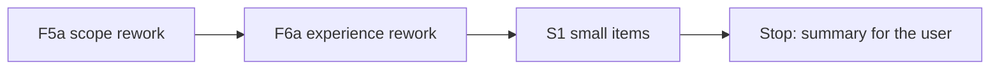

# Handoff: Step 3.2 Rework F5a and F6a (2026-10-23)

Read this file first. Then read `CLAUDE.md` (project rules), and these parts of `tasks/todo.md` (under **Now**, Step 3.2): the "Step 3.2 fix plan", the F5 and F6 items with their Done notes, "Review of F4 to F7", and "Decisions after F4 to F7". Also read the labeling guide `apps/backend-py/tests/fixtures/eval/grounding/README.md` and the last section of `tasks/lessons.md` ("A perfect score on a dev set says nothing about phrasings the set lacks"). `tasks/handoff-step3-2-f4-f7.md` shows the format that worked for F4 to F7. The check commands are in section 4 of `tasks/handoff-2026-10-19.md`.

The user will review your work after F6a.

## 1. Status

| Item | State |
|------|-------|
| `main` | 24 commits ahead of `origin/main` (not pushed). Do not push. |
| Last eval | After F7, on the main set: micro F1 0.793, MLflow run `f62f6ce8206f4618ac7831b58209ef26`. The table is in `tasks/todo.md` under F7. Use it as the "before" for F5a. |
| Why this rework | The main-set precision of `scope_inflation` and `fabricated_experience` is 1.000, but probes with new sentences found 15 false flags and 3 misses in these two checks. The main set has none of those phrasings. The F6 tests also reuse main-set sentences. The review lists each failure class. |
| Holdout | **Do not open** `cases.jsonl` or `profiles.json` in `apps/backend-py/tests/fixtures/eval/grounding_holdout/`. You may read its `README.md`. |
| `ungrounded_claims` | Still predicted on 64 of 65 cases. D6 changes how it is measured. Do not change it here. |
| This handoff | F5a, F6a, and one commit of small items. **Stop after that.** Do not start D5 or D6, and do not run the holdout. |

## 2. The task



For each fix, the same steps as F4 to F7:

1. Write unit tests first. Run them and keep the failure output.
2. Make the change. Rules must be general: no rule may refer to a `case_id`, a fixture file, or a fictional name from the dataset.
3. Mutation proof: put the old behavior back with an exact string replacement, check that the checksum changed and that a fixed-string count is right, see the tests fail, restore, and compare with the backup.
4. Run `python main.py eval grounding` on the main set. In `tasks/todo.md`, under the F5a or F6a item, add a "Done (date)" note with the tests, the mutation, and the per-label table (precision, recall, F1, and predicted count) against the previous run.
5. Black, ruff, and the mypy gate on `main.py scripts/mypy_gate.py src/ tests/`, and the full pytest suite. One commit per fix.

**New rule for the tests in this handoff.** Every test sentence and every name is new. Do not use a name or a sentence from `tests/fixtures/eval/grounding/cases.jsonl` or `profiles.json`. Do not copy a sentence from the review notes in `tasks/todo.md` either: the reviewer probes again with sentences that you have not seen, so a test copied from the notes proves nothing. For each failure class below, write your own ordinary sentence of that kind. Before each commit, check that no name in your new tests occurs in the main set.

Check a name against the main set (from `apps/backend-py`, one name at a time):

```bash
grep -c "Your Name Here" tests/fixtures/eval/grounding/cases.jsonl tests/fixtures/eval/grounding/profiles.json
```

The count must be 0 for every name.

**True positives to keep.** On the main set, `scope_inflation` finds 4 of 4 and `fabricated_experience` finds 6 of 8 after F7. A rework that removes false flags by removing a whole pattern also removes true positives. If a main-set true positive is lost, explain why in the Done note, or change the rule. Each pattern keeps at least one test that it still flags a real claim.

All line numbers below are for `apps/backend-py/src/generation/cover_letter_grounding.py` at `115fcd9`, unless the text names another file.

### F5a. Scope inflation

The code: `_SCOPE_INFLATION_PHRASES` (line 126), `_SCOPE_BARE_VERBS` (147), `_SCOPE_OBJECT_STOPS` (152), `_SCOPE_HEAD_RE` (176), `_leadership_claims` (1409), and `_resume_has_leadership_claim` (1444).

Failure classes from the review:

1. A bare verb takes any words after it as the object. A result ("led to a drop in ..."), a pronoun ("led me to ..."), and an infinitive ("managed to <verb>") become leadership claims.
2. "leading" used as an adjective ("a leading provider of ...", "an industry-leading ...") becomes a leadership claim. The hyphen in "industry-leading" is a word boundary, so `\bleading\b` matches there too.
3. The object ends only at the stop list or after six words. When the letter continues the claim ("a team of 3 engineers to rebuild ..."), the claim includes "to", and the profile ("a team of 3 engineers that rebuilt ...") does not contain it, so a supported claim is flagged.

Required behavior:

- After a bare verb, "to", "me", "us", and "them" do not start an object. There is no claim.
- "leading" is not a claim when the word before it is "a", "an", or "the", or when a hyphen joins it to the word before it.
- The object also ends at "to", "that", "which", "who", and "whose". The six-word limit stays.
- The comparison does not change: the claim with its object must be in the profile, and number words equal digits.

Tests: one sentence for each failure class (not flagged); a team claim that continues with "to <verb>" when the profile has the same team claim (not flagged); the same claim with a different team size (flagged); and the F5 positives ("led the", "managed a team of N", "headed", "owned the", "oversaw") still flagged with new objects.

### F6a. Fabricated experience

The code: `_ORG_NAME` (line 1775), `_EMPLOYER_RES` (1776), `_TITLE_WAS_RE` (1781), `_AS_TITLE_RE` (1786), `_DEGREE_LEVEL_RE` (1791; also used to read profile degrees at 1930), `_DEGREE_TAIL_RE` (1796), `_CERT_WORD_RE` (1803), `_profile_has_title` (1889), `_profile_has_certificate` (1945), `_certificate_name` (1964), and `flag_fabricated_experience_claims` (2023; the "as a X at Y" block starts at 2069). The validator calls it at `cover_letter_validator.py:274`.

Failure classes and required behavior:

1. **Names take the pronoun.** `_ORG_NAME` takes the next capitalized word, so "worked at <Org> I <verb>" reads "<Org> I". A name never contains the word "I".
2. **Events are employers.** `at <Org> I` reads a talk at a conference as an employer. Keep that pattern only when the word after "I" is a work verb from `_PAST_CLAIM_VERBS` (line 2248). "at <Event> I gave a talk" is not a claim; "at <Org> I built ..." still is.
3. **The "as a X at Y" pattern.**
    - It ignores case, so any words become a title ("as a result at <Org>"), and the company part accepts lowercase words. The title must end with a role noun from a short list (for example engineer, developer, analyst, scientist, intern, manager, architect, designer, consultant, researcher, administrator, specialist, lead, director, officer). The company must start with a capital letter.
    - Titles must be equal today, so a shorter title is flagged ("backend engineer" when the profile has "Senior Backend Engineer"). A letter title is supported when all its words are in one profile title. A letter title with a word that no profile title has is flagged ("Staff Engineer" when the profile has "Senior Backend Engineer"). Use the same rule for "my title was X".
    - The company Y is never checked. "as a <title on the profile> at <employer not on the profile>" passes. Y is an employer claim: flag it when it is not on the profile and is not the target company. Remove the branch at that point that cannot change the result.
    - The target job is not a claim: when the title is the target title and Y is the target company or is absent, there is no claim.
4. **Degree words in other senses.** `master` matches as a verb and in "the master branch". "master" and "bachelor" are degree words only when "'s", "of", "in", or "degree" follows them. Abbreviations (MBA, PhD, B.Sc., M.Sc.) and "doctorate" stay as they are. Do not change how profile degrees are read at line 1930.
5. **Degree field.** "a Bachelor's degree in X" does not read X, so a different field passes. Read the field after "'s degree in" and after "degree in" with no level, and compare it as today (`_field_in_text`).
6. **Certificate names.**
    - The name is only the capitalized words before the certificate word, and names must be equal. "I am an <Issuer> Certified <Role>" reads only "<Issuer>", which is not equal to the full profile name, so a real certificate is flagged. "I am a Certified <Role>" reads nothing, so a fake certificate passes. Read the capitalized words on both sides of the certificate word, and include the certificate word when it is capitalized.
    - A letter name is supported when all its words are in one profile certification name, or when it equals the issuer.
    - A certificate that the job asks for, or that the candidate plans to earn, is not a claim. Skip a certificate word when the sentence states a requirement ("asks for", "requires", "required", "preferred") or a plan ("plan to", "hope to", "want to", "would like to", "intend to"). `_is_skippable_non_claim` (line 2444) already skips a sentence that starts with a plan; you may use it.
7. **Wiring test.** No test covers the validator call. Turning it off left every unit test green. Add a test in `tests/test_cover_letter_validator.py` that runs `CoverLetterValidator(llm_router=None, strict_mode=False).validate` on a letter with a fabricated employer and no selected project, and checks that `FABRICATED_EXPERIENCE` is in the issues, and that a letter with only profile employers does not get it. The mutation proof for this test turns the call off.
8. **Tests that reuse the main set.** Rewrite the F6 tests and the F7 analogy tests that use main-set names or sentences (for example "Orbit Lantern", "Glassmill College", "Design History", "Northbridge Ledger Auditor", "Director of Engineering", "similar to the penetration-testing", "Northwind"). Keep the behavior that each test checks, with new names and sentences, and say in the summary which tests you rewrote. Also fix `test_target_company_and_ordinary_at_are_not_employers`: "I want to join <target>" matches no pattern ("joined" only), so it does not test the target-company rule. Use a sentence that a pattern does read with the target company.

Tests: for each class, a sentence that must not be flagged and, where the class is a miss, a sentence that must be flagged. Positives for each kind still flagged: an employer, a title, a degree (level and field), and a certificate that the profile does not have.

### S1. Small items (one commit)

- The first line of the second docstring paragraph of `flag_inflated_duration_claims` (line 1171) has 8 spaces of indent. Use 4.
- `_project_name_spans` (line 1464) finds a project name inside a longer word, because it uses `str.find`. Match whole words, and add a test with a project name inside a longer word.

## 3. Traps

- **The holdout set.** Opening its cases makes it useless.
- **Labels and letters do not change.** Do not edit `tests/fixtures/eval/grounding/cases.jsonl` or `profiles.json`. If you think a label is wrong, write it in the summary.
- **Narrow, not empty.** Each rule must remove a failure class and keep the real claims of that kind. Prefer a rule about the words next to the match over a rule that drops a pattern.
- **Word lists.** Keep the role-noun list and the requirement and plan phrases short and general, with a comment. Do not add a word because one main-set letter has it.
- **Existing tests.** Rewriting the tests in item 8 is a change that this handoff asks for. If any other existing test conflicts with a change, stop and ask the user.
- **No real data.** Never open `.env`, `.env.local`, or `apps/backend-py/data/settings/user_settings.json`.
- **Startup time.** `main.py` takes about 100 s to start on `/mnt/d`; the full backend suite takes 3 to 8 minutes. Run long commands in the background.
- **Line endings and scratch files.** Check `git ls-files --eol` before you commit, and do not commit the 14 files that Cursor rewrites with CRLF. Put scratch files and commit messages outside the repository; use `git commit -F <file>`.

## 4. Rules (unchanged)

- Follow `CLAUDE.md`: docstrings with description, arguments, and returns; type hints; ASD-STE100 for documentation; no emojis; a Mermaid diagram in documentation.
- Before each commit, run `git status --short` and stage only the files of that fix.
- Never run `scripts/mypy_gate.py --update` to accept a new error.
- Keep dry run as the default. Do not make auto-submit reachable.
- Do not push. Push only from WSL, and only after the user approves.

## 5. Summary to leave for the user

At the end, add "Cursor results (date)" to this file with:

- The commits (hash and subject), one for F5a, one for F6a, and one for S1.
- For each fix: what changed, the tests and their failure output before the fix, the mutation result, and the eval table against the previous run, with any label that got worse and why.
- The tests you rewrote under item 8, and the name check result for your new tests.
- Any main-set true positive that was lost, and why.
- Any label you think is wrong (do not change it).
- Every check you ran and its result. Say clearly what you did not run.
