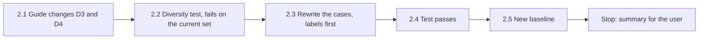

# Handoff: Step 3.2 Rework, a Diverse Grounding Dataset (2026-10-22)

Read this file first. Then read `CLAUDE.md` (project rules), Step 3.2 in `tasks/todo.md` (under **Now**: the labeling rules, the Baseline, and "Review of the dataset and baseline", items D1 to D4), `apps/backend-py/tests/fixtures/eval/grounding/README.md` (the labeling guide), and `tasks/lessons.md` (the last section). The check commands are in section 4 of `tasks/handoff-2026-10-19.md`.

The user will review your work after you finish.

## 1. Status and the problem

| Item | State |
|------|-------|
| `main` | `3d7d137`, 4 commits ahead of `origin/main` (not pushed). Do not push. |
| Dataset | 65 cases in `apps/backend-py/tests/fixtures/eval/grounding/`, baseline recorded in `tasks/todo.md`. |
| Problem | The letters are templated (review D1 to D4). 570 sentences, but only 78 distinct ones; one sentence is in all 65 letters; each profile has one base letter. Precision and the clean false-positive rate measure 3 base letters, not 65 letters. |
| This handoff | Rewrite the dataset under measurable diversity limits that the dataset test enforces, fix the two guide gaps (D3, D4), and run the baseline again. **Do not change the validator, and do not start the M7 fixes or the CI gate.** |

## 2. The task



Work in this order. Make one commit for the guide, test, profiles, and cases (when the test passes), and one commit for the new baseline. Do not push.

### 2.1 Guide changes (D3, D4)

Change `apps/backend-py/tests/fixtures/eval/grounding/README.md`, and add each change, with its reason and the date, to the "Changes" section:

- **D3, techniques are not technologies.** Retrieval, reranking, RAG, fine-tuning, reinforcement learning, distillation, and similar methods are techniques. A technique given to a profile project that does not document it is `technique_mismatch`; a technique claim that the profile does not support is also `ungrounded_claims`. Neither is `fabricated_technology`. Named tools, libraries, languages, and services (for example FAISS, LangChain, PyTorch, Kubernetes) are technologies.
- **D4, values and working style.** A statement of values, working style, or opinion that states no checkable fact ("I value clear documentation", "I enjoy pairing with designers") is not `ungrounded_claims`. A self-assessment that implies a fact ("I am an expert in distributed systems", "I have shipped many production ML systems") is `ungrounded_claims` when the profile does not support it. A sign-off line ("Sincerely, Mara Chen") is part of the closing.
- **Voice rule.** Each letter is written by the candidate, in the first person, about the candidate's own work. No sentence describes the profile or the dataset. The review found "Atlas Search documents retrieval and reranking, while Finch Classifier documents supervised fine-tuning." in 24 letters (D2); no candidate writes that.

### 2.2 Diversity test (write it first)

Add `test_grounding_dataset_diversity` to `apps/backend-py/tests/unit/test_grounding_dataset.py`, with a helper that normalizes sentences, and run it on the **current** set first. It must fail; keep that output for the summary.

Normalization (use exactly this, so the numbers are reproducible): join whitespace, split after `.`, `!`, or `?` followed by whitespace, lowercase, replace each run of digits with `#`, strip. A **long sentence** has 8 or more words. Only long sentences count in the limits below, so short greetings and sign-offs are not limited.

| Limit | Rule |
|-------|------|
| L1 | A long sentence appears in at most 3 cases. |
| L2 | Two cases share at most 2 long sentences. |
| L3 | Distinct long sentences divided by all long sentences is at least 0.80. |
| L4 | At least 20 distinct job companies and at least 12 distinct job titles. No company is in more than 5 cases. |
| L5 | Each letter has 150 to 350 words, and at least 15 letters have more than 220 words. |
| L6 | Each profile is used by at least 12 cases. |

The existing structure and count test stays (group minimums, unique IDs, `@example.com` emails, at least 15 cases with no expected labels).

Mutation: in a temporary copy, put one long sentence into 4 cases; L1 must fail. Keep the committed files unchanged.

### 2.3 Rewrite the cases

Rewrite `cases.jsonl` so that every case is its own letter. Do not use base letters with one changed sentence. You can keep the 3 profiles, and you can add one or two more fictional profiles (for example a DevOps engineer or a career changer) for more variety; all emails end with `@example.com`.

- Keep the group minimums from `tasks/handoff-step3-2.md` section 2.3 (65 or more cases in total).
- Vary the structure: opening (direct, story, company-first), number of paragraphs (2 to 4), and the position of the injected error (first, middle, or last paragraph).
- Vary closings and greetings across cases; do not reuse one closing sentence in more than 3 cases (L1 counts it when it has 8 or more words).
- Each job has its own fictional company and title. Write all text yourself; do not copy real job postings, real companies, or real people.
- **Labels before the validator** (guide Rule 2). Label each case with the changed guide, then freeze the labels. Do not change a label because of the validator output; if a definition is wrong, change the guide, record it in "Changes", and relabel every affected case.
- Write a `note` for each case: what was injected, where, and why each label is or is not present.

### 2.4 Checks before the commit

- The dataset test passes (structure, counts, and L1 to L6).
- Read 10 random letters in full. Each must read like a real cover letter. Fix the ones that do not.
- Black, ruff, and the mypy gate on `main.py scripts/mypy_gate.py src/ tests/`, and the full pytest suite.

### 2.5 New baseline

1. Run the grounding suite with the default MLflow store.

    Run the suite (from `apps/backend-py`):

    ```bash
    .venv/bin/python main.py eval grounding
    ```

2. In `tasks/todo.md`, under Step 3.2: mark the first Baseline as "superseded (templated set, 2026-10-22)" and keep it for history. Add "Baseline 2 (date)" with the git SHA, dataset SHA-256, MLflow run ID, case count, the diversity numbers (distinct long sentences, the L3 ratio, companies, titles), the per-label table (precision, recall, F1, support), the micro scores, `clean_false_positive_rate`, and the 5 largest error groups.
3. For each of these review findings, say whether Baseline 2 still shows it: homonyms flagged; `Go` missed (note: `go` is skipped on purpose as an ambiguous word, `_AMBIGUOUS_TEXT_ALIASES`); greetings, closings, and sign-offs flagged as `ungrounded_claims`; a sentence with two projects given to the wrong project; `fabricated_experience` checks only selected projects.
4. Tick D1 to D4 in `tasks/todo.md` when they are done. Leave the M7 fix and CI gate items open.

## 3. Traps

- **This is a measurement.** The labels must come from the guide, not from the validator output. The value of Baseline 2 depends on this.
- **Do not change the validator** (`cover_letter_validator.py`, `cover_letter_grounding.py`) or the suite code. Write any bug you see in the baseline note.
- **No real data.** Never open `.env`, `.env.local`, or `apps/backend-py/data/settings/user_settings.json`.
- **Startup time.** `main.py` takes about 100 s to start on `/mnt/d`; the full backend suite takes 4 to 8 minutes. Run long commands in the background.
- **Line endings.** Check `git ls-files --eol` before you commit. Do not commit the 14 files that Cursor rewrites with CRLF.
- **Scratch files** go outside the repository. Write commit messages to a file outside the repository and use `git commit -F <file>`.

## 4. Rules (unchanged)

- Follow `CLAUDE.md`: docstrings with description, arguments, and returns; type hints; ASD-STE100 for documentation; no emojis; a Mermaid diagram in documentation.
- Before each commit, run `git status --short` and stage only the files of that commit.
- Never run `scripts/mypy_gate.py --update` to accept a new error.
- Keep dry run as the default. Do not make auto-submit reachable.
- Do not push. Push only from WSL, and only after the user approves.

## 5. Summary to leave for the user

At the end, add "Cursor results (date)" to this file with:

- The commits (hash and subject).
- The diversity test: its failure on the old set (the L1 to L6 numbers), the mutation result, and the numbers on the new set.
- The case count per group and per profile, and any profile you added.
- The guide changes.
- Baseline 2: the table, the top error groups, and the status of each review finding (section 2.5, step 3), compared with the first baseline.
- Every check you ran and its result. Say clearly what you did not run.
