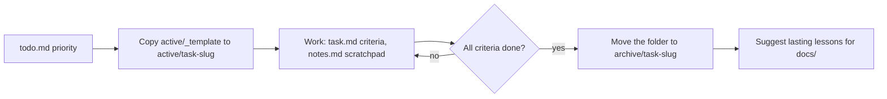

# Tasks System Contract

This folder manages active development work, scratchpad context, and task execution.
Long-term project knowledge, conventions, and architecture belong in `docs/`, not here.

## Directory Conventions

### Active Tasks
Active work lives in isolated folders inside `tasks/active/`.
Pattern: `tasks/active/<task-slug>/`

Examples:
- `tasks/active/fix-pagination-bug/`
- `tasks/active/refactor-auth-middleware/`

### Archived Tasks
Completed tasks are moved from `active/` to `archive/`.
Pattern: `tasks/archive/<task-slug>/`

### Discovering Tasks
To see what is currently being worked on, inspect the filesystem:
- Active task definitions: `tasks/active/*/task.md`
- Active task notes: `tasks/active/*/notes.md`
- Current priorities: `tasks/todo.md`

## Agent Rules & Workflow

### 1. Context Loading (Preventing Bloat)
- **Always start** by reading `tasks/index.md` and `tasks/todo.md`.
- **Only load** the `task.md` and `notes.md` for the specific task you are currently executing.
- **Never load** all files in `tasks/active/` at once.
- **Never load** files in `tasks/archive/` unless explicitly asked to review past work.
- **Read `docs/`** for established project conventions and long-term knowledge.

### 2. During Execution
- Update `tasks/active/<task-slug>/task.md` to track progress and check off acceptance criteria.
- Append debugging steps, raw thoughts, and temporary context to `tasks/active/<task-slug>/notes.md`.
- Keep `tasks/todo.md` strictly limited to the current cycle's high-level priorities.

### 3. Task Completion & Archiving
When a task is fully completed:
1. Move the entire folder from `tasks/active/<task-slug>/` to `tasks/archive/<task-slug>/`.
2. Remove the task from `tasks/todo.md`.
3. **Distillation:** Review `notes.md`. If there are reusable, permanent lessons (e.g., "API errors must always include a trace ID"), suggest adding them to the relevant file in `docs/`. Do not leave permanent rules trapped in archived task notes.

## Project Additions (Job Raider)

- **Lessons:** after a correction from the user, add the pattern to `docs/lessons.md` (`CLAUDE.md`, Self-Improvement Loop).
- **Backlog:** `tasks/backlog.md` holds parked work and design notes. Read it only when you choose new work. To start an item, add it to `tasks/todo.md` and create its task folder.
- **Handoffs:** a handoff to another agent (for example Cursor) is a file in the task folder, `handoff-<round>.md`. The other agent adds its results at the end of that file. The review of each round goes in the task's `notes.md`. A micro-handoff (`mh-*.md`, the complete code and commands of one small change) is applied by the handoff runner, without an agent: see `docs/handoff-runner.md` for the block format and the command.
- **Plans and reviews:** the plan of a task is its `task.md` (goal, constraints, acceptance criteria). Detailed sub-step plans, decisions, and reviews go in `notes.md`.
- **Legacy:** `tasks/archive/legacy/` holds the old single-file archive (`todo-done.md`, "Phase 1" to "Phase 54"), an old plan (`auto_apply_plan.md`), and the old `todo.md` conventions.
- **Style:** task files follow `CLAUDE.md`: ASD-STE100 Simplified Technical English, no emojis, and each terminal command in its own snippet.
