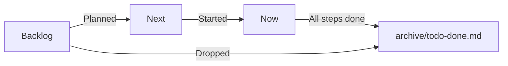
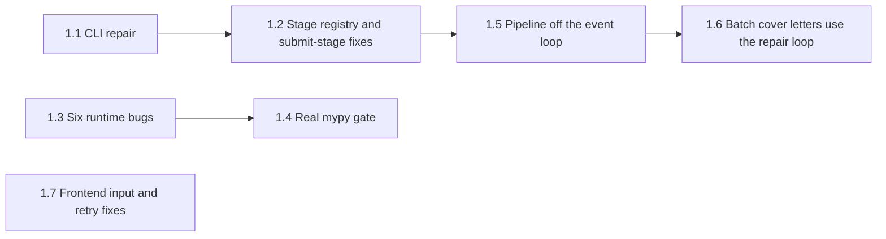
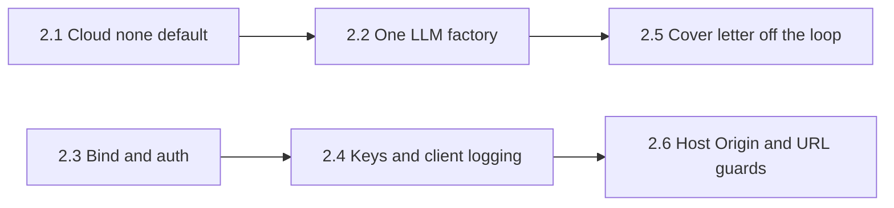
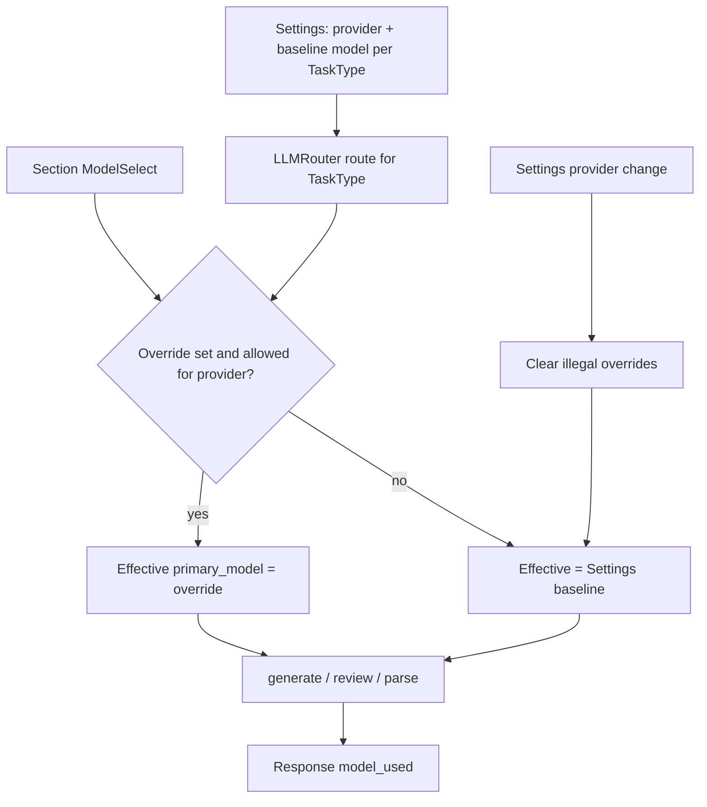
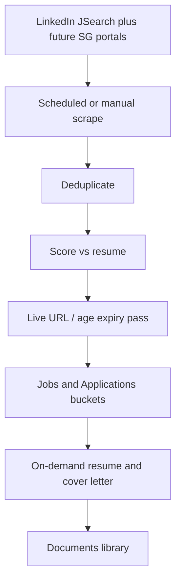
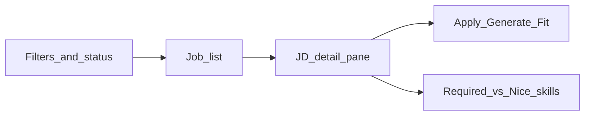

# Job Raider Tasks

This file lists active work only. Completed work is in [archive/todo-done.md](archive/todo-done.md).

## How to use this file

1. Put each work item under one of three sections: **Now**, **Next**, or **Backlog**.
2. Give each work item a level-3 heading with a name and a date. Example: `### Pipeline elapsed timer (2026-10-18)`.
3. Do not give work items numbers. Do not use the word "Phase" for new work.
4. Number the steps inside a work item: "Step 1", "Step 2", and so on. If a step needs its own sub-steps, number them "Step 1.1", "Step 1.2", and so on.
5. When all steps are done, add a "Review" subsection. Then move the work item to the end of [archive/todo-done.md](archive/todo-done.md).
6. "Phase 1" to "Phase 54" are old labels. They are in the archive only. Do not reuse them.

## Now

### Review follow-up (2026-10-18)

Source: [review-2026-10-18.md](review-2026-10-18.md), section 6. Each step has its own checklist in that file.

- [x] Step 0: Push and stabilize.
  - [x] Add LF rules for `*.ts`, `*.tsx`, `*.js`, `*.jsx`, `*.mjs`, `*.cjs`, and `*.css` to `.gitattributes`. Restore LF in the 16 files that had CRLF on disk.
  - [x] Run all local checks (2026-10-18). Backend: ruff and Black clean; pytest 983 passed. Frontend (`node:20` container, same as CI): `npm ci`, ESLint (0 warnings), tsc, Prettier, Vitest 202 passed in 38 files, `next build`, and Playwright 41 passed with 1 flaky (Mobile Chrome Dashboard link timed out on a cold dev-server start, then passed on retry). Gitleaks: no leaks in the unpushed commits. mypy is still non-blocking (195 errors); Step 1.4 makes it a gate.
  - Note: `npm ci` fails with npm 11 (Node 24) because `package-lock.json` lacks the optional `@tailwindcss/oxide-*` platform packages. npm 10 (Node 20, as in CI) accepts it. Regenerate the lock file when CI moves to Node 24.
  - [x] Push to `origin/main` (approved 2026-10-18). Pushed `dbac242..63e5e0a` from WSL (Git Bash on Windows has no GitHub SSH key). CI run 39094293658 passed all 11 jobs; Docker build skipped by design. Note: the mypy "Type Check" and "Security Scan" jobs cannot fail yet.
- [ ] Step 1: Make the core flow run. The plan is below. Approved on 2026-10-18. Steps 1.1 to 1.7 are done and pushed (last: `5a8232f`). Only the manual check in "Verification for Step 1" is open.
- [ ] Step 2: Make local-first true. The plan is below. Steps 2.1 to 2.6 are done (not pushed). The review on 2026-10-20 found two blockers (R1, R2) to fix before push.
- [ ] Step 3: Make claims measurable.
- [ ] Step 4: Make it demo-able.
- [ ] Step 5: Focus and prune.

#### Step 1 plan: Make the core flow run

**Goal:** A full-mode pipeline run goes from scrape to the submit stage in dry run. The CLI starts. CI catches new type errors. The UI shows real progress and does not send POST requests two times.

**Constraints:**

- Do not make auto-submit reachable. Detection and submission stay as they are until the Easy Apply decision in Step 5.
- Keep dry run as the default in every layer.
- Each sub-step is one pull request with its own tests. Run all local checks before each push.

Steps 1.1, 1.3, and 1.7 do not depend on other sub-steps. Step 1.4 needs 1.3, so that the baseline does not contain the six bugs. Step 1.6 needs 1.5, because the cover-letter service is async and needs a thread without a running event loop.

##### Step 1.1: CLI repair (effort: S)

- [x] Remove the second `argparse` block in `apps/backend-py/main.py` (the block after the first `parse_args()` at line 701). Move parser construction into `build_parser()`. Define `-i/--interactive` on the top-level parser, and share `--log-level` and `--log-file` with both commands through a parent parser.
- [x] Change `profile.target_job` to the fields of `profile.targets` in `run_pipeline` (`main.py:272-281`).
- [x] Read the allowed `--sources` values from the scraper registry, not from a hard-coded list (`main.py:600`). New `available_sources()` in `src/scrapers/manager.py`; `ScraperManager` uses it too.
- [x] Add `tests/unit/test_cli.py` (36 tests): help for each command, README forms, sources, experience choices, target fields, routing, and the full `analyze` path.
- [x] Update the README CLI examples to match the real commands. No edit needed: `pipeline` is the default command again, so `main.py --resume ...` in the README and `docs/usage.md` works as written.
- [x] Found during the work and fixed:
  - `ResumeParser.parse()` does not exist. `load_user_profile` and `analyze` now call `parse_file()`. `profile.contact_info.name` is now `profile.name`.
  - `--target-experience` choices (`entry`, `mid`) did not match `ExperienceLevel` values ("Entry Level"). The choices now map to enum member names.
  - `analyze` always failed: a local `from pathlib import Path` made `Path` unbound at the resume check (ruff F823). Removed the local import; a test now fails if it comes back.
  - The second `ensure_dependencies()` call inside `main()` is removed. The call before the imports stays. `main()` can now run in tests without `os.execv`.
  - `main.py` was not linted in CI. It is now ruff- and Black-clean, and CI and `make lint` check it.
  - Pinned `Makefile` and `Dockerfile*` to LF in `.gitattributes`, because `make` and Docker fail on CRLF.

##### Step 1.2: One stage registry and an honest submit stage (effort: S to M)

Steps 1.2 parts A and B must land together. When the run reaches the submit stage, the bugs in part B start to write wrong data.

Part A: stage registry

- [x] Define one ordered stage list with one handler per stage. New `src/models/pipeline_stage.py` holds `PipelineStage` and `STAGE_ORDER` (the enum order). Both runners in `src/pipeline/orchestrator.py` use `_stages_to_run()`. `PIPELINE_STAGE_ORDER` and `DISCOVER_LAST_STAGE` in `src/api/models/requests.py` derive from it.
- [x] Replace the `if`/`elif` dispatch in `_execute_stage` with a lookup (`_stage_handlers()`). Add the missing `LINKEDIN_AUTH` handler (`stages.stage_linkedin_auth`).
- [x] Make `stage_linkedin_auth` check only that credentials exist. No code change was needed: it already reads only `LINKEDIN_EMAIL` and `LINKEDIN_PASSWORD`. A test now fails if it starts Playwright.
- [x] Tests (`tests/unit/test_pipeline_orchestrator.py`): every `PipelineStage` has a handler; the request stage order equals `STAGE_ORDER`; a full-mode dry run runs all 11 stages in order and passes each stage's output to the next. `tests/integration/test_pipeline.py` now asserts `success` and the completed stages. A mutation check (handler removed) makes the tests fail.

Part B: submit stage

- [x] Match submission results to generated resumes by `job_id`, not by list index.
- [x] Do not save dry-run results as applied records. They are counted as `simulated`.
- [x] Count `jobs_applied` (`total_applications`) from real submissions only. Before, it equaled the number of generated resumes, so the Dashboard and Pipeline history showed every generated resume as "applied".
- [x] Tests for each of the three items above (`tests/unit/test_pipeline_stages.py`).
- [x] Found during the work and fixed: `stage_generate_resumes` failed when no job was selected ("0/0 successful", no error message), so a full run with an empty shortlist ended as failed. An empty selection is now a success. When every selected job fails, the stage fails with a message.

##### Step 1.3: Fix six runtime bugs that mypy found (effort: S)

- [x] `src/classifiers/job_classifier.py:606`: `WorkPace.FAST` to `WorkPace.FAST_PACED`. Rule-based classification of any JD with "fast-paced", "rapidly", or "startup environment" returned `success=False`. Tests: `tests/unit/test_job_classifier.py`.
- [x] `src/generation/formatter.py:535-563`: set `run.bold` and `run.italic` on the returned run, not as `add_run` arguments. DOCX resumes were silently missing; PDF still worked. Test: `tests/unit/test_resume_formatter_docx.py`.
- [x] `src/metrics/outcome_tracker.py:992`: `Path.remove()` to `Path.unlink()`. The status left the cache but its file stayed, so it came back after a restart. Tests: `tests/unit/test_outcome_tracker_custom_status.py`.
- [x] `src/metrics/mlflow_tracker.py:480`: `experiment.experiment_name` to `experiment.experiment_id` in `get_run_history`; run history was always empty. (`get_best_run` was already correct.) Test: `tests/unit/test_mlflow_run_history.py`.
- [x] `src/experiments/ab_testing.py`: deleted the `src/experiments/` package (decision 1). Nothing imported it. Removed its line from the README source tree.
- [x] `src/generation/resume_writer.py:285`: the template fallback, which runs when the LLM fails, now joins the names of the first five skills. Test: `tests/unit/test_resume_writer_fallback.py`.
- [x] Mutation check: with the five source fixes stashed, the bug tests fail with the original errors.

##### Step 1.4: Make mypy a real gate (effort: S)

- [x] Add a `[tool.mypy]` section to `apps/backend-py/pyproject.toml` (`ignore_missing_imports = true`). `python_version` is not set: the local `.venv` is Python 3.12 with a numpy whose stubs only parse on 3.12, so forcing 3.11 stops mypy.
- [x] Add `apps/backend-py/scripts/mypy_gate.py`. It compares errors by file, error code, and message (line numbers and "line N" in messages are ignored), counts duplicates, fails on new errors, and fails when mypy crashes. `--update` writes a new baseline. Tests: `tests/unit/test_mypy_gate.py` (12).
- [x] Remove `|| true` and `continue-on-error` from the CI `type-check` job and from `make lint`. Both run the gate. CI pins `mypy==2.4.0`, `types-requests==2.33.0.20261006`, and `types-PyYAML==6.0.12.20260906` (the versions CI used on 2026-10-18). The local `.venv` uses the same pins.
- [x] Done: the baseline (`apps/backend-py/mypy-baseline.txt`) was built from the CI Type Check log of run 39143155828 and has 183 errors. It does not contain the nine Step 1.3 errors. A deliberate new error makes the gate exit 1; clean code exits 0.
- [x] Found during the work and fixed: local and CI differed only in `src/metrics/mlflow_tracker.py`, because `mlflow` is not pinned and newer releases type `search_runs()` as `list[Run] | DataFrame`. Pass `output_format="pandas"` and cast to `DataFrame`; annotate the compare report as `Dict[str, Any]`. Local and CI now give the same 183 errors.
- [x] Lint `scripts/mypy_gate.py` in CI and `make lint`. Docs: "mypy Baseline Gate" in `docs/testing.md`; README code-style commands; `COMPREHENSIVE_TESTING_STRATEGY.md`.

##### Step 1.5: Run the pipeline off the event loop (effort: M)

- [x] In `src/api/routes/pipeline.py`, `_execute_pipeline()` runs in a worker thread (`asyncio.to_thread`). It builds the orchestrator, runs the stages, and backfills shortlist descriptions; all of these block.
- [x] Use the orchestrator stage hooks to send `stage_started`, `stage_completed`, and `stage_progress` (0 to 100) events with `asyncio.run_coroutine_threadsafe`. The hooks also set `current_stage`, `stage_progress`, `stages_planned`, and `stages_completed`, which `GET /status` now returns, so the monitor is correct even when the WebSocket connects late.
- [x] `PipelineOrchestrator.run(should_stop=...)` checks the cancel status before each stage, so cancel stops the run at the next stage boundary. A running stage is not interrupted.
- [x] Set the default `UVICORN_WORKERS` to 1 in `docker/Dockerfile`, because run state is in memory (decision 2).
- [x] Frontend: progress uses the backend 0 to 100 value (no extra `* 100`). The badge shows Running, Complete, Failed, or Cancelled, and a failed run shows its error. Logic is in `src/lib/pipeline-run-state.ts`. Added the missing `linkedin_auth` and `present_selection` stages to `PIPELINE_STAGES`.
- [x] Tests: `tests/unit/test_pipeline_run_async.py` (worker thread, the loop keeps running during a blocking stage, event order, failed status, cancel), a cancel test in `test_pipeline_orchestrator.py`, `/status` and `/results` tests in `test_pipeline_routes.py`, `src/lib/pipeline-run-state.test.ts`, and `tests/app/pipeline/live-monitor.test.tsx`. A mutation check (pipeline called on the event loop again) fails 3 of the 4 async tests.
- [x] Found during the work and fixed:
  - A run with `success=False` was reported as "completed". It is now "failed", with the failing stage's error.
  - `GET /api/pipeline/results/{run_id}` raised for every completed run: it called `.value` on stage names that are already strings.

##### Step 1.6: Batch cover letters use the repair loop (effort: M)

- [x] `stage_generate_resumes` now gets each cover letter from the shared service (`_generate_cover_letter` in `src/pipeline/stages.py`). The service writes, validates, and rewrites one time on hard-fail grounding issues, like the Cover Letter page. The service body moved to `generate_cover_letter_sync()`; `generate_cover_letter_for_profile()` is a thin async wrapper for the routes. A new `selection` argument lets the stage reuse its resume selection, so there is no second selector call per job.
- [x] A letter that still hard-fails after the rewrite is not saved. It is kept as `cover_letter_status="needs_review"` with `cover_letter_issues`. Stage metadata counts `cover_letters_saved`, `cover_letters_needs_review`, and `cover_letters_failed`. A letter error no longer drops the job's resume.
- [x] Tests (`tests/unit/test_pipeline_stages.py`, `TestBatchCoverLetters`): the service gets the resume selection; a clean letter is saved; a hard-fail letter is not saved; soft issues alone do not block saving; a letter error keeps the resume. A mutation check (hard-fail rule disabled) fails the hard-fail test.
- [x] Removed the unused `cover_letter_writer` and `cover_letter_validator` from `PipelineStages`.
- Follow-up (not in Step 1): the API routes still call the synchronous service from async handlers, so a cover-letter request blocks the event loop while the LLM runs. Use `asyncio.to_thread` in `generate_cover_letter_for_profile`.

##### Step 1.7: Frontend input and retry fixes (effort: S)

- [x] `src/lib/api/client.ts`: retry only `GET` and `HEAD` (`canRetry`). Honor `Retry-After` on 429, capped at 30 s (`retryDelayMs`). TanStack query retries are off in `src/app/providers.tsx`, so the client is the only retry layer (mutations already defaulted to 0). A caller abort (`AbortError`) is rethrown unchanged and not retried.
- [x] The proxy sets `X-Proxy-Error: backend-unreachable` on its 503 for a down backend. The client maps exactly that case to `ConnectionError`, so the "Is the backend running?" message appears. A 503 from the backend itself stays an `ApiError`.
- [x] `splitList` (comma-only) is now `src/lib/utils/split-list.ts`. The Pipeline form, the Jobs search bar, and the profile job targets use it (decision 3). The placeholders already show comma-separated examples, so they did not change.
- [x] The UI `max_jobs` limit is 100, the same as the backend.
- [x] Tests: `canRetry`, `retryDelayMs`, and `request` retry behavior in `src/lib/api/client.test.ts` (POST sent once on 503; GET retried; proxy 503 is `ConnectionError`; backend 503 is `ApiError`; abort rethrown); `src/lib/utils/split-list.test.ts`; a Pipeline form test that "New York, Remote" gives two locations.

##### Verification for Step 1

- [x] Backend: pytest, ruff, Black, and the mypy gate. CI run 39188312697 on `5a8232f`: 1,067 passed; gate 182 known errors, 0 new.
- [x] Frontend (Node 20): ESLint, tsc, Prettier, Vitest, `next build`, and Playwright. CI run 39188312697: 41 Vitest files passed; Playwright 40 passed, 2 flaky (see the Backlog item "Flaky Mobile Chrome navigation smoke test").
- [ ] Manual: start a full-mode dry run from the Pipeline page with Ollama running. Confirm that the stage list moves during the run, and that the run reaches `submit_applications` with zero real submissions.

##### Out of scope for Step 1

- Silent cloud fallback, API binding, and auth (Step 2).
- Scoring, dedupe, scam regex, and RAG fusion fixes (Step 3, after there is an eval set).
- Auto-submit reachability and the Easy Apply decision (Step 5).

##### Decisions (2026-10-18)

1. `ab_testing.py`: delete it. Nothing imports it, and it calls a method that does not exist.
2. Uvicorn workers: change the default to 1. One local user does not need more, and run state is in memory.
3. Keywords: split on commas only. "python engineer" is one search phrase.

#### Step 2 plan: Make local-first true

**Goal:** Resume text and API keys stay on the machine by default. Cloud LLM use is opt-in, logged, and visible in the UI. Auth is on unless the user sets an explicit bypass. The API is not reachable from other devices on the network by default.

**Constraints:**

- Do not make auto-submit reachable (Step 5).
- Keep dry run as the default in every layer.
- Each sub-step is one commit (or PR) with its own tests. Run all local checks before each push.
- Do not change eval scoring, scam rules, or RAG fusion (Step 3).
- Line numbers below were re-checked on 2026-10-19 after Steps 1.1 to 1.7.

Steps 2.1 and 2.3 can start in parallel. Step 2.2 needs 2.1 so that factory-built routers inherit `CloudProvider.NONE`. Step 2.5 is independent of 2.3 and 2.4. Step 2.6 can follow 2.4.

##### Step 2.1: No silent cloud fallback (effort: S) — S1

- [x] Add `CloudProvider.NONE` in `src/api/settings.py`. Make it the default for `APIConfig.cloud_fallback_provider` (today the default is `CloudProvider.ANTHROPIC` at about line 71) (decision 1).
- [x] In `src/llm/router.py`, stop treating Anthropic as the default fallback on the built-in routes (about lines 81 to 201). When the primary provider fails and fallback is `none` or unset, log the failure and raise (or return a clear error). Do not call a cloud client.
- [x] On every successful `generate` call, log and return which provider and model ran (primary or fallback). Extend the response / metadata the API already exposes so the UI can show a small "Cloud" badge on results when the provider was not Ollama (decision 6).
- [x] Settings UI: cloud fallback control includes "None (local only)". Document that a cloud key alone does not send data until the user picks a cloud fallback.
- [x] Tests: with `CloudProvider.NONE`, a forced Ollama failure does not call Anthropic or Gemini. With Anthropic selected, a forced Ollama failure does call Anthropic and the response marks `provider=anthropic`. Mutation: put Anthropic back as the default; the NONE test must fail.
- [x] Done when: a run with no cloud fallback never leaves the machine, and the Cover Letter / Pipeline UIs can show when a cloud model was used.

**Review (2026-10-19):** `LLMResponse.provider` stamped by the router; Cover Letter shows a Cloud badge when `provider_used` is not ollama. Tests: `test_cloud_fallback_none.py`. Backend 1,073 passed; mypy gate 182/0 new.

##### Step 2.2: One LLM factory everywhere (effort: S) — S2

Bare `LLMRouter()` call sites re-checked on 2026-10-19:

| Location | Notes |
|----------|-------|
| `src/pipeline/stages.py` (~114) | Pipeline stages |
| `src/pipeline/orchestrator.py` (~182) | `llm_router or LLMRouter()` |
| `src/api/routes/profile.py` (~141, ~345, ~778) | Three sites |
| `src/api/main.py` (~78) | Agent system init |
| `src/evaluation/cover_letter_compare.py` (~325) | Compare writer |

Already correct: `cover_letter_service.py`, `cover_letter.py` routes, and `jobs.py` use `create_router(prefer_local=True)`.

- [x] Replace every bare `LLMRouter()` above with `create_router(...)` (or inject a router from the caller). Keep one public factory in `src/llm/router.py`.
- [x] Test that fails if a production module constructs `LLMRouter(` directly (AST or import-graph scan of `src/`, excluding tests and the factory itself).
- [x] Done when: Settings (host, models, fallback) apply to pipeline, profile, agents, and compare the same way they apply to Cover Letter.

**Review (2026-10-19):** AST scan in `test_no_bare_llm_router.py`. Backend 1,074 passed.

##### Step 2.3: Bind to localhost and require auth (effort: S) — S3, S4

Current state (2026-10-19):

- `scripts/dev.sh` (~84): `uvicorn ... --host 0.0.0.0`.
- `docker/Dockerfile` CMD: `--host 0.0.0.0`.
- `docker-compose.yml`: publishes backend `8000` and frontend `3000` on all host interfaces.
- `scripts/dev.sh` (~90): `npm run dev -- --port 3000`; `next dev` listens on all interfaces.
- `src/api/auth.py` (~51-58): skips auth when `ENVIRONMENT=development` and `API_KEY` is empty.

- [x] Bind the local API to `127.0.0.1` in `scripts/dev.sh`.
- [x] Docker: keep `--host 0.0.0.0` inside the backend container, so the frontend container reaches `backend:8000` on the Compose network. Stop publishing `8000` on the host (decision 3). Update `docker-run.sh` and `scripts/find-port.sh` if they still look for a free backend port.
  - Consequence: in Docker, the browser WebSocket (`ws://localhost:8000`) no longer connects. The Live Monitor still works from status polling (Step 1.5). If live events are needed in Docker later, publish `127.0.0.1:8000` only.
- [x] Bind the frontend to `127.0.0.1` (decision 4): run `next dev` with `-H 127.0.0.1` in `scripts/dev.sh`, and publish the frontend as `host_ip: 127.0.0.1` in `docker-compose.yml`. Reason: the Next.js proxy adds `X-API-Key` to every request it forwards, so any device that reaches port 3000 can use the API (for example `GET /api/proxy/profile/export`).
- [x] `setup.sh`: generate a random `API_KEY` and write it to both backend `.env` and frontend `.env.local` (never commit those files). Stop writing the public placeholder `your_api_key_here`.
- [x] Auth bypass only when `AUTH_DISABLED=1` is set explicitly. Remove the "empty API_KEY in development" bypass from `src/api/auth.py` (decision 2).
- [x] Tests: empty `API_KEY` without `AUTH_DISABLED` returns 401. `AUTH_DISABLED=1` allows requests. A test reads `docker-compose.yml` and fails if a port is published without `host_ip: 127.0.0.1`, or if backend port `8000` is published. Document the flag in `.env.example` and `docs/usage.md`.
- [x] Done when: a fresh setup has a real key, and another device on the LAN can reach neither the API nor the frontend proxy.

**Review (2026-10-19):** TestClient overrides auth except in `test_auth.py`. Compose test: `test_docker_compose_local_first.py`.

##### Step 2.4: Do not return or log secrets (effort: S) — S5

- [x] `GET /api/settings/` returns `has_anthropic_key` / `has_gemini_key` (booleans), not the key strings (`src/api/routes/settings.py`). PUT still accepts keys to save them.
- [x] Frontend Settings form uses the flags to show "Key saved" vs empty, and only sends a key field when the user edits it.
- [x] `src/lib/api/client.ts` (~149-153): do not log request or response bodies outside development (or never log bodies that may contain keys). Keep method and path.
- [x] Tests: settings GET fixture has no `sk-` / key material; client log spy does not receive the PUT body.
- [x] Done when: DevTools Network still needs HTTPS locally for transport safety, but the JSON settings payload and the console no longer print secrets.

**Review (2026-10-19):** `for_client` / `merge_preserving_api_keys`; client never logs bodies. Mutation: remove `for_client` from GET → test fails on secret leak.

##### Step 2.5: Cover letter routes off the event loop (effort: S) — follow-up from Step 1.6

- [x] `generate_cover_letter_for_profile` in `src/generation/cover_letter_service.py` awaits `asyncio.to_thread(generate_cover_letter_sync, ...)` (today it calls the sync body on the event loop at ~561).
- [x] Same pattern for any other async route that still awaits the sync service directly (`cover_letter.py`, `jobs.py` cover-letter path) if they bypass the helper.
- [x] Tests: while a generate is in flight, a health or status request still completes (same style as `test_pipeline_run_async.py`).
- [x] Done when: a long cover-letter generate does not stall WebSockets or other API requests on the single worker.

**Review (2026-10-19):** Routes already use the helper. Mutation: sync-on-loop → tick count fails.

##### Step 2.6: Host, Origin, ollama_host, and profile_url guards (effort: S to M) — S6, S7, S8

- [x] Validate `ollama_host` on Settings save (`src/api/settings.py` / routes): `http` or `https`, host and port only, and the host must be `localhost`, `127.0.0.1`, `host.docker.internal`, or `ollama` (decision 5).
- [x] Add `TrustedHostMiddleware` in `src/api/main.py` with hosts for local and Compose use.
- [x] Next.js proxy (`apps/frontend-ts/src/app/api/proxy/[...path]/route.ts`): reject a request when `Sec-Fetch-Site` is `cross-site`, or when `Origin` is present and is not the app origin (cross-site requests from a page the user visits). Also reject a `Host` that is not `localhost` or `127.0.0.1` with the app port (DNS rebinding). Allow requests with no `Origin`; after decision 4 only this machine can reach the proxy.
- [x] Validate `profile_url` before Playwright `page.goto` in `src/linkedin/session.py` (`fetch_profile_text` ~376, `navigate_to_url` ~372): allow only `https://` LinkedIn profile URLs; reject `file://`, bare IPs, and non-LinkedIn hosts.
- [x] Tests for each guard (reject bad host, bad Origin, bad profile URL).
- [x] Done when: a changed Settings host, a cross-site POST, and a `file://` profile URL are all refused with clear errors.

**Review (2026-10-19):** `navigate_to_url` allows any https LinkedIn path (search); `fetch_profile_text` requires `/in/`. ``ALLOWED_HOSTS`` includes ``testserver``.

##### Step 2 review (2026-10-20)

Cursor implemented Steps 2.1 to 2.6 in `8e97841`..`0560b48` (not pushed). All CI checks passed: Black, ruff, mypy gate 182/0 new, pytest 1,085 passed, ESLint, tsc, Prettier, Vitest 241 passed in 43 files, and `next build`. Probes against running servers found two blockers that the tests did not cover.

Blockers (fix before push):

- [x] **R1. `make dev` returns 401 on every API call.** No code path loads `apps/backend-py/.env` for native runs: `scripts/dev.sh` does not source it, uvicorn has no `--env-file`, and `src/` never calls `load_dotenv`. Before Step 2.3, an empty `API_KEY` skipped auth in development, so the gap did not show. Probe: uvicorn started as `dev.sh` does logged `Authentication MISCONFIGURED`, and `GET /api/settings/` returned 401. `AUTH_DISABLED=1` in `.env` is ignored in the same way. Compose is not affected (it uses `env_file`). Fix: pass `--env-file "$BACKEND_DIR/.env"` to uvicorn in `scripts/dev.sh`; every `make dev*` target uses that script.
  - **Done (2026-10-20):** `scripts/dev.sh` passes `--env-file`. `tests/unit/test_dev_launcher.py` runs the real script in a temporary repository layout with a stub `python3` and checks the uvicorn arguments; it failed before the fix (`--env-file` missing). Runtime proof with `--reload`: no key 401, wrong key 401, right key 200. The real `dev.sh api` logged `Loading environment from '.../apps/backend-py/.env'` and no auth error.
- [ ] **R2. The proxy rejects the app's own POST requests.** `guard.ts` compares `Origin` with `req.nextUrl.origin`. Next.js builds that URL from the server bind settings, not from the browser `Host`. Probes: the Docker standalone server (`HOSTNAME=0.0.0.0`) returned 403 for every same-origin POST; `next dev --hostname 127.0.0.1` returned 403 for `Origin: http://127.0.0.1:3001` and allowed only `localhost`. Same-origin GET requests send no `Origin`, so pages loaded, but saves, pipeline runs, and cover letter generation failed. The unit test built each request with a URL equal to its `Host`, so it could not see this. Fix: check the `Host` first, then require `Origin` to have the same host and port as the `Host` header.

Should fix (Step 2 gaps):

- [ ] **R3.** The `ollama_host` allowlist runs as a model validator, so it also runs on load. `SettingsStorage.load_settings` turns any validation error into defaults, so a stored host outside the allowlist silently drops all saved settings, and the next save writes defaults without the stored API keys. Validate on save and validate only, or replace only the bad host on load and log a warning.
- [ ] **R4.** A bad LinkedIn `profile_url` is not refused with a clear error. `_fetch_linkedin_profile_text_sync` catches the `ValueError`, logs a warning, and continues with empty text after it opened a LinkedIn session. Validate `profile_url` on the request model (422) before a session starts.
- [ ] **R5.** The "Cloud" badge is on the Cover Letter page only. The Step 2.1 "Done when" also names the Pipeline UI.

Smaller items:

- [ ] **R6.** `tests/unit/test_settings_api.py` calls `PUT /api/settings/`, `POST /reset`, and `POST /ollama-defaults` on the real `data/settings/user_settings.json` (since 2026-07-09). Each pytest run resets the developer's settings, and after Step 2.4 that includes saved cloud API keys. Point the settings storage at `tmp_path` for these tests.
- [ ] **R7.** The Settings page cannot remove a saved cloud API key (a blank field keeps the stored key).
- [ ] **R8.** `ALLOWED_HOSTS` defaults include `testserver`. Set it in test setup instead. The comment above `TrustedHostMiddleware` says it is outermost, but CORS (added later) wraps it.
- [ ] **R9.** The WebSocket `/api/pipeline/{run_id}/progress` has no auth and no `Origin` check. A page in the browser that knows a `run_id` can read progress events. Check `Origin` on connect.
- [ ] **R10.** Delete the Cursor scratch files `tasks/_*.sh` and `tasks/_commit_msg.txt` (untracked).

##### Out of scope for Step 2

- LinkedIn automation / User Agreement / cookie storage hardening (review S9; Step 5).
- Scoring, dedupe, scam regex, RAG fusion (Step 3).
- Demo polish (Step 4).
- Easy Apply / auto-submit reachability (Step 5).

##### Decisions (2026-10-19)

1. **Default cloud fallback:** `CloudProvider.NONE`. A cloud model runs only when the user picks a cloud fallback in Settings.
2. **Auth bypass:** only `AUTH_DISABLED=1`. Remove the `ENVIRONMENT=development` + empty `API_KEY` bypass.
3. **Backend in Docker:** `0.0.0.0` inside the container; do not publish `8000` on the host. The frontend container uses `backend:8000`.
4. **Frontend:** bind to `127.0.0.1` in `next dev` and in Compose. This changes the plan's first recommendation (keep publishing `3000` on all interfaces), because the proxy adds the API key to every request it forwards.
5. **`ollama_host`:** allow only `localhost`, `127.0.0.1`, `host.docker.internal`, and `ollama`.
6. **Cloud badge:** show a small "Cloud" badge on results when the provider was not Ollama.

## Next

Fix the Step 2 review blockers R1 and R2, then push Step 2. After that, R3 to R6.

## Backlog

Items here are parked. Move an item to **Next** before you start it.

### Flaky Mobile Chrome navigation smoke test (2026-10-19)

`tests/e2e/smoke.spec.ts:86` ("Primary navigation", Mobile Chrome project) times out after 30 s while it waits for `locator('nav').getByRole('link', { name })`. It passes on retry. The page is different each run, and it also fails on commits with no frontend change:

| Commit | Flaky | Pages |
|--------|-------|-------|
| `63e5e0a` | 0 | none |
| `39ce749` | 2 | Dashboard, Assessment |
| `3ae8a9e` | 1 | LinkedIn Analysis |
| `428977c` | 0 | none |
| `ca030d2` | 2 | Dashboard, Resume Analysis |
| `b5ecfed` | 1 | Metrics |
| `5a8232f` | 2 | Jobs, Career Coach |

- [x] Step 1: Find the root cause. Candidates: the mobile navigation sheet is not open or not ready when the test clicks; `next dev` compiles the route on first visit.
- [x] Step 2: Fix the test or the navigation, so that the test does not need a retry. Do not only raise the timeout.

**Root cause:** On mobile, `locator("nav")` also matched the desktop sidebar `nav` that stays in the DOM under `hidden md:flex`. The test clicked the hamburger and then raced that hidden nav before the sheet dialog was ready.

**Review (2026-10-19):** Added a screen-reader `SheetTitle` ("Navigation") on the mobile sheet. The smoke helper opens the sheet, waits for `getByRole("dialog", { name: "Navigation" })`, and clicks the link inside that dialog. Desktop clicks use `aside`. `--repeat-each=10` on Mobile Chrome smoke: 140 passed, 0 flaky. Full Playwright suite: 42 passed.

### Small follow-ups from completed work (2026-10-18)

These items were still open inside completed sections. Each line names its source in the archive.

- [ ] mypy reports pre-existing typing issues across the backend. *(Source: Phase 47; 195 mypy errors on 2026-10-18; review Step 1 covers this)*
- [ ] Test DISC assessment end-to-end *(Source: Phase 36 backlog; no E2E spec covers DISC on 2026-10-18)*
- [ ] Expand fixtures from real pastes during job hunt (keep PII out) *(Source: Paste-JD unstructured to structured (2026-08-07))*
- [ ] Metrics: cache hit rate already sketched on cost tracker — make real *(Source: LLM caching strategy; `CostTracker.track_call` is never called on 2026-10-18)*
- [ ] Prefer YAML single source where Python duplicates templates *(Source: LLM caching strategy)*
- [ ] Document minimum token thresholds / providers that no-op below size *(Source: LLM caching strategy)*
- [ ] Gemini CachedContent only if fallback volume justifies it *(Source: LLM caching strategy)*
- [ ] Document VRAM tradeoff *(Source: LLM caching strategy)*
- [ ] Abandon if idle CPU / main-thread cost is noticeable; do not add Three.js *(Source: Optional cinematic atmosphere)*
- [ ] Handle non-Easy Apply jobs (external site redirect) — flag, surface in UI, pre-fill clipboard *(Source: Phase 31 backlog; decide on Easy Apply first; see review Step 5)*
- [ ] Add resume upload handling in form filler *(Source: Phase 31 backlog; decide on Easy Apply first; see review Step 5)*
- [ ] Add frontend UI for LinkedIn auto-apply configuration and monitoring *(Source: Phase 31 backlog; decide on Easy Apply first; see review Step 5)*
- [ ] DISC: Extra results visualizations (radar on results, bars toggle, match-gap charts, view toggle) *(Source: DISC assessment improvements, standby ideas)*
- [ ] DISC: Richer role recommendations aligned to AI Eng / SWE+AI / DA ladder with trait-driven explanations *(Source: DISC assessment improvements, standby ideas)*

### Pipeline duration / progress honesty

**Status:** Deferred — do after Discover → Jobs is stable.

**Idea:** Improve scrape/run feedback beyond the existing stage progress bar.

- [ ] Elapsed timer on live monitor while a run is active
- [ ] Final `duration_seconds` surfaced clearly on complete + history rows
- [ ] Optional: per-stage timings (scrape usually dominates)
- [ ] Optional later: ETA from prior runs (stage-weighted; avoid fake global %)

**Note:** A smoother 0–100% bar alone is lower value than elapsed + stage timings for network-bound scraping.

### Ops and quality ideas (2026-07-21)

Source: archive, "Future-Considerations Plan (2026-07-21)", items 4 to 10. None of these items has started.

#### Frontend E2E coverage for the audit area

**Why:** The pipeline start fix and profile state are exactly the kind of cross-system behavior that should be covered by Playwright.

- Add a Playwright spec that uploads a resume, waits for profile load, starts a pipeline, and asserts a run id is returned.
- Run the spec in CI against the local backend (`make dev` stack).

#### Dependency lock file

**Why:** Fresh installs currently resolve against `requirements.txt` ranges, which can drift between machines and CI runs.

- Generate `apps/backend-py/uv.lock` or `requirements-lock.txt` from a working environment.
- Update CI to install from the lock file in the test/lint jobs.
- Keep `requirements.txt` as the human-editable source of truth.

#### Re-enable shared services (Ollama / MLflow) as opt-in

**Why:** The audit removed the external `shared-services` network to make `docker compose up` work out of the box, but the shared-services pattern is still valuable for advanced users.

- Add an override file `docker-compose.shared-services.yml` that re-attaches backend to `shared-services` and disables the internal `mlflow` service.
- Document the two modes: standalone (default) and shared-services (advanced).

#### Health-check consolidation

**Why:** Health endpoints exist in FastAPI and Docker but are not exercised automatically.

- Add a lightweight `scripts/health-check.sh` that polls `/api/health`, `/api/jobs/sources`, and the frontend proxy until all return 200.
- Call it from `make dev` after startup and from CI as a final smoke step.

#### CI artifact retention

**Why:** CI uploads Playwright reports and screenshots but the retention policy and artifact names are basic.

- Add unique artifact names per run (e.g., `playwright-report-${{ github.run_id }}`) and a 7-day retention.
- Only upload screenshots on failure to keep artifact sizes small.

#### Documentation debt sweep

**Why:** Several docs still reference the Streamlit frontend or outdated project paths.

- Audit `docs/usage.md`, `docs/architecture.md`, `docs/troubleshooting.md`, and `DOCKER.md` for stale references to `frontend-py/`, `backend-py/`, or removed files.
- Update diagrams to the current Next.js + FastAPI + shared-services/standalone layout.

#### Observability basics

**Why:** The system has Sentry and MLflow hooks but no local tracing for debugging user-reported issues.

- Add structured request logging middleware in FastAPI with correlation IDs.
- Expose a `/api/health/details` endpoint with git commit, Python version, and dependency versions.
- Add a frontend error boundary report that captures the correlation ID.

### Appearance presets UX (Odysseus-inspired, Settings-housed)

**Status:** Roadmap only — keep themes inside Settings (not a separate Theme mini-window).

**Inspired by Odysseus (display / structure, not a clone):**
- Themes tab: grid of preset cards with 3 overlapping color swatches + name; clear selected border
- Customize tab (later): Colors (bg/panel/border/text/sidebar/accent), Color harmony (accent + complementary/etc.), Font & layout (font, density, optional frost), Reset / save-export optional

**Job Raider differences:**
- Live under Settings — Appearance (same place as cinematic), not a popped Theme window
- Curated Raid-branded catalog (include our own presets Odysseus does not have)
- Still remap CSS tokens via ``data-scheme`` (+ optional overrides later)

#### Preset catalog (curated)

| Preset | Status | Notes |
|--------|--------|-------|
| Raid (default) | Shipped | Current red ops look |
| Neon | Shipped | Cyan / magenta |
| Retrowave | Shipped | Hot pink / electric blue |
| Gunmetal | Shipped | Steel ops (ours) |
| Terminal | Shipped | Console green |
| Hackerman | Shipped | Black / neon-green matrix ops |
| Midnight | Shipped | Calm dark blue |
| Paper | Shipped | Light print-like |
| Forest | Shipped | Nature green |
| Ocean | Shipped | Teal / deep blue |
| Copper | Shipped | Warm metal |
| Stained glass | Shipped | Jewel gold / violet (token remap; frost later) |
| Skip / deprioritize | - | gpt, claude, cute, organs, lavender unless novelty pack wanted |

#### Phased checklist

- [x] Replace Appearance scheme Select with swatch-card grid (Raid / Neon / Retrowave first)
- [x] Add remaining curated presets (Gunmetal through Stained glass)
- [ ] Settings Appearance sub-tabs: Themes | Customize (Customize behind feature completeness)
- [ ] Customize: token color pickers writing CSS variables; Reset to preset
- [ ] Optional later: harmony generate, density, frost (cinematic already covers motion wash)
- [ ] Stained glass frost: optional backdrop-filter on cards/sidebar only

#### Review (2026-08-06)

- Curated catalog shipped: Raid, Neon, Retrowave, Gunmetal, Terminal, Hackerman, Midnight, Paper, Forest, Ocean, Copper, Stained glass.
- Light + dark CSS token packs via ``data-scheme``; Settings swatch-card grid (3–4 cols).
- Frontend CI (Node 20 Docker): lint, type-check, format, scheme tests (8), build passed.

### ScrapeGraphAI / LLM detail enricher (standby)

**Status:** Considerations captured; **not implementing yet**.

**Problem to solve (only):** empty LinkedIn (etc.) job descriptions after selector/JSON-LD enrich fails.

#### Coupling rules (required if ever built)

- [ ] `JobDetailEnricher` (or equivalent) port — not imports of scrapegraphai inside scrapers
- [ ] Fallback-only after CSS/JSON-LD; never default for every listing
- [ ] Soft/optional dependency; feature flag + per-run cap
- [ ] Keep `JobListing.description` contract for score/RAG/shortlist
- [ ] Leave JSearch and search-card scrape unchanged

#### Go / no-go before any PR

- [ ] Measured win on empty-JD rate vs current enrich
- [ ] Latency/VRAM acceptable under Ollama load
- [ ] Session/auth story clear (reuse Playwright context or document out of scope)
- [ ] Schema-constrained output (no invented fields)

#### Notes

See `docs/decision-log.md` (2026-08-05). Stars are not a go signal; loose coupling is the firebreak.

### Design backlog: Per-section model dropdowns (Settings = baseline) (2026-08-13)

**Status:** Pilot in progress (2026-08-13) — Cover Letter **writer** ModelSelect shipped for testing the waters. Session-only override; no Save-as-default; provider stays in Settings. Inventories: Anthropic + Gemini catalogs selectable when those providers are active; Ollama = installed tags only; foreign models greyed.

**Problem:** Model choice today is global via Settings ``routing[TaskType]``. Switching models to A/B a cover letter (or try a larger tag for one write) forces a Settings trip and risks changing behavior for resume parse, selection, review, etc.

**Goal:** Convenient, low-friction per-surface model choice without turning every page into a second Settings panel. Settings remains the single place for **provider** and **baseline model**; surfaces may override **model name only**. Learn from a narrow pilot before generalizing.

#### Layering (locked)

| Layer | Owns | Does not own |
|---|---|---|
| Settings | Provider per task (or tier defaults), baseline model, fallbacks, Ollama host, API keys | Per-request experimentation UI |
| Section dropdown | Model name for that surface’s TaskType(s), scoped to Settings provider | Provider switch, host, keys |
| Response | ``model_used`` (and provider if useful) for audit | Mutating saved settings |

**Provider stays in Settings only.** Changing Ollama ↔ Anthropic ↔ Gemini never happens from Cover Letter / Profile / Assessment. The dropdown reacts to whatever provider Settings already set for that ``TaskType``.

#### Dropdown UX (locked direction)

When Settings primary provider for the relevant task is **Anthropic** (example):

- **Selectable (normal):** Anthropic models in the known catalog for that provider.
- **Visible but disabled (grey):** models belonging to other providers (e.g. installed Ollama tags, Gemini IDs) — still listed so the user understands why they cannot pick ``qwen2.5:7b`` until Settings switches back.
- Same pattern for Gemini and Ollama: current-provider set is the allowlist; cross-provider entries are grey denylist, not omitted silently.

**After a Settings provider swap:**

1. Recompute allowlist for every open surface.
2. If the section override is no longer in the allowlist, **clear the override** and fall back to Settings baseline for that task.
3. Optional short hint: “Previous model unavailable for Anthropic — using Settings default.”

**Grey-list composition (mostly locked; size still open):**

- Foreign provider entries come from the **Anthropic** and **Gemini (GCP)** curated catalogs, plus **installed** Ollama tags only.
- **Still open:** grey = full foreign inventories vs only baselines / last-used (full is clearer; last-used is quieter).

#### Surface → TaskType mapping (efficiency)

Do **not** put one “LLM model” control on a page that runs multiple tasks. Wire dropdowns to ``TaskType``:

| Surface (pilot candidates) | Dropdown(s) | TaskType |
|---|---|---|
| Cover Letter | Writer | ``cover_letter_writing`` |
| Cover Letter (when review on) | Reviewer | ``cover_letter_review`` |
| Profile / resume upload | Parse | ``resume_parsing`` |
| Resume generation | Selection + Writing | ``selection``, ``resume_writing`` |
| Assessment | Gen / Eval | ``assessment_generation``, ``assessment_evaluation`` |

**Efficiency rules:**

- Default selection = Settings baseline for that TaskType (label: “Settings default (qwen2.5:7b)” or equivalent).
- One-click **Reset to Settings default** clears the override.
- Show current effective model near Generate (and keep ``model_used`` in results).
- Do not require opening Settings to confirm what will run.
- Only show a dropdown on surfaces where model choice actually changes outcomes users care about (start with Cover Letter writer ± reviewer). Background/pipeline tasks can stay Settings-only longer.

#### Override persistence (open — pick before implement)

| Option | Pros | Cons |
|---|---|---|
| **A. Session / tab only** (local React state or sessionStorage) | Safest; no surprise tomorrow | Lost on refresh |
| **B. Per-surface sticky** (localStorage, not backend settings) | Convenient for multi-day A/B | Can drift from Settings; must invalidate on provider change |
| **C. Persist into Settings routing** on every change | Single source of truth | Destroys “baseline vs experiment”; not recommended |

**Recommendation for pilot:** **A**, with optional promote control “Save as Settings default” that writes that TaskType’s ``primary_model`` only (provider unchanged).

#### API / router contract (when built)

- Request body optional ``model`` (or ``model_overrides: { task_type: model }``) for generate/validate/review endpoints that need it.
- Router: for that call only, if override is non-empty **and** allowed for the route’s ``primary_provider``, use it as ``primary_model``; else ignore and use Settings route.
- **Never** change saved Settings from a generate call unless the user explicitly hits “Save as default.”
- Reject or ignore cross-provider model names server-side (UI greying is not enough).
- Kind-A response cache keys must include the effective model so overrides do not return another model’s cached body.

#### Model inventories (locked 2026-08-13)

External providers for v1 are **only** Anthropic and Google (GCP / Gemini). No other cloud providers in the section dropdown.

| Provider (Settings) | Selectable models in section dropdown |
|---|---|
| **Anthropic** | Curated Anthropic console / API model IDs from Job Raider’s model catalog (``model_config.yaml`` / Settings models API ``anthropic`` list) — not free-text |
| **Gemini (GCP)** | Curated Google Gemini / GCP model IDs from the same catalog (``gemini`` list) — not free-text |
| **Ollama** | **Installed tags only** from live discovery (``ollama_installed`` via ``resolve_effective_ollama_host``). Do **not** offer YAML-catalogued Ollama names that are not actually pulled |

**Grey / disabled entries** when the Settings provider is e.g. Anthropic: show Gemini catalog models + currently installed Ollama tags as grey text (and vice versa). Do not invent uninstalled Ollama tags just to fill the grey list.

**Settings vs section (pilot stance):** For the experiment, only the **section dropdown** must follow the inventories above (Ollama = installed-only; Anthropic / Gemini = curated catalogs). Whether Settings’ own Ollama picker stays catalog∪installed or also goes installed-only is **deferred** — decide after the pilot. Do not block Cover Letter on Settings UI consistency.

Dropdown disabled or linked to Settings when the provider has no usable inventory (empty install list, missing API key, unreachable Ollama host).

#### Non-goals (v1)

- Per-page provider switcher.
- Free-text arbitrary model IDs.
- Overriding fallback provider/model from the section UI.
- Changing Ollama host or API keys from a feature page.
- Forcing every pipeline stage to expose a dropdown on day one.
- Offering uninstalled Ollama catalog entries as selectable (or as “available”) in the section UI.
- Adding Azure OpenAI / other clouds until explicitly productized.

#### Open questions (resolve before coding; OK to stay soft during pilot)

1. Session-only vs sticky localStorage for overrides? (**Lean A / session for pilot** so a failed experiment leaves no sticky mess.)
2. Grey list = foreign full catalogs + installed Ollama, or only baselines / last-used?
3. Cover Letter pilot: writer only, or writer + reviewer as two controls? (**Lean writer-only first.**)
4. Should “Save as Settings default” exist in v1 at all? (**Lean no for first pilot** — Settings remains the only way to change baseline.)
5. Writer override applies to review rewrite that reuses ``COVER_LETTER_WRITING``? (Yes if rewrite shares that TaskType.)
6. Align Settings Ollama picker with installed-only? (**Deferred** — not part of testing the waters.)

#### Suggested pilot order

1. [x] Ship the smallest Cover Letter **writer** ModelSelect + optional request ``writer_model`` override + router allowlist (inventories above).
2. Use it for a few real letters; note friction (grey list noise, wrong default, provider swap confusion).
3. Only then: reviewer dropdown, sticky persistence, Save-as-default, other surfaces, Settings picker alignment.
4. If the pattern feels wrong, remove the section control and keep Settings-only — low sunk cost by design.

#### Flow

**Priority:** Medium — UX quality / workflow efficiency; not blocking job-search use of current Settings routing.

### Design backlog: Learnings from SG Jobs Dashboard (2026-08-13)

**Note (2026-10-18):** Items 1 to 3 of the suggested order below have shipped: listing lifecycle v1, MyCareersFuture, Careers@Gov, and JobStreet Singapore. See the archive. Items 4 and 5 are still open.

**Status:** Future plan only — **do not start new job portals until the current LinkedIn / JSearch / Cover Letter / Profile stack is solid.** MyCareersFuture, Careers@Gov, and JobStreet are **important** next sources (not optional nice-to-haves), but they wait on current-state quality.

**Source (public, personal project):**
- Post: multi-portal SG scrape + resume scoring + ATS resume/cover letter + daily expire cleanup
- Dashboard: [JunRong19/SG-Jobs-Dashboard](https://github.com/JunRong19/SG-Jobs-Dashboard)
- Pipeline: [JunRong19/SG-Jobs-Scraper](https://github.com/JunRong19/SG-Jobs-Scraper)

**Do not copy their code.** Use the shape of the product as a checklist against Job Raider. Their stack (Supabase + LiteLLM + OpenAI) is not a migration target; Job Raider already has local Ollama routing, FastAPI, Next.js, and file-backed storage.

#### Overlap (Job Raider already covers)

| Their feature | Job Raider today |
|---|---|
| Scrape LinkedIn into one dashboard | LinkedIn + JSearch + manual paste |
| Score listings vs resume 0–100 | Score / rank + semantic re-rank + fit explain |
| Tailored resume + cover letter | Resume generation + Cover Letter (grounded) |
| Track applications | Applications dashboard + custom statuses |
| Next.js + Python | Same shape (frontend-ts + backend-py) |

#### Gaps worth learning from (priority order)

1. **Job lifecycle (highest product value, source-agnostic)**
   - Auto-expire stale listings (age / last-seen).
   - Recheck whether a posting is still live on the source URL.
   - Hide or bucket expired jobs instead of leaving dead cards in Jobs / Applications.
   - Their UI: buckets Total / Applied / In-progress / Not interested / Rejected / **Expired**, plus a **Scraped Today** toggle.
   - Job Raider has no listing `expired` / live-status pass today (`JobSource` is linkedin / jsearch / manual / other only).

2. **Singapore-local sources (important — after current state is solid)**
   - **Must consider (not optional):** MyCareersFuture, Careers@Gov, JobStreet.
   - These are first-class SG search channels that LinkedIn + JSearch do not fully cover (public sector, gov portal, Seek/JobStreet inventory).
   - Treat as new ``JobSource`` adapters behind the existing scraper manager, not a second dashboard.
   - **Constraint:** scraping may violate site ToS. Prefer official/public APIs where they exist (especially MyCareersFuture). Same legal caution Job Raider already takes on LinkedIn.
   - **Sequence lock:** do not add adapters until Discover, scoring, cover-letter grounding, profile parse, and listing hygiene on the current two sources feel reliable in daily use.

3. **Scheduled daily pipeline (ops, not UI)**
   - Their scripts: scrape → score → generate top-match docs → expire/delete inactive.
   - Job Raider pipeline is operator-triggered. A daily schedule (Discover + score + expire) would match “set and forget” without changing generation quality.
   - Keep generation on-demand unless we explicitly want auto-docs for top-N (cost / grounding review risk).

4. **Documents library**
   - One place for every generated resume and cover letter, with in-browser PDF preview.
   - Job Raider generates per job / Cover Letter page but does not present a global library of artefacts.

5. **Re-score after customizing a resume**
   - Their `score_jobs.py` re-scores jobs that already have a tailored resume.
   - Useful later: after generating a tailored resume, refresh fit score against that variant, not only the base profile.

#### Explicit non-goals (from this comparison)

- Replacing the LLM router with LiteLLM / locking to OpenAI.
- Moving storage to Supabase.
- Cloning their junior/entry-level-only filter as a hard default (Job Raider already has target-job + apprenticeship constraints).
- Auto-generating a resume PDF for every scrape hit (wasteful; keep generate-on-apply).

#### Suggested future order (when current state is solid)

0. **Now:** Perfect current sources and generation (LinkedIn, JSearch, manual paste, scoring, grounded cover letters, profile SoT, model-select pilot). No new portal work in this phase.
1. Listing lifecycle on **existing** listings: last-seen, expire, live URL check, Expired bucket + Scraped Today filter (pays off before new scrapers). **v1 done 2026-08-13:** catalog last-seen, age/deadline expire, Jobs hide-expired + Scraped today. **Applications Expired bucket done 2026-08-14.** Still open: live URL HEAD check (optional; ToS / flaky LinkedIn).
2. MyCareersFuture adapter (structured expiry; important SG inventory).
3. Careers@Gov and JobStreet adapters after MCF proves the pattern and ToS stance.
4. Documents library of generated artefacts.
5. Optional daily schedule wrapping existing pipeline stages.

#### Flow (target, not current)

**Priority:** Medium — those three SG boards matter for coverage, but **current-state quality is the gate**. Not blocking job search on LinkedIn/JSearch today.

### Jobs desk inspired by SupCareer (parked)

Preferred direction when Jobs UX is next opened. Not the next mandatory sprint.
Roadmap: `C:/Users/James/.cursor/plans/jobs_desk_future_073ad2df.plan.md`

**Grounding rule:** Prefer structured JD skill extractor output. Use description heuristics only when structured skills are empty, and always treat them as inferred. Never present heuristic skills with the same confidence as extractor-backed skills.

**Pause gate:** Pure UI/layout (Step A shell, pane chrome, nav clustering that only moves links) may proceed alone. Any work that changes cover-letter generate, JobMatcher/fit scoring, or skill extractor / JD skill claims requires a deliberate pause and re-approve before Step B or C starts (or before merge if exploration already began).

#### When Jobs UX is next opened

- [ ] **Step A (UI-only):** Jobs master–detail shell + open-in-pane. No claim/fit/skill changes. May start without the pause gate.
- [ ] **Pause checkpoint:** Before Step B or C, stop for review if the work touches generate wiring, JobMatcher/fit, or skill extractor / claim presentation.
- [ ] **Step B:** Prefill Cover Letter / resume generate from the selected listing. Pause if any generator or matcher change goes beyond prefill handoff.
- [ ] **Step C:** Required / nice-to-have skill chips; inferred flag on heuristic fallback. Pause before extractor or fit-facing skill claims. Tests must cover the inferred path.
- [ ] **Step D:** Saved / Applied / Not applied + seniority chips. Reuse Applications state; pause if scoring changes.
- [ ] **Step E (UI-only):** Cluster analysis tools under secondary nav so primary stays Profile → Jobs → Applications → generate tools.

Each step is its own small PR with tests. Do not start Step A until Jobs UX work is explicitly opened.

**On first implementation:** Add a short decision-log entry: Jobs desk follows SupCareer-style master–detail and on-job actions; keep Job Raider grounding and local-first identity; inferred skills never share confidence with extractor skills.

**Existing hooks:** `apps/frontend-ts/src/app/jobs/page.tsx`; Applications tracker; Cover Letter paths + assess / explain fit APIs; `apps/backend-py/src/extractors/paste_job.py` and listing models.

**Out of scope to copy:** Purple consumer SaaS theming, Headshot, Premium upsell, Community chrome; shallow match CTAs that replace Pipeline / Metrics / grounding depth; three-pane layout on every page; heuristic JD skills shown as structured extraction facts.

**Related parked item (separate):** Fresh-grad assess routing (auto-detect via `career_stage` vs explicit UI/API toggle for `fresh_grad_mode`).

### Scam detector refinement — evolving outreach patterns (parked)

Not the next mandatory sprint. Keep as a living backlog because scam tactics change faster than static rules.

**Source cue (2026-09):** Field report of polished HR-impersonation after a real company apply: offer without interview, WhatsApp as easy contact, SMS follow-up on email. Company and copy looked legit; behaviour did not match real HR. Suspected job-portal CV harvest (email + phone + target role). Singapore retrenchment context raises seeker urgency.

**Gap vs current detector:** Listing `JobScamDetector` and cover-letter `_scan_scam_flags` already cover messaging apps, personal email, no-interview / immediate-hire, and weak grammar or fake company. They miss (1) offer / contract language without a hiring process, (2) legit company + AI-clean copy, (3) multi-channel chase after apply (email → WhatsApp → SMS), (4) portal data-exposure product questions.

#### When scam detection is next opened

- [ ] **Listing / assess flags (cheap):** Add patterns for offer-before-interview, contract / onboarding without assessment, and HR contact via WhatsApp/Telegram paired with urgency or “we received your application.” Keep results as flags to review, not a hard “employer is fake” verdict. Extend tests so new patterns do not regress.
- [ ] **Separate surface (later):** Optional screening or tips for inbound recruiter email/SMS (offer without interview, SMS chase, lookalike domains). Not a JD-only change.
- [ ] **Product / privacy note (later):** Document that portals can expose CV contact data; seeker guidance when saving or applying. Out of scope for regex scoring alone.
- [ ] **Review cadence:** Revisit indicator set when new field reports land; prefer small PRs and evaluation notebook updates over a big rewrite.

**Existing hooks:** `apps/backend-py/src/scoring/scam_detector.py`; cover-letter `_scan_scam_flags` in `apps/backend-py/src/api/routes/cover_letter.py`; pipeline `filter_scams`; `notebooks/scam_detector_evaluation.ipynb`.

**Do not start** until scam-detection work is explicitly opened. Prefer additive indicators and clearer seeker-facing copy over lowering the bar with noisy false positives.

#### Employer and recruiter verification (later)

- [ ] **Deterministic checks first:** Recruiter email domain vs official company domain, lookalike-domain detection (for example `companyx-careers.com`), domain age via WHOIS, and role present on the official careers page. Small Python checks; same answer every run.
- [ ] **Agent research layer (optional, on request only):** Evaluate DeerFlow (ByteDance, v2.0 rewrite released February 2026, built on LangGraph and LangChain) or a similar agent harness when it matures. Use cases: verify a specific employer or recruiter contact with cited sources, and periodic research on new scam tactics to propose indicators for human review.

**Agent layer rules:** Never run inside `filter_scams` or cover-letter assess (volume, latency, cost, and non-deterministic output). Findings show as sourced flags to review, never an automatic scam verdict. New indicators need human review before they enter `scam_detector.py`. Re-assess DeerFlow maturity, sandbox security (bash access), and local-model performance before any spike. Borrowing ideas (Markdown skills, isolated research sub-agents) without the framework is also an option.
